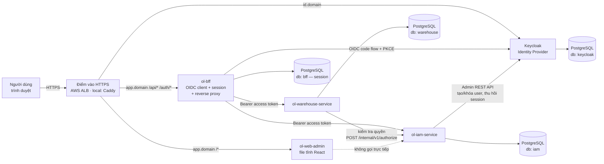
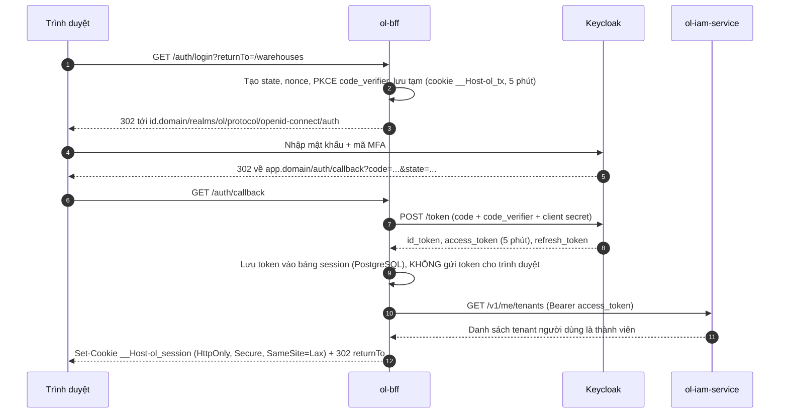
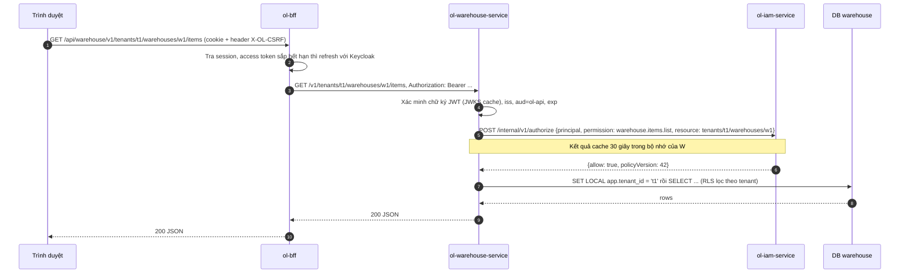
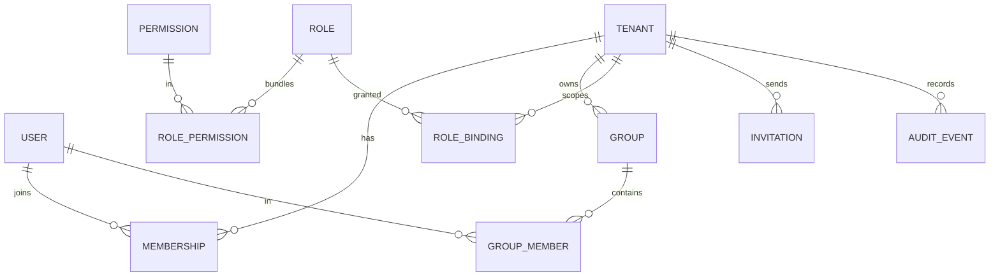
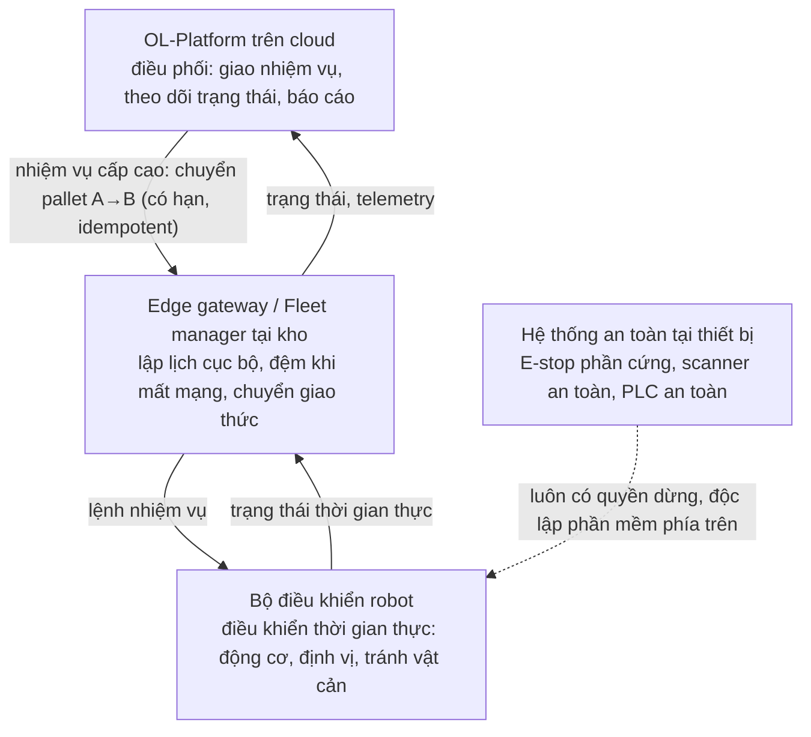
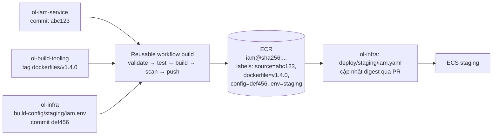

# Bước 0 — Chốt kiến trúc, stack và mục tiêu phi chức năng

> Phiên bản: 0.2 · Ngày: 03/11/2026 · Trạng thái: **Đã chốt** (quyết định mở ở mục 11 chọn theo mặc định)
>
> Tài liệu này không phải bộ thiết kế dài. Nó chỉ chốt những gì **phải đúng trước khi viết dòng code đầu tiên**: thành phần nào tồn tại, chúng nói chuyện với nhau ra sao, chọn công nghệ gì và vì sao, và "production-ready" được đo bằng con số nào.

---

## 1. Phạm vi phiên bản đầu (v1)

| Có trong v1 | Để sau (khi có nhu cầu thật) |
|---|---|
| Frontend quản trị (`ol-web-admin`) | Module đơn hàng, giao vận, tuyến đường |
| BFF — cổng vào của trình duyệt (`ol-bff`) | Cổng API cho đối tác (partner gateway), webhook |
| Identity Provider: **Keycloak** | Message broker (SQS/SNS, EventBridge hoặc NATS) |
| IAM service (`ol-iam-service`) | Cache dùng chung (Redis/ElastiCache) |
| Service nghiệp vụ mẫu: **Warehouse** (`ol-warehouse-service`) — danh mục hàng và tồn kho theo tenant | Kết nối Camera AI, robot, IoT (MQTT, edge gateway) |
| Thư viện dùng chung (`ol-node-kit`) | Kubernetes, service mesh |
| Repo `ol-build-tooling`, `ol-infra`, `ol-handbook` | Multi-region, active-active |
| 3 môi trường AWS: dev, staging, production + local | Fine-grained authorization engine (OpenFGA/Cedar) |

Service Warehouse được chọn làm service mẫu vì (1) đó là mảng bạn đang làm hằng ngày nên dễ kiểm chứng nghiệp vụ, (2) nó có cấu trúc tài nguyên phân cấp `tenant → kho → mặt hàng`, đủ để kiểm chứng phân quyền theo phạm vi tài nguyên.

---

## 2. Sơ đồ tổng thể

### 2.1 Thành phần và luồng truy cập

Chỉ **3 đích** được mở ra Internet qua điểm vào: file tĩnh frontend, BFF và Keycloak. IAM service và Warehouse service **không** có route công khai — chúng chỉ nhận request từ trong mạng nội bộ (ECS Service Connect trên AWS, Docker network ở local).

### 2.2 Vai trò từng thành phần — không trùng lặp

| Vai trò | Thành phần đảm nhận | Làm gì | Không làm gì |
|---|---|---|---|
| **Load balancer** | AWS ALB (local: Caddy) | Kết thúc TLS, chia tải giữa các task, health check, định tuyến theo host/path, chặn path nhạy cảm (`/admin` của Keycloak) | Không hiểu người dùng là ai |
| **API Gateway cho trình duyệt** | `ol-bff` | Đổi session cookie thành access token, gắn `Authorization` khi chuyển tiếp tới service, chống CSRF, giới hạn tốc độ theo session, ghi log truy cập | Không quyết định quyền nghiệp vụ, không chứa logic nghiệp vụ |
| **Identity Provider (IdP)** | Keycloak | Xác thực: đăng nhập, mật khẩu, MFA (TOTP/WebAuthn), quên mật khẩu, phiên SSO, phát hành và ký token (OIDC/OAuth 2.0), client credentials cho service | Không biết tenant, role nghiệp vụ, kho hàng |
| **IAM API** | `ol-iam-service` | Phân quyền: tenant, membership, group, role, permission, role binding theo phạm vi, mời/khóa người dùng, audit log, API quyết định `authorize` | Không xử lý mật khẩu, không phát token |
| **Service nghiệp vụ** | `ol-warehouse-service` | Xác minh token, **tự thực thi** phân quyền (hỏi IAM) và cô lập tenant trên dữ liệu của mình | Không tin bất kỳ header nào do client tự gửi về tenant/quyền |

Gộp vai trò hợp lý: BFF vừa là OIDC client vừa là gateway cho trình duyệt → không cần thêm Kong/API Gateway riêng ở v1. Khi có đối tác gọi API trực tiếp (máy với máy), ta thêm **partner gateway** riêng vì mô hình xác thực khác hẳn (client credentials/mTLS, quota theo đối tác).

### 2.3 Luồng đăng nhập (chỉ chạy khi chưa có session)

### 2.4 Luồng gọi API nghiệp vụ (mọi request sau đăng nhập — không đi qua IAM API trừ bước kiểm tra quyền)

Điểm mấu chốt:

1. **Trình duyệt không bao giờ cầm access token.** XSS không lấy được token để gọi API từ nơi khác.
2. **IAM API không nằm trên đường đi của dữ liệu.** Warehouse chỉ hỏi IAM "được hay không", rồi tự đọc DB của mình.
3. **Tenant đến từ đường dẫn tài nguyên**, nhưng không được tin: quyết định `authorize` kiểm tra principal có binding trên `tenants/t1/...` hay không; sau đó PostgreSQL Row-Level Security (RLS) chặn thêm lớp nữa nếu code quên điều kiện `tenant_id`.

---

## 3. Quản lý phiên/token phía frontend — chọn **BFF**, không chọn SPA thuần

| Tiêu chí | SPA thuần (token trong trình duyệt) | **BFF (đã chọn)** |
|---|---|---|
| Token nằm ở đâu | Bộ nhớ JS/localStorage của trình duyệt | Bảng session phía server; trình duyệt chỉ có cookie HttpOnly |
| Hậu quả khi bị XSS | Kẻ tấn công lấy được token và dùng ở nơi khác tới khi hết hạn | Kẻ tấn công chỉ thao tác được trong tab đang mở; không mang token đi được |
| Refresh token | Phải lưu trong trình duyệt, cần rotation + phát hiện tái sử dụng | Nằm ở server |
| Thu hồi tức thì | Khó (token đã phát ra rồi) | Xóa bản ghi session là xong; Keycloak gọi back-channel logout tới BFF |
| CORS | Cần cấu hình CORS giữa SPA và nhiều API | Cùng origin `app.domain` → không cần CORS |
| Chi phí | Không thêm service | Thêm 1 service nhỏ + bảng session |

Lý do chính: hướng dẫn hiện hành của nhóm OAuth tại IETF cho ứng dụng chạy trên trình duyệt (draft *OAuth 2.0 for Browser-Based Apps*) xếp mô hình Backend-for-Frontend là phương án bảo vệ token tốt nhất trong các mô hình được mô tả, và platform quản trị (thao tác khóa người dùng, đổi quyền) là nơi đáng trả chi phí thêm một service. Tài liệu này vẫn ở trạng thái Internet-Draft tại thời điểm viết — **[CHƯA XÁC MINH]** số hiệu RFC nếu đã được xuất bản; sẽ kiểm lại ở Bước 3.

Chống CSRF trong BFF: cookie `SameSite=Lax` + bắt buộc header tùy chỉnh `X-OL-CSRF` trên mọi request thay đổi dữ liệu + kiểm tra header `Origin` khớp `app.domain`.

---

## 4. Xác thực và phân quyền chi tiết

### 4.1 Bốn khái niệm phải tách bạch

| Khái niệm | Câu hỏi trả lời | Ở đâu |
|---|---|---|
| **Authentication** (xác thực) | "Bạn có đúng là người/máy bạn tự nhận?" | Keycloak |
| **Authorization** (phân quyền) | "Bạn có được làm hành động X trên tài nguyên Y?" | IAM service quyết định, service nghiệp vụ thực thi |
| **Danh tính người dùng** | Con người, đăng nhập bằng mật khẩu + MFA, thuộc ≥1 tenant | Keycloak user (`sub`) ↔ IAM principal `users/{sub}` |
| **Danh tính service** | Một workload (warehouse, iam, cron job…) | Keycloak confidential client (client credentials) ↔ IAM principal `services/{clientId}` |

### 4.2 Mô hình quyền — học nguyên tắc từ 3 nhà cloud, không sao chép mô hình hạ tầng

| Nguyên tắc | Lấy từ | Áp dụng vào OL-Platform |
|---|---|---|
| Mặc định từ chối (implicit deny); chỉ cho phép khi có allow tường minh | AWS IAM — [Policy evaluation logic](https://docs.aws.amazon.com/IAM/latest/UserGuide/reference_policies_evaluation-logic.html) | Route nào không khai báo permission → 403. Không có binding → 403. |
| Permission dạng `service.resource.verb`; không cấp permission trực tiếp mà gom vào role | Google Cloud IAM — [IAM overview](https://cloud.google.com/iam/docs/overview) | `warehouse.items.list`, `iam.users.invite`. Role = tập permission. |
| Gán quyền = **principal + role + scope**; quyền ở scope cha kế thừa xuống scope con; quyền hiệu lực là tổng các assignment | Azure RBAC — [What is Azure RBAC](https://learn.microsoft.com/azure/role-based-access-control/overview); GCP policy inheritance | Role binding gắn tại `tenants/t1` có hiệu lực cho `tenants/t1/warehouses/*` |
| Group làm principal để gán quyền theo nhóm | Cả ba | Binding có thể gán cho `groups/{id}` |
| Explicit deny ghi đè allow | AWS IAM, GCP deny policies | **Chưa làm ở v1** — thêm khi có nhu cầu "chặn ngoại lệ"; giữ v1 đơn giản, dễ kiểm chứng |

Không mang sang: ARN, account/subscription/project, IAM conditions, resource-based policy, SCP — đó là khái niệm của hạ tầng cloud, không phải nghiệp vụ logistics.

### 4.3 Mô hình dữ liệu IAM v1

- **Tên tài nguyên** dạng đường dẫn: `tenants/{tenantId}`, `tenants/{tenantId}/warehouses/{warehouseId}`, `tenants/{tenantId}/warehouses/{warehouseId}/items/{itemId}`. Kế thừa = so khớp tiền tố (prefix) — đơn giản, test được bằng bảng.
- **Role hệ thống** do platform định nghĩa (ví dụ `roles/iam.tenantAdmin`, `roles/warehouse.viewer`, `roles/warehouse.operator`); **custom role** do tenant admin tạo từ permission có sẵn.
- **Platform admin** (đội vận hành của bạn) quản lý tenant nhưng **không mặc định đọc được dữ liệu nghiệp vụ của tenant**. Truy cập dữ liệu tenant cho mục đích hỗ trợ là "break-glass": cấp tạm thời, có hạn, ghi audit.
- **Audit log**: bảng append-only; DB user của ứng dụng chỉ có quyền `INSERT`/`SELECT`, không có `UPDATE`/`DELETE`.

### 4.4 Xác thực giữa các service

| Tình huống | Cơ chế v1 | Ghi chú |
|---|---|---|
| Người dùng gọi qua BFF → service | BFF chuyển tiếp access token của người dùng (aud = `ol-api`) | Service xác minh token bằng thư viện `jose` + JWKS của Keycloak (có cache) |
| Service gọi service cho việc hệ thống (không có người dùng) | Client credentials: mỗi service là 1 confidential client trong Keycloak, lấy token ngắn hạn | Secret của client nằm trong AWS Secrets Manager |
| Service gọi IAM `authorize` | Token client credentials của service gọi; IAM chỉ chấp nhận principal có permission `iam.authz.check` | Endpoint `/internal/*` không có route trên ALB |
| Mở rộng sau | Token exchange (RFC 8693) để thu hẹp audience theo từng service; mTLS nội bộ khi có service mesh | Ghi nhận rủi ro: v1 dùng 1 audience chung `ol-api`, chấp nhận vì token ngắn hạn và không ra khỏi server |

### 4.5 Cập nhật, thu hồi quyền và xử lý khi phụ thuộc lỗi

| Sự kiện | Cơ chế | Thời gian có hiệu lực mục tiêu |
|---|---|---|
| Đổi role binding | IAM tăng `policyVersion`; service cache quyết định tối đa 30 giây | ≤ 30 giây |
| Vô hiệu hóa người dùng | IAM gọi Keycloak: disable user + logout mọi session → Keycloak back-channel logout tới BFF → BFF xóa session | Tức thì với trình duyệt; token đã phát (nếu bị lộ) chết sau ≤ 5 phút |
| Keycloak không truy cập được | Người đã có session tiếp tục dùng tới khi refresh thất bại; đăng nhập mới thất bại có thông báo rõ | — |
| IAM không truy cập được | Service dùng quyết định trong cache còn hạn; hết hạn thì **từ chối (fail closed)** với 503 + `Retry-After` | Không bao giờ "fail open" |
| Gọi IAM chậm | Timeout 300 ms, retry tối đa 1 lần có jitter (chỉ vì `authorize` là thao tác chỉ đọc) | — |

### 4.6 Phần dùng sẵn và phần tự xây

| Dùng giải pháp có sẵn (không tự viết) | Tự xây |
|---|---|
| Đăng nhập, băm mật khẩu, MFA TOTP/WebAuthn, quên mật khẩu, phiên SSO, ký JWT, OIDC/OAuth 2.0 → **Keycloak** | Mô hình tenant/membership/group/role/permission/binding |
| OIDC client trong BFF → thư viện **openid-client** | API quản trị IAM + giao diện quản trị |
| Xác minh JWT, JWKS → thư viện **jose** | API quyết định `authorize` + cache phía service |
| Cấu hình realm/client/flow → **Terraform provider cho Keycloak** | Mời người dùng, vô hiệu hóa, bootstrap admin (gọi Keycloak Admin API) |
| Băm/mã hóa dữ liệu nghỉ → KMS của AWS, TLS của ALB | Audit log và truy vấn audit |

Không có dòng code mật mã hay giao thức xác thực nào do ta tự viết.

---

## 5. Robot, IoT và Camera AI — ranh giới trách nhiệm (thiết kế trước, triển khai sau)

Nguyên tắc chốt ngay để không phải sửa kiến trúc sau này:

1. **Platform không nằm trong vòng điều khiển thời gian thực.** Độ trễ Internet và việc deploy lại service không được phép ảnh hưởng tới chuyển động của robot.
2. **Chức năng an toàn nằm tại thiết bị**, được chứng nhận theo tiêu chuẩn của nhà sản xuất (với xe tự hành công nghiệp thường tham chiếu ISO 3691-4 — **[CHƯA XÁC MINH]** áp dụng cụ thể cho thiết bị bạn dùng). Platform không bao giờ có lệnh "tắt an toàn".
3. **Lệnh từ platform có thời hạn và idempotent**: lệnh cũ hết hạn bị bỏ; gửi lại cùng một lệnh không làm robot chạy hai lần.
4. **Mất kết nối cloud thì edge tự đưa thiết bị về trạng thái an toàn** và tiếp tục đệm dữ liệu.
5. **Thiết bị có danh tính riêng** (chứng chỉ X.509 theo từng thiết bị, mTLS) — tách khỏi danh tính người dùng và service; quyền thiết bị cũng đi qua IAM (principal `devices/{id}`).

---

## 6. Stack đã chọn

### 6.1 Bảng tóm tắt

| Lớp | Lựa chọn | Cần ngay (v1) |
|---|---|---|
| Ngôn ngữ, runtime | TypeScript 5.x trên **Node.js 26 LTS** | ✅ |
| Quản lý package | pnpm (pin version bằng trường `packageManager`) | ✅ |
| Backend framework | **Express 5** + Clean Architecture | ✅ |
| Dependency injection | Awilix | ✅ |
| Validate dữ liệu, schema API | Zod + OpenAPI sinh từ Zod | ✅ |
| Database | **PostgreSQL** (mỗi service một database + một DB user riêng; RLS cho dữ liệu có tenant) | ✅ |
| ORM, migration | Drizzle ORM cho truy vấn có kiểu; migration là **file SQL viết tay** chạy bằng migrator của Drizzle | ✅ |
| Identity Provider | **Keycloak 26.x** | ✅ |
| OIDC client (BFF) / xác minh JWT (service) | openid-client / jose | ✅ |
| Frontend | React + Vite + TypeScript, TanStack Query, React Router, Mantine | ✅ |
| Log, metrics, trace | pino (JSON) + OpenTelemetry SDK → Collector → CloudWatch / X-Ray (local: Grafana LGTM) | ✅ |
| Test | Vitest, Supertest, Testcontainers, Playwright | ✅ |
| Container | Docker (BuildKit), image base Node chính thức, chạy non-root | ✅ |
| CI/CD | GitHub Actions, OIDC sang AWS (không có access key dài hạn) | ✅ |
| Quét bảo mật | gitleaks, Trivy, Semgrep CE (hoặc CodeQL nếu repo public), Dependabot | ✅ |
| Cloud | AWS, region **ap-southeast-1 (Singapore)** | ✅ |
| Compute | **ECS Fargate** (không Kubernetes ở v1) | ✅ |
| Điểm vào | ALB + ACM (TLS) + Route 53; AWS WAF cho prod | ✅ |
| Registry | Amazon ECR (tag bất biến, quét image) | ✅ |
| Secret | AWS Secrets Manager (+ GitHub Secrets chỉ cho thứ CI cần) | ✅ |
| Email (mời, quên mật khẩu) | Amazon SES (local: Mailpit) | ✅ |
| IaC | **Terraform** (state trên S3, khóa state bằng lockfile của S3 backend) | ✅ |
| Message broker | SQS/SNS hoặc EventBridge | ⏳ khi có sự kiện bất đồng bộ giữa service |
| Cache dùng chung | ElastiCache (Valkey/Redis) | ⏳ khi session/rate-limit vượt khả năng PostgreSQL |
| Orchestrator | EKS (Kubernetes) | ⏳ khi > ~15 service hoặc cần operator/service mesh |
| IoT | AWS IoT Core hoặc MQTT broker + edge gateway | ⏳ khi làm module robot/IoT |

Mọi số phiên bản cụ thể (patch) được pin ở Bước 2 bằng file lock và kiểm tra lại tại thời điểm cài.

### 6.2 Giải thích từng lựa chọn (5 câu)

#### Node.js 26 LTS
- **Nghĩa là gì?** Runtime chạy JavaScript/TypeScript (sau khi biên dịch) phía server; bản 26 là dòng LTS (hỗ trợ dài hạn).
- **Dùng thế nào?** `fnm install 26` trên máy dev; image `node:26-bookworm-slim` trong Dockerfile; khai báo `"engines": { "node": ">=26 <27" }` trong `package.json`.
- **Thay thế bằng gì?** Node.js 24 (đang Maintenance LTS), Bun, Deno.
- **Lợi thế khi chọn?** Theo lịch của nhóm phát hành Node.js, dòng 26 vào Active LTS cuối tháng 10/2026 và được hỗ trợ tới 30/04/2029 — dự án mới bắt đầu bây giờ có hơn 2 năm không phải nâng major.
- **Không dùng thì sao?** Chọn Node 24 sẽ phải nâng cấp sớm hơn (hết hỗ trợ 30/04/2028); chọn Bun/Deno thì một số thư viện (OpenTelemetry auto-instrumentation, Testcontainers) chưa chắc ổn định bằng.

> Lưu ý: từ Node.js 25, Corepack **không còn đi kèm** Node. Vì vậy pnpm được cài riêng (`npm install -g pnpm`) và pin bằng trường `packageManager`.

#### pnpm
- **Nghĩa là gì?** Trình quản lý package cho Node.js, lưu package một lần trong kho chung và liên kết vào từng dự án.
- **Dùng thế nào?** `pnpm install --frozen-lockfile` trong CI; `pnpm add zod`; file khóa `pnpm-lock.yaml` được commit.
- **Thay thế bằng gì?** npm, Yarn.
- **Lợi thế khi chọn?** Cài nhanh, tiết kiệm đĩa, chặn "phantom dependency" (dùng package không khai báo) nhờ `node_modules` không phẳng.
- **Không dùng thì sao?** Dùng npm vẫn chạy được, nhưng dễ lọt dependency không khai báo và cài chậm hơn trong CI nhiều repo.

#### Express 5 + Clean Architecture
- **Nghĩa là gì?** Express là web framework tối giản cho Node.js; Clean Architecture chia code thành các vòng `domain → application (use case) → infrastructure/interface`, phụ thuộc chỉ trỏ vào trong.
- **Dùng thế nào?** Route Express chỉ là adapter: parse request → gọi use case → map kết quả ra HTTP. Use case chỉ biết interface `UserRepository`, không biết Drizzle hay Express.
- **Thay thế bằng gì?** NestJS (có sẵn DI và module), Fastify, Hono.
- **Lợi thế khi chọn?** Bạn yêu cầu Express; Express 5 hỗ trợ async handler trả lỗi tự động về error middleware; tự dựng lớp kiến trúc giúp hiểu rõ từng ranh giới thay vì để framework che.
- **Không dùng thì sao?** Không có Clean Architecture → logic nghiệp vụ dính vào route và ORM, khó test đơn vị, khó đổi DB hoặc framework.

#### Awilix (dependency injection)
- **Nghĩa là gì?** Container DI: đăng ký cách tạo đối tượng một lần, container tự "tiêm" dependency vào constructor/hàm.
- **Dùng thế nào?** `container.register({ userRepo: asClass(DrizzleUserRepository).singleton(), inviteUser: asFunction(makeInviteUser).scoped() })`; mỗi request tạo scope riêng chứa `requestContext`.
- **Thay thế bằng gì?** tsyringe, InversifyJS (dựa trên decorator), tự viết factory thủ công.
- **Lợi thế khi chọn?** Không cần decorator/reflect-metadata, hoạt động tốt với ESM, có scope theo request — phù hợp nguyên tắc Dependency Inversion (chữ D trong SOLID).
- **Không dùng thì sao?** Phải tự nối dây bằng tay ở `main.ts`; dự án nhỏ vẫn ổn, nhưng khi nhiều use case sẽ thành một file khởi tạo khổng lồ và khó thay mock khi test.

#### Zod
- **Nghĩa là gì?** Thư viện khai báo schema và validate dữ liệu lúc chạy, đồng thời suy ra kiểu TypeScript.
- **Dùng thế nào?** `const InviteBody = z.object({ email: z.email(), roleIds: z.array(z.uuid()).min(1) })`; middleware validate body; sinh tài liệu OpenAPI từ schema.
- **Thay thế bằng gì?** Valibot, TypeBox + Ajv, class-validator.
- **Lợi thế khi chọn?** Một nguồn sự thật cho kiểu TypeScript, validate runtime và tài liệu API; dùng được cả frontend lẫn backend.
- **Không dùng thì sao?** Dữ liệu từ client đi thẳng vào use case mà không kiểm tra — lỗ hổng injection, lỗi 500 khó hiểu, tài liệu API lệch với code.

#### PostgreSQL + Row-Level Security
- **Nghĩa là gì?** Hệ quản trị CSDL quan hệ; RLS là tính năng tự lọc dòng dữ liệu theo chính sách gắn trên bảng.
- **Dùng thế nào?** Mỗi service một database và một user riêng; bảng có `tenant_id`; `CREATE POLICY tenant_isolation ON items USING (tenant_id = current_setting('app.tenant_id')::uuid)`; mỗi transaction chạy `SET LOCAL app.tenant_id = ...`.
- **Thay thế bằng gì?** MySQL/Aurora MySQL (không có RLS tương đương), MongoDB, DynamoDB.
- **Lợi thế khi chọn?** Dữ liệu IAM, kho, đơn hàng đều là dữ liệu quan hệ cần ràng buộc và transaction; RLS là lớp cô lập tenant thứ hai ngay trong DB.
- **Không dùng thì sao?** Không có RLS thì chỉ cần một câu `SELECT` quên `WHERE tenant_id` là lộ dữ liệu giữa khách hàng.

> "Mỗi service sở hữu dữ liệu riêng" ở v1 được thực hiện bằng **database riêng + DB user riêng trên cùng một RDS instance** mỗi môi trường để tiết kiệm chi phí. Service không có quyền kết nối database của service khác. Tách instance khi tải hoặc yêu cầu khôi phục độc lập đòi hỏi.

#### Drizzle ORM + migration SQL viết tay
- **Nghĩa là gì?** ORM nhẹ cho TypeScript, viết truy vấn gần giống SQL. Migration là file SQL do người viết (`migrations/0001_x.sql`), migrator của Drizzle ghi lại file nào đã chạy.
- **Dùng thế nào?** `pnpm db:new add_x` tạo file mới + mục trong `migrations/meta/_journal.json`; viết SQL (kể cả RLS, GRANT, trigger — thứ ORM không mô tả được); review trong PR; chạy bằng task `migrate` riêng trước khi deploy.
- **Thay thế bằng gì?** Prisma, Kysely, TypeORM, node-pg-migrate.
- **Lợi thế khi chọn?** Không có engine nhị phân, kiểu dữ liệu chặt, migration là SQL thuần dễ review và dễ áp dụng chiến lược expand/contract.
- **Không dùng thì sao?** Viết SQL tay không có kiểu → lỗi tên cột chỉ lộ ra lúc chạy; không có migration có phiên bản → các môi trường lệch schema.

#### Keycloak
- **Nghĩa là gì?** Identity Provider mã nguồn mở (Apache 2.0) hỗ trợ OIDC, OAuth 2.0, SAML, MFA, quản lý phiên.
- **Dùng thế nào?** Realm `ol`; client `ol-bff` (confidential, code flow + PKCE); client cho từng service (client credentials); cấu hình bằng Terraform; chạy image `quay.io/keycloak/keycloak` đã build tối ưu.
- **Thay thế bằng gì?** Amazon Cognito, Zitadel, Ory (Kratos + Hydra), Auth0/Okta (SaaS), Microsoft Entra External ID.
- **Lợi thế khi chọn?** Chạy giống hệt nhau ở local và AWS (Cognito không chạy local được); không khóa nhà cung cấp; tính năng Organizations hỗ trợ SSO doanh nghiệp cho từng khách hàng khi mở rộng.
- **Không dùng thì sao?** Phải tự viết đăng nhập/MFA/phiên — trái nguyên tắc "không tự viết giao thức xác thực" và là nguồn lỗ hổng phổ biến nhất.

> Keycloak cộng đồng chỉ vá bản mới nhất, không có LTS → phải có quy trình nâng cấp định kỳ (Bước 8). Bản mới nhất được ghi nhận tại thời điểm viết là dòng 26.8; pin bản patch cụ thể ở Bước 2.

#### openid-client (trong BFF)
- **Nghĩa là gì?** Thư viện OIDC client được chứng nhận OpenID cho Node.js.
- **Dùng thế nào?** `discovery(new URL(issuer), clientId, clientSecret)` → `buildAuthorizationUrl(...)` với PKCE → `authorizationCodeGrant(...)` ở callback → `refreshTokenGrant(...)`.
- **Thay thế bằng gì?** passport-openidconnect, oauth2-proxy (proxy viết sẵn).
- **Lợi thế khi chọn?** Xử lý đúng state/nonce/PKCE/kiểm tra id_token theo chuẩn, do cùng tác giả với `jose`.
- **Không dùng thì sao?** Tự viết luồng OIDC dễ bỏ sót kiểm tra `state`/`nonce` → lỗ hổng CSRF đăng nhập và tráo token.

#### jose (trong service)
- **Nghĩa là gì?** Thư viện JOSE/JWT (ký, xác minh, JWKS) không phụ thuộc, chạy trên mọi runtime JS.
- **Dùng thế nào?** `const JWKS = createRemoteJWKSet(new URL(jwksUri)); await jwtVerify(token, JWKS, { issuer, audience: 'ol-api' })`.
- **Thay thế bằng gì?** jsonwebtoken + jwks-rsa.
- **Lợi thế khi chọn?** Cache và xoay vòng khóa JWKS sẵn, bắt buộc chỉ định thuật toán/issuer/audience, API hiện đại.
- **Không dùng thì sao?** Tự giải mã JWT mà không xác minh chữ ký hoặc không kiểm `aud` là lỗi kinh điển dẫn tới giả mạo danh tính.

#### React + Vite + TanStack Query + Mantine
- **Nghĩa là gì?** React dựng UI; Vite là công cụ dev/build; TanStack Query quản lý dữ liệu từ server (cache, retry, invalidation); Mantine là bộ component UI.
- **Dùng thế nào?** Tổ chức `src/features/users/{api,hooks,components,pages}`; `useQuery({ queryKey: ['users', tenantId], queryFn: usersApi.list })`; `pnpm vite build` ra file tĩnh.
- **Thay thế bằng gì?** Next.js (có SSR), Angular, Vue; component: shadcn/ui, Ant Design, MUI.
- **Lợi thế khi chọn?** Admin console không cần SSR/SEO → SPA tĩnh nhẹ, deploy đơn giản sau BFF; Mantine có sẵn bảng, form, modal cho trang quản trị.
- **Không dùng thì sao?** Không có TanStack Query thì phải tự viết loading/error/cache cho từng màn hình; không có bộ component thì tốn thời gian cho UI thay vì IAM.

#### pino + OpenTelemetry
- **Nghĩa là gì?** pino ghi log JSON nhanh; OpenTelemetry (OTel) là chuẩn mở cho trace/metrics/log.
- **Dùng thế nào?** Mỗi log có `trace_id`, `tenant_id`, `principal`; SDK OTel tự đo HTTP/Express/pg và gửi OTLP tới Collector; Collector xuất sang CloudWatch/X-Ray (local: Grafana LGTM).
- **Thay thế bằng gì?** winston; Datadog/New Relic agent độc quyền.
- **Lợi thế khi chọn?** Chuẩn mở, đổi backend quan sát mà không sửa code; trace xuyên BFF → service → IAM → DB.
- **Không dùng thì sao?** Khi có sự cố, không lần ra một request đi qua những đâu và chậm ở bước nào.

#### Vitest, Supertest, Testcontainers, Playwright
- **Nghĩa là gì?** Vitest chạy test đơn vị; Supertest gọi HTTP vào app Express trong test; Testcontainers bật PostgreSQL/Keycloak thật trong Docker cho integration test; Playwright chạy test end-to-end trên trình duyệt.
- **Dùng thế nào?** `pnpm vitest run`; `await request(app).get('/v1/...').expect(403)`; `new PostgreSqlContainer('postgres:18').start()`; `pnpm playwright test`.
- **Thay thế bằng gì?** Jest, Cypress, DB giả lập trong bộ nhớ.
- **Lợi thế khi chọn?** Test phân quyền và RLS trên PostgreSQL thật chứ không phải mock; Vitest nhanh và hỗ trợ TypeScript/ESM sẵn.
- **Không dùng thì sao?** Mock DB không bắt được lỗi RLS và migration — đúng loại lỗi gây rò rỉ dữ liệu giữa tenant.

#### AWS ECS Fargate
- **Nghĩa là gì?** Dịch vụ chạy container của AWS; Fargate là chế độ không phải quản lý máy chủ.
- **Dùng thế nào?** Mỗi service là một ECS service với task definition (image theo digest, CPU/RAM, biến môi trường, secret); triển khai rolling với circuit breaker tự rollback.
- **Thay thế bằng gì?** EKS (Kubernetes), App Runner, EC2 + Docker Compose.
- **Lợi thế khi chọn?** Ít khái niệm hơn Kubernetes rất nhiều, không có control plane phải trả tiền và vá, tích hợp sẵn ALB/Secrets Manager/CloudWatch — đủ cho 5–10 service.
- **Không dùng thì sao?** Kubernetes ở quy mô này tốn công vận hành và chi phí mà chưa đem lại lợi ích tương xứng; EC2 + Compose thì phải tự vá OS, tự lo autoscaling và nhiều vùng sẵn sàng.

#### ALB + ACM + Route 53 (+ WAF)
- **Nghĩa là gì?** ALB là load balancer tầng HTTP; ACM cấp và tự gia hạn chứng chỉ TLS; Route 53 là DNS; WAF lọc request độc hại.
- **Dùng thế nào?** Listener 443 với chứng chỉ ACM; rule `host=id.domain` → Keycloak, `host=app.domain && path=/api/*,/auth/*` → BFF, còn lại → web; rule chặn `/admin/*` của Keycloak.
- **Thay thế bằng gì?** CloudFront + API Gateway, NLB + Nginx/Caddy tự quản.
- **Lợi thế khi chọn?** Một thành phần làm được cả TLS, cân bằng tải và định tuyến → không cần thêm reverse proxy riêng trên AWS.
- **Không dùng thì sao?** Phải tự vận hành reverse proxy, tự gia hạn chứng chỉ, tự lo khả dụng của chính proxy.

#### Caddy (chỉ ở local)
- **Nghĩa là gì?** Web server/reverse proxy có HTTPS tự động.
- **Dùng thế nào?** `Caddyfile` mô phỏng đúng các rule của ALB cho `app.ol.test` và `id.ol.test`, dùng chứng chỉ mkcert.
- **Thay thế bằng gì?** Nginx, Traefik.
- **Lợi thế khi chọn?** Cấu hình ngắn; bạn đã làm quen trong lab IAM trước.
- **Không dùng thì sao?** Chạy local bằng `http://localhost:port` sẽ không phát hiện được lỗi cookie `Secure`/`__Host-`, lỗi redirect URI và lỗi cùng origin — những lỗi chỉ xuất hiện khi lên HTTPS thật.

#### Terraform
- **Nghĩa là gì?** Công cụ Infrastructure as Code khai báo hạ tầng bằng HCL và áp dụng thay đổi theo kế hoạch (`plan` → `apply`).
- **Dùng thế nào?** `infra/infrastructure/` chia module (network, database, ecs-service, keycloak-realm…); `terraform plan -out=tfplan` trong PR, `apply` khi merge có phê duyệt; state trên S3 với khóa bằng lockfile.
- **Thay thế bằng gì?** OpenTofu (nhánh mã nguồn mở tương thích), AWS CDK, Pulumi, CloudFormation.
- **Lợi thế khi chọn?** Phổ biến nhất, có provider cho cả AWS lẫn Keycloak và GitHub → một công cụ cho toàn bộ cấu hình.
- **Không dùng thì sao?** Hạ tầng tạo bằng tay trên console không tái tạo được, không review được, môi trường dev/staging/prod lệch nhau.

#### GitHub Actions + OIDC sang AWS
- **Nghĩa là gì?** GitHub Actions chạy pipeline CI/CD; OIDC cho phép workflow đổi một token ngắn hạn do GitHub ký lấy quyền IAM role trên AWS.
- **Dùng thế nào?** `permissions: id-token: write` + `aws-actions/configure-aws-credentials` với `role-to-assume`; trust policy của role giới hạn theo repo, nhánh và environment.
- **Thay thế bằng gì?** GitLab CI, Jenkins, CircleCI; lưu AWS access key trong GitHub Secrets.
- **Lợi thế khi chọn?** Repo đã ở GitHub; không có access key dài hạn nào để bị lộ.
- **Không dùng thì sao?** Access key lưu trong secrets sống mãi tới khi bị xoay vòng thủ công — rò một lần là mất quyền kiểm soát tài khoản AWS.

#### Amazon ECR
- **Nghĩa là gì?** Registry lưu Docker image của AWS.
- **Dùng thế nào?** Một repository ECR cho mỗi module; tag bất biến; triển khai bằng digest `...@sha256:...`; bật quét lỗ hổng khi push.
- **Thay thế bằng gì?** GitHub Container Registry (GHCR), Docker Hub.
- **Lợi thế khi chọn?** ECS kéo image qua IAM role, không cần mật khẩu registry; dữ liệu nằm cùng region với cluster.
- **Không dùng thì sao?** Dùng GHCR vẫn được, nhưng phải cấp credential pull cho ECS và đi qua Internet.

#### AWS Secrets Manager
- **Nghĩa là gì?** Kho bí mật có mã hóa KMS, phân quyền IAM, hỗ trợ xoay vòng.
- **Dùng thế nào?** RDS tự quản mật khẩu master trong Secrets Manager; task definition khai báo `secrets` để ECS tiêm vào biến môi trường lúc khởi động.
- **Thay thế bằng gì?** SSM Parameter Store (SecureString), HashiCorp Vault, SOPS (file mã hóa trong Git).
- **Lợi thế khi chọn?** Có xoay vòng tự động cho RDS, audit qua CloudTrail, không phải vận hành thêm Vault.
- **Không dùng thì sao?** Bí mật nằm trong file `.env` hoặc biến CI, khó xoay vòng, khó biết ai đã đọc.

#### Công cụ quét: gitleaks, Trivy, Semgrep CE / CodeQL, Dependabot
- **Nghĩa là gì?** gitleaks tìm secret trong Git; Trivy quét lỗ hổng trong image, dependency và cấu hình IaC; Semgrep/CodeQL phân tích tĩnh mã nguồn; Dependabot cảnh báo và mở PR nâng dependency.
- **Dùng thế nào?** gitleaks chạy ở git hook pre-commit (Bước 1) và trong CI; Trivy chạy sau khi build image, chặn release nếu có lỗ hổng mức CRITICAL đã có bản vá; Dependabot cấu hình qua `.github/dependabot.yml`.
- **Thay thế bằng gì?** TruffleHog, Grype, Snyk, SonarQube, Renovate.
- **Lợi thế khi chọn?** Miễn phí, chạy được cả local lẫn CI, đầu ra SARIF hiển thị trong tab Security của GitHub.
- **Không dùng thì sao?** Secret lọt vào lịch sử Git hoặc image chứa lỗ hổng đã biết sẽ chỉ được phát hiện khi đã bị khai thác.

---

## 7. Repository

| Repo | Nội dung | Team chủ sở hữu |
|---|---|---|
| `.github` | Hồ sơ Organization, file cộng đồng mặc định (PR template, issue form, SECURITY, CONTRIBUTING) | platform |
| `ol-repo-template` | Template cho repo mới: `.editorconfig`, `.gitattributes`, `.gitignore`, `lefthook.yml`, `dependabot.yml` | platform |
| `ol-handbook` | Tài liệu này, ADR, runbook | platform |
| `ol-web-admin` | Frontend quản trị | frontend |
| `ol-bff` | Backend-for-Frontend | backend |
| `ol-iam-service` | IAM service + CLI bootstrap | backend (security review) |
| `ol-warehouse-service` | Service nghiệp vụ mẫu | backend |
| `ol-node-kit` | Thư viện dùng chung: middleware xác thực/phân quyền, logger, error, config, OTel — phát hành lên GitHub Packages | backend |
| `ol-build-tooling` | Dockerfile tập trung, reusable workflows build/test/scan/push | platform |
| `ol-infra` | Terraform, cấu hình build & deploy theo môi trường, workflow triển khai | platform (security review) |

`ol-node-kit` tồn tại vì middleware phân quyền là code nhạy cảm bảo mật: chép lại vào từng service là cách nhanh nhất để mỗi nơi có một lỗi khác nhau.

### 7.1 Luồng build và triển khai (chi tiết ở Bước 4 và 7)

Nguyên tắc: **backend chỉ dùng runtime config** → một image (một digest) được build một lần và được "thăng cấp" dev → staging → production; artifact chạy ở production chính là artifact đã qua staging. Frontend cũng ưu tiên runtime config (`/config.json` do container phục vụ). Nếu một module bắt buộc phải có build-time config khác nhau theo môi trường, pipeline build riêng image cho môi trường đó và image đó phải chạy test/smoke ở chính môi trường tương ứng trước khi đi tiếp.

---

## 8. Môi trường

| | local | dev | staging | production |
|---|---|---|---|---|
| Nơi chạy | Máy bạn: Docker trong WSL (Ubuntu) | AWS account riêng | AWS account riêng | AWS account riêng |
| Mục đích | Viết code, debug | Tích hợp liên tục sau mỗi merge | Giống prod, kiểm thử phát hành | Người dùng thật |
| Vùng sẵn sàng | — | 1 AZ | 2 AZ | 2 AZ (RDS Multi-AZ) |
| Số task mỗi service | 1 | 1 | 1–2 | ≥ 2, autoscaling |
| Dữ liệu | Seed giả | Seed giả | Dữ liệu giả lớn để load test | Thật |
| Triển khai | `docker compose up` | Tự động khi merge | Tự động sau dev xanh | Cần phê duyệt |
| Tắt ngoài giờ | — | Có (tiết kiệm) | Có thể | Không |

Đề xuất cấu trúc AWS Organizations: `management` (chỉ billing + Organizations), `shared-services` (ECR, Route 53 zone gốc), `dev`, `staging`, `prod`. Tách account là ranh giới an toàn mạnh nhất của AWS: một lỗi quyền ở dev không chạm được vào prod.

---

## 9. Mục tiêu phi chức năng (NFR) v1 và cách kiểm chứng

| Nhóm | Mục tiêu | Kiểm chứng bằng |
|---|---|---|
| Khả dụng | Production ≥ 99,5%/tháng cho đăng nhập và API (≈ 3,6 giờ downtime/tháng) | SLO dashboard từ metric ALB (Bước 9) |
| Độ trễ | API đọc qua BFF: p95 < 300 ms; API ghi: p95 < 800 ms; `authorize` có cache: p95 < 20 ms | Load test k6 tại staging (Bước 9) |
| Tải | 50 request/giây duy trì, 200 request/giây đột biến, không lỗi 5xx | Load test |
| Bảo mật — xác thực | MFA bắt buộc cho platform admin và tenant admin; access token sống 5 phút; session BFF hết hạn sau 30 phút không hoạt động, tối đa 8 giờ | Test E2E + cấu hình Terraform của realm |
| Bảo mật — thu hồi | Khóa người dùng có hiệu lực tức thì với trình duyệt; thay đổi quyền có hiệu lực ≤ 30 giây | Test tích hợp đo thời gian |
| Cô lập tenant | 0 đường truy cập chéo tenant; mọi bảng **dữ liệu nghiệp vụ** có `tenant_id` phải có RLS (IAM cô lập ở tầng repository vì phải đánh giá quyền xuyên tenant cho platform admin) | Test truy cập chéo tenant ở IAM, Warehouse và E2E; test RLS chạy trên PostgreSQL thật |
| Phân quyền | 100% route khai báo permission; route không khai báo → 403 | Test quét route registry |
| Audit | 100% thao tác quản trị IAM có bản ghi audit; lưu ≥ 1 năm | Test + chính sách lưu trữ |
| Dữ liệu | RPO ≤ 15 phút, RTO ≤ 4 giờ (production); thử restore ít nhất mỗi quý | Biên bản diễn tập restore (Bước 8) |
| Phát hành | Deploy không downtime; rollback ≤ 15 phút | Diễn tập rollback ở staging |
| Chuỗi cung ứng | Mọi image production truy vết được commit source, Dockerfile, config; có SBOM và provenance; không lỗ hổng CRITICAL đã có bản vá | Kiểm tra label + attestation trong pipeline |
| Quan sát | Log JSON có `trace_id`; trace xuyên BFF → service → IAM → DB; cảnh báo khi đốt error budget nhanh | Dashboard + thử gây lỗi có chủ đích |
| Chi phí | Theo ngân sách bạn chốt (mục 11) | AWS Budgets + cảnh báo |

---

## 10. Nhật ký quyết định (ADR rút gọn)

| # | Quyết định | Lý do chính | Xem lại khi |
|---|---|---|---|
| ADR-001 | Microservices, multi-repo | Yêu cầu học vận hành enterprise; ranh giới sở hữu rõ | — |
| ADR-002 | BFF thay vì SPA giữ token | Token không ra trình duyệt; thu hồi tức thì | — |
| ADR-003 | Keycloak làm IdP, IAM service tự xây cho phân quyền | Không tự viết xác thực; phân quyền là nghiệp vụ riêng | Khi cần SSO doanh nghiệp theo tenant → dùng Keycloak Organizations |
| ADR-004 | Phân quyền tập trung qua API `authorize` + cache 30 giây, fail closed | Đổi quyền có hiệu lực nhanh, không nhồi quyền vào JWT | Khi tải `authorize` quá lớn → cache dùng chung hoặc engine chuyên dụng |
| ADR-005 | PostgreSQL, database riêng mỗi service, RLS cho dữ liệu tenant | Dữ liệu quan hệ; phòng thủ nhiều lớp | Khi tải tăng → tách instance |
| ADR-006 | ECS Fargate, không Kubernetes | Ít vận hành, đủ cho quy mô v1 | > ~15 service hoặc cần operator |
| ADR-007 | Không message broker, không cache dùng chung ở v1 | Chưa có luồng bất đồng bộ thật; PostgreSQL đủ cho session | Khi thêm module đơn hàng/giao vận phát sự kiện |
| ADR-008 | Build một lần, thăng cấp image theo digest | Artifact ở prod đúng là artifact đã test | Module bắt buộc có build-time config |
| ADR-009 | GitHub Actions + OIDC, không access key dài hạn | Giảm rủi ro rò credential | — |

---

## 11. Quyết định đã chốt (theo mặc định đề xuất)

| # | Câu hỏi | Đã chốt | Hệ quả |
|---|---|---|---|
| 1 | Repo public hay private, gói GitHub | **Organization gói Free, mọi repo public** | Có ruleset, environment + người duyệt, secret scanning, push protection, CodeQL miễn phí. Không bao giờ commit bí mật hay dữ liệu khách hàng |
| 2 | Ngân sách AWS | **Tiết kiệm: mục tiêu ~400 USD/tháng khi chạy cả 3 môi trường liên tục, thấp hơn nhiều khi dev/staging tắt ngoài giờ** — **[CHƯA XÁC MINH]**, kiểm bằng AWS Pricing Calculator ở Bước 6 | dev/staging: không NAT, Fargate Spot, tự tắt 20:00–07:30 và cuối tuần, RDS micro. prod: NAT đơn, RDS Multi-AZ, WAF. AWS Budgets cảnh báo 80%/100% |
| 3 | Tên miền | **Biến `__DOMAIN__`** — bạn mua một domain (hoặc dùng subdomain sẵn có) và thay bằng script ở Bước 2 | prod: `app.<domain>`, `id.<domain>`; dev/staging: `app.<env>.<domain>` |
| 4 | Docker trên máy | **Docker Engine trong WSL Ubuntu** (đúng ý "WSL chỉ chạy image"); script `ol.ps1` vẫn tự nhận Docker Desktop nếu có | Mọi lệnh compose gọi qua `wsl --cd ... docker compose`; không cài Node/pnpm trong Ubuntu |

## 12. Tài liệu tham khảo chính thức

- AWS IAM — Policy evaluation logic: https://docs.aws.amazon.com/IAM/latest/UserGuide/reference_policies_evaluation-logic.html
- Google Cloud IAM — Overview: https://cloud.google.com/iam/docs/overview
- Azure RBAC — Overview: https://learn.microsoft.com/azure/role-based-access-control/overview
- IETF — OAuth 2.0 for Browser-Based Applications: https://datatracker.ietf.org/doc/draft-ietf-oauth-browser-based-apps/
- Node.js release schedule: https://github.com/nodejs/Release
- Keycloak documentation: https://www.keycloak.org/documentation
- GitHub — About rulesets: https://docs.github.com/repositories/configuring-branches-and-merges-in-your-repository/managing-rulesets/about-rulesets
- GitHub — Managing environments for deployment: https://docs.github.com/actions/how-tos/deploy/configure-and-manage-deployments/manage-environments
