# Bước 1 — Công cụ và GitHub Organization

> Phiên bản: 0.2 · Ngày: 03/11/2026 · Trạng thái: **Sẵn sàng thực hiện — chưa có bằng chứng chạy thật**
>
> Quyết định áp dụng: Organization gói Free, mọi repo public (Bước 0, mục 11).
>
> Script trong bước này chưa được chạy trên GitHub thật và chưa được kiểm tra cú pháp bằng PowerShell; JSON/YAML đã được kiểm tra hợp lệ. Vì vậy luôn chạy `-DryRun` trước (mục 1.8).

## Mục lục

- [1.0 Tổng quan](#10-tổng-quan)
- [1.1 Khái niệm cần nắm (5 câu)](#11-khái-niệm-cần-nắm)
- [1.2 Cài công cụ trên Windows](#12-cài-công-cụ-trên-windows)
- [1.3 Đăng nhập GitHub CLI](#13-đăng-nhập-github-cli)
- [1.4 Cấu hình Git, SSH key và ký commit](#14-cấu-hình-git-ssh-key-và-ký-commit)
- [1.5 Kiểm tra công cụ](#15-kiểm-tra-công-cụ)
- [1.6 Tạo Organization trên web](#16-tạo-organization-trên-web)
- [1.7 Đặt sổ tay vào thư mục làm việc](#17-đặt-sổ-tay-vào-thư-mục-làm-việc)
- [1.8 Chạy script khởi tạo](#18-chạy-script-khởi-tạo)
- [1.9 Giới hạn theo gói GitHub và phương án thay thế](#19-giới-hạn-theo-gói-github-và-phương-án-thay-thế)
- [1.10 GitHub App cho tự động hóa chéo repo, variables và secrets](#110-github-app-cho-tự-động-hóa-chéo-repo-variables-và-secrets)
- [1.11 Clone toàn bộ repo và bật Git hooks](#111-clone-toàn-bộ-repo-và-bật-git-hooks)
- [1.12 Nghiệm thu Bước 1](#112-nghiệm-thu-bước-1)
- [1.13 Lỗi thường gặp](#113-lỗi-thường-gặp)
- [1.14 Hoàn tác](#114-hoàn-tác)

---

## 1.0 Tổng quan

| Mục | Nội dung |
|---|---|
| **Mục tiêu** | Máy Windows có đủ công cụ; GitHub Organization có teams, 10 repo, quyền theo team, CODEOWNERS, ruleset bảo vệ `main` và tag, Environments `dev/staging/production`, Actions bị khóa chặt; commit được ký và kiểm tra trước khi rời máy |
| **Điều kiện đầu vào** | Windows 10/11, quyền admin trên máy, tài khoản GitHub `KuroHiyuki` đã bật 2FA, đã đọc [Bước 0](00-kien-truc-va-quyet-dinh.md) và chốt quyết định mở số 1 (public/private) |
| **Nơi thao tác** | PowerShell 7 trên Windows (không phải Windows PowerShell 5.1, không phải WSL); trình duyệt cho các bước chỉ làm được trên web |
| **Kết quả cuối** | Bảng nghiệm thu ở mục 1.12 đều đạt |

Thứ tự bắt buộc (mỗi bước phụ thuộc bước trước):

```mermaid
flowchart LR
    A[1.2 Cài công cụ] --> B[1.3 gh auth login] --> C[1.4 Git + SSH + ký commit] --> D[1.5 check-tools]
    D --> E[1.6 Tạo Org trên web] --> F[1.7 Đặt handbook] --> G[1.8 bootstrap -DryRun] --> H[1.8 bootstrap thật]
    H --> I[1.10 GitHub App + secrets] --> J[1.11 Clone + lefthook] --> K[1.12 Nghiệm thu]
```



---

## 1.1 Khái niệm cần nắm

#### GitHub Organization
- **Nghĩa là gì?** Tài khoản dùng chung chứa nhiều repo, có thành viên, team và chính sách áp lên tất cả repo.
- **Dùng thế nào?** Tạo trên web một lần; sau đó quản lý bằng `gh api orgs/<org>/...`.
- **Thay thế bằng gì?** Để mọi repo dưới tài khoản cá nhân `KuroHiyuki`.
- **Lợi thế khi chọn?** Có team, quyền theo team, chính sách Actions và secret dùng chung cho cả org; mô phỏng đúng cách doanh nghiệp tổ chức.
- **Không dùng thì sao?** Không có team và CODEOWNERS theo team; secret phải lặp lại ở từng repo; khi có người thứ hai tham gia phải chuyển repo sang org sau.

#### Team
- **Nghĩa là gì?** Nhóm thành viên trong org, được gán quyền trên repo và được nhắc tên trong CODEOWNERS (`@org/backend`).
- **Dùng thế nào?** `gh api -X POST orgs/<org>/teams` để tạo; `PUT orgs/<org>/teams/<team>/repos/<org>/<repo>` với `permission` để cấp quyền.
- **Thay thế bằng gì?** Cấp quyền trực tiếp cho từng người trên từng repo.
- **Lợi thế khi chọn?** Người mới vào chỉ cần thêm vào team là có đúng quyền ở mọi repo (onboarding/offboarding một chỗ).
- **Không dùng thì sao?** Quyền rải rác từng người từng repo, offboarding dễ sót.

Mức quyền repo theo thứ tự tăng dần: `pull` (đọc) → `triage` (quản lý issue/PR, không push) → `push` (ghi) → `maintain` (quản lý repo trừ cài đặt nhạy cảm) → `admin`.

#### Repository template
- **Nghĩa là gì?** Repo được đánh dấu "template"; repo mới tạo từ nó nhận sẵn toàn bộ file ban đầu.
- **Dùng thế nào?** `gh repo create <org>/<repo> --template <org>/ol-repo-template`.
- **Thay thế bằng gì?** Copy tay; công cụ sinh dự án (Yeoman, cookiecutter).
- **Lợi thế khi chọn?** Mọi repo mới có cùng `.editorconfig`, `.gitattributes`, `.gitignore`, `lefthook.yml`, `dependabot.yml` ngay từ commit đầu.
- **Không dùng thì sao?** Mỗi repo cấu hình một kiểu — đúng điều bạn muốn tránh ("không để mỗi image/repo một kiểu").

#### Repo `.github` của Organization
- **Nghĩa là gì?** Repo đặc biệt chứa file cộng đồng mặc định (PR template, issue form, SECURITY, CONTRIBUTING) và trang hồ sơ org (`profile/README.md`).
- **Dùng thế nào?** Đặt file trong repo `.github` (phải là public); repo nào không có file riêng sẽ dùng bản mặc định.
- **Thay thế bằng gì?** Chép các file này vào từng repo.
- **Lợi thế khi chọn?** Sửa một chỗ áp dụng cho mọi repo.
- **Không dùng thì sao?** PR template và chính sách bảo mật lệch nhau giữa các repo.

#### Ruleset
- **Nghĩa là gì?** Bộ luật bảo vệ nhánh/tag: cấm xóa, cấm force-push, bắt buộc PR, bắt buộc commit có chữ ký, bắt buộc check CI…
- **Dùng thế nào?** Khai báo JSON (`config/rulesets/*.json`) và gửi `POST repos/<org>/<repo>/rulesets`.
- **Thay thế bằng gì?** Branch protection rules (cơ chế cũ, mỗi nhánh chỉ một rule).
- **Lợi thế khi chọn?** Nhiều ruleset xếp chồng được, áp được cho tag, quản lý bằng API/JSON → là "code".
- **Không dùng thì sao?** Ai có quyền ghi cũng push thẳng lên `main`, force-push xóa lịch sử, xóa tag phát hành — không còn nguồn sự thật đáng tin cho pipeline.

#### CODEOWNERS
- **Nghĩa là gì?** File `.github/CODEOWNERS` ánh xạ đường dẫn → người/team sở hữu; GitHub tự yêu cầu họ review PR chạm vào đường dẫn đó.
- **Dùng thế nào?** Dòng `/deploy/prod/ @org/platform @org/security`; dòng khớp sau cùng thắng.
- **Thay thế bằng gì?** Chỉ định reviewer thủ công.
- **Lợi thế khi chọn?** Thay đổi production hoặc mã xác thực luôn có đúng người xem; kết hợp ruleset "require code owner review" để bắt buộc.
- **Không dùng thì sao?** PR nhạy cảm có thể được người không hiểu ngữ cảnh duyệt.

#### Environment (GitHub Actions)
- **Nghĩa là gì?** Đích triển khai có tên (`dev`, `staging`, `production`) với luật bảo vệ, secret và variable riêng.
- **Dùng thế nào?** Job khai báo `environment: production`; job chỉ chạy khi qua luật (nhánh được phép, người duyệt).
- **Thay thế bằng gì?** Workflow riêng cho từng môi trường, phê duyệt ngoài GitHub.
- **Lợi thế khi chọn?** Secret production chỉ lộ cho job đã được duyệt; lịch sử triển khai hiển thị trên repo; trust policy OIDC của AWS có thể ràng buộc theo environment.
- **Không dùng thì sao?** Mọi workflow trong repo đều đọc được secret production.

#### Conventional Commits
- **Nghĩa là gì?** Quy ước commit message `type(scope): mô tả`, ví dụ `feat(iam): thêm API mời người dùng`.
- **Dùng thế nào?** Hook `commit-msg` (Lefthook) kiểm ở máy; Bước 5 thêm kiểm tra tiêu đề PR trong CI.
- **Thay thế bằng gì?** Commit tự do; gitmoji.
- **Lợi thế khi chọn?** Tự sinh CHANGELOG và tự tăng version SemVer (Bước 7 dùng release-please).
- **Không dùng thì sao?** Phải tự quyết version và tự viết release note — dễ sai, dễ quên breaking change.

#### Ký commit bằng SSH
- **Nghĩa là gì?** Gắn chữ ký số vào commit/tag để GitHub hiển thị "Verified" và chứng minh commit do bạn tạo.
- **Dùng thế nào?** `git config --global gpg.format ssh` + `user.signingkey` + `commit.gpgsign true`; tải public key lên GitHub với loại *signing*.
- **Thay thế bằng gì?** Ký bằng GPG; ký bằng Sigstore gitsign.
- **Lợi thế khi chọn?** Dùng lại SSH key sẵn có, không phải học GPG.
- **Không dùng thì sao?** Ai biết email của bạn cũng tạo được commit "mang tên bạn"; ruleset `required_signatures` sẽ chặn commit chưa ký.

#### Lefthook
- **Nghĩa là gì?** Trình quản lý Git hooks (một file nhị phân) chạy lệnh trước commit/push.
- **Dùng thế nào?** File `lefthook.yml` trong repo; mỗi bản clone chạy `lefthook install` một lần.
- **Thay thế bằng gì?** Husky (cần Node trong repo), pre-commit (Python).
- **Lợi thế khi chọn?** Không phụ thuộc Node → dùng được cả ở `ol-infra` (Terraform) và `ol-build-tooling`.
- **Không dùng thì sao?** Lỗi định dạng commit và secret chỉ bị phát hiện ở CI, sau khi đã rời máy.

#### Gitleaks
- **Nghĩa là gì?** Công cụ quét secret (API key, token, private key) trong file và lịch sử Git.
- **Dùng thế nào?** Hook pre-commit `gitleaks git --pre-commit --redact --staged --verbose`; trong CI quét toàn repo (Bước 5).
- **Thay thế bằng gì?** TruffleHog, detect-secrets.
- **Lợi thế khi chọn?** Nhanh, chạy offline, có rule cho hầu hết nhà cung cấp.
- **Không dùng thì sao?** Secret đã vào lịch sử Git của repo public coi như đã lộ, phải thu hồi ngay.

#### GitHub App
- **Nghĩa là gì?** Danh tính máy do org sở hữu, có quyền tối thiểu theo từng loại tài nguyên, phát token cài đặt sống tối đa 1 giờ.
- **Dùng thế nào?** Workflow dùng action `actions/create-github-app-token` để lấy token, rồi checkout repo khác hoặc gửi `repository_dispatch`.
- **Thay thế bằng gì?** Personal Access Token (PAT) của bạn; deploy key.
- **Lợi thế khi chọn?** Không gắn với tài khoản cá nhân; token ngắn hạn; giới hạn được repo và quyền mỗi lần lấy token.
- **Không dùng thì sao?** `GITHUB_TOKEN` mặc định chỉ có quyền trên chính repo đang chạy → pipeline không lấy được Dockerfile từ `ol-build-tooling` hay config từ `ol-infra` (repo private), hoặc phải dùng PAT sống lâu với quyền rộng.

---

## 1.2 Cài công cụ trên Windows

**Nơi thao tác:** Windows Terminal → PowerShell (mở *Run as administrator* cho lệnh `winget` nếu bị hỏi quyền).
**Không cài Node, pnpm hay công cụ dev nào vào Ubuntu WSL** — WSL chỉ dùng để chạy container.

### 1.2.1 PowerShell 7, Git, GitHub CLI, VS Code

```powershell
winget install --id Microsoft.PowerShell -e --source winget
winget install --id Git.Git -e --source winget
winget install --id GitHub.cli -e --source winget
winget install --id Microsoft.VisualStudioCode -e --source winget
```

| Phần lệnh | Ý nghĩa |
|---|---|
| `winget install` | Cài phần mềm bằng trình quản lý gói chính thức của Windows |
| `--id Microsoft.PowerShell` | Định danh gói chính xác (tránh cài nhầm gói tên giống) |
| `-e` | Exact match — chỉ khớp đúng id |
| `--source winget` | Lấy từ kho winget, không lấy từ Microsoft Store |

Sau khi cài, **đóng mọi cửa sổ terminal và mở lại bằng PowerShell 7** (`pwsh`). Kiểm tra: `$PSVersionTable.PSVersion` phải ≥ 7.2.

#### PowerShell 7
- **Nghĩa là gì?** Shell và ngôn ngữ script đa nền tảng của Microsoft (khác Windows PowerShell 5.1 cài sẵn).
- **Dùng thế nào?** `pwsh -File .\script.ps1`; mọi script của sổ tay viết cho PowerShell 7.
- **Thay thế bằng gì?** Git Bash, WSL bash.
- **Lợi thế khi chọn?** Bạn đã quen PowerShell; PS7 có `ConvertFrom-Json -Depth`, truyền tham số cho chương trình ngoài đúng chuẩn, chạy được cả trong CI Linux.
- **Không dùng thì sao?** Script chạy trên PowerShell 5.1 sẽ lỗi cú pháp và lỗi mã hóa tiếng Việt.

#### Git
- **Nghĩa là gì?** Hệ quản lý phiên bản phân tán.
- **Dùng thế nào?** `git switch -c feat/x`, `git commit`, `git push`.
- **Thay thế bằng gì?** Không có lựa chọn thực tế khác cho GitHub.
- **Lợi thế khi chọn?** Bắt buộc; Git for Windows kèm Git Bash (`sh`) mà Lefthook dùng để chạy hook.
- **Không dùng thì sao?** Không làm được gì với repo.

#### GitHub CLI (`gh`)
- **Nghĩa là gì?** Công cụ dòng lệnh chính thức của GitHub, gọi được mọi REST/GraphQL API qua `gh api`.
- **Dùng thế nào?** `gh repo create`, `gh pr create`, `gh api -X POST orgs/<org>/teams --input body.json`.
- **Thay thế bằng gì?** Thao tác trên web; Terraform provider `integrations/github`.
- **Lợi thế khi chọn?** Không phải tự cầm token: `gh` lưu token trong Windows Credential Manager; script tái chạy được.
- **Không dùng thì sao?** Hàng trăm cú click trên web, không lặp lại được, không review được.

> Ghi chú thiết kế: cấu hình GitHub ở bước này là **script + JSON**. Khi số repo/team lớn, có thể chuyển sang Terraform provider GitHub trong `ol-infra` để có `plan` trước khi đổi. Chưa làm ngay vì cần một nơi lưu state trước khi có hạ tầng AWS (Bước 6).

### 1.2.2 Node.js 26 qua fnm, pnpm

```powershell
winget install --id Schniz.fnm -e --source winget            # Cài fnm (Fast Node Manager)

if (-not (Test-Path $PROFILE)) {                               # Nếu chưa có file profile của PowerShell...
    New-Item -ItemType File -Path $PROFILE -Force | Out-Null   # ...tạo file rỗng (kể cả thư mục cha)
}
Add-Content -Path $PROFILE -Value 'fnm env --use-on-cd --shell powershell | Out-String | Invoke-Expression'
# Dòng trên ghi vào profile: mỗi lần mở PowerShell, nạp biến môi trường của fnm;
# --use-on-cd: khi cd vào thư mục có .node-version, tự chuyển đúng version Node

. $PROFILE                     # Nạp lại profile ngay trong cửa sổ hiện tại
fnm install 26                 # Tải và cài Node.js dòng 26 mới nhất
fnm default 26                 # Đặt Node 26 làm mặc định
node -v                        # Kỳ vọng: v26.x.y
npm install -g pnpm            # Cài pnpm toàn cục (Node ≥ 25 không còn kèm Corepack)
pnpm -v                        # Kỳ vọng: 10.x trở lên
```

#### fnm
- **Nghĩa là gì?** Trình quản lý nhiều phiên bản Node.js, viết bằng Rust, chạy tốt trên Windows.
- **Dùng thế nào?** `fnm install 26`, `fnm use 26`; file `.node-version` trong repo để tự chuyển.
- **Thay thế bằng gì?** nvm-windows, Volta, mise; cài Node trực tiếp bằng installer.
- **Lợi thế khi chọn?** Đổi version theo từng repo; nâng Node 26 → 28 sau này không phá máy.
- **Không dùng thì sao?** Mọi dự án dùng chung một Node; nâng cấp một dự án làm hỏng dự án khác.

#### pnpm
Xem 5 câu ở Bước 0, mục 6.2. Lưu ý: package cài `-g` gắn với từng version Node của fnm → đổi sang Node major khác thì cài lại pnpm.

### 1.2.3 Lefthook và Gitleaks

```powershell
winget search lefthook          # Tìm id chính xác của Lefthook trong kho winget
winget search gitleaks          # Tìm id chính xác của Gitleaks
```

**[CHƯA XÁC MINH]** Id winget dự kiến là `evilmartians.lefthook` và `Gitleaks.Gitleaks`. Dùng id mà lệnh `search` trả về:

```powershell
winget install --id <id-lefthook-tìm-được> -e --source winget
winget install --id <id-gitleaks-tìm-được> -e --source winget
```

Nếu winget không có:
- Lefthook: `npm install -g lefthook` (gói npm chính thức tải đúng file nhị phân cho Windows).
- Gitleaks: tải file `gitleaks_<version>_windows_x64.zip` từ trang Releases chính thức `https://github.com/gitleaks/gitleaks/releases`, giải nén vào `C:\Tools\gitleaks\`, thêm thư mục đó vào PATH người dùng.

Kiểm tra:

```powershell
lefthook version     # Kỳ vọng: 1.x hoặc 2.x
gitleaks version     # Kỳ vọng: 8.19 trở lên (cú pháp "gitleaks git" có từ 8.19)
```

### 1.2.4 Docker — chỉ kiểm tra, chưa đổi gì

Bạn chọn WSL chỉ để chạy image. Có hai cách cài phổ biến, Bước 2 sẽ dùng một trong hai:

```powershell
wsl -l -v                                   # Liệt kê distro WSL và version (cần VERSION = 2)
Get-Command docker -ErrorAction SilentlyContinue   # Có docker CLI trên Windows không?
wsl -e docker version                       # Docker Engine bên trong distro mặc định có chạy không?
wsl -e docker compose version               # Có Compose plugin v2 không?
```

| Kết quả | Nghĩa là |
|---|---|
| `docker` có trên Windows và `docker version` có phần **Server** | Docker Desktop (WSL2 backend) |
| `docker` không có trên Windows nhưng `wsl -e docker version` chạy | Docker Engine cài trong Ubuntu |
| Cả hai đều lỗi | Chưa có Docker; Bước 2 sẽ hướng dẫn cài |

Ghi lại kết quả để trả lời quyết định mở số 4 của Bước 0.

---

## 1.3 Đăng nhập GitHub CLI

**Nơi thao tác:** PowerShell 7, bất kỳ thư mục nào.

```powershell
gh auth login --hostname github.com --git-protocol ssh --web `
  --scopes "admin:org,admin:public_key,admin:ssh_signing_key,workflow,read:packages,write:packages"
```

| Phần lệnh | Ý nghĩa |
|---|---|
| `--hostname github.com` | Đăng nhập GitHub.com (không phải GitHub Enterprise Server) |
| `--git-protocol ssh` | `git clone/push` qua SSH |
| `--web` | Đăng nhập bằng trình duyệt: gh in mã 8 ký tự, bạn dán vào trang github.com/login/device. **Không dán token vào đâu cả** |
| `admin:org` | Tạo team, đổi cài đặt org, tạo ruleset, Actions policy |
| `admin:public_key` | Tải SSH public key (xác thực) lên tài khoản |
| `admin:ssh_signing_key` | Tải SSH public key (ký commit) lên tài khoản |
| `workflow` | Cho phép push file trong `.github/workflows/` |
| `read:packages`, `write:packages` | Cài và phát hành lần đầu `@<ORG>/node-kit` trên GitHub Packages (Bước 2). Token chỉ được đưa vào biến môi trường của tiến trình, không ghi file |
| (mặc định) `repo`, `gist` | gh luôn xin sẵn |

### 1.3.1 Câu hỏi về SSH key khi đăng nhập

Kiểm tra trước máy đã có SSH key chưa:

```powershell
ls ~/.ssh/*.pub     # Không in ra file nào = máy chưa có key
```

| gh hỏi | Khi nào gặp | Nên chọn |
|---|---|---|
| *"Generate a new SSH key to add to your GitHub account?"* | Máy **chưa có** key | **No** (khuyến nghị): ta tạo key riêng ở mục 1.4, có passphrase, ssh-agent và dùng cho cả ký commit |
| *"Upload your SSH public key to your GitHub account?"* | Máy **đã có** key | **Skip**, lý do như trên |

Nếu đã lỡ chọn **Yes**, gh sẽ làm tiếp các bước sau (không hỏng gì, chỉ cần lưu ý ở bước cuối):

1. Hỏi **passphrase**: nên đặt, đừng để trống.
2. Hỏi **title** cho key: để mặc định hoặc đặt tên máy, ví dụ `win-laptop`.
3. In **mã 8 ký tự** và mở trình duyệt: dán mã vào trang github.com/login/device rồi bấm **Authorize**.
4. Key tạo ra chỉ được tải lên với loại *authentication*. Muốn dùng nó để ký commit, tải thêm loại *signing*: `gh ssh-key add ~/.ssh/<tên-key>.pub --type signing --title "<tên>-sign"`. Hoặc làm theo **Cách B** ở mục 1.4.3 (dùng lại key này) hay **Cách A** (tạo key riêng; hai key cùng tồn tại không gây xung đột).

Kiểm tra:

```powershell
gh auth status          # Kỳ vọng: "Logged in to github.com account KuroHiyuki" và danh sách scopes ở trên
ssh -T git@github.com   # Chỉ chạy được sau khi đã có key trên GitHub (mục 1.4, hoặc nếu bạn chọn Yes ở trên); kỳ vọng "Hi <tên>! You've successfully authenticated..."
```

Token được lưu trong Windows Credential Manager, không nằm trong file văn bản.

---

## 1.4 Cấu hình Git, SSH key và ký commit

**Nơi thao tác:** PowerShell 7.

### 1.4.1 Danh tính commit dùng email ẩn

Repo public để lộ email trong mọi commit. Dùng email `noreply` của GitHub:

1. Trên web: **Settings → Emails** → bật *Keep my email addresses private* và *Block command line pushes that expose my email*.
2. Lấy email noreply và cấu hình Git:

```powershell
$u = gh api user | ConvertFrom-Json                  # Lấy id và login của tài khoản đang đăng nhập
$noreply = "$($u.id)+$($u.login)@users.noreply.github.com"   # Ghép email dạng 12345+KuroHiyuki@users.noreply.github.com
$noreply                                             # In ra để kiểm tra trước khi dùng
git config --global user.name "Nguyễn Phương"     # Tên hiển thị trên commit
git config --global user.email $noreply            # Email ẩn
git config --global init.defaultBranch main        # Repo mới tạo bằng git init có nhánh main
git config --global core.autocrlf input            # Commit: đổi CRLF→LF; checkout: giữ nguyên (kết hợp .gitattributes)
git config --global pull.rebase true               # git pull dùng rebase, tránh merge commit thừa
git config --global fetch.prune true               # Tự xóa tham chiếu tới nhánh remote đã bị xóa
```

### 1.4.2 Bật ssh-agent của Windows

Mở **PowerShell 7 với quyền Administrator**:

```powershell
Get-Service ssh-agent | Set-Service -StartupType Automatic   # Cho ssh-agent tự khởi động cùng Windows
Start-Service ssh-agent                                      # Chạy ngay
Get-Service ssh-agent                                        # Kỳ vọng: Status = Running
```

Đóng cửa sổ admin, quay lại PowerShell thường.

### 1.4.3 Chuẩn bị SSH key dùng cho cả xác thực và ký

Chọn **một** trong hai cách, tùy ở mục 1.3 bạn đã chọn gì:

| Tình huống | Làm |
|---|---|
| Ở 1.3 chọn **No/Skip** (chưa có key trên GitHub) | Cách A: tạo key mới |
| Ở 1.3 chọn **Yes** (gh đã tạo key và tải lên loại *authentication*) | Cách B: dùng lại key đó, không tạo thêm |

Không chắc đã có key chưa thì chạy `ls ~/.ssh/*.pub` và `gh ssh-key list`.

#### Cách A: tạo key mới

```powershell
$key = Join-Path $HOME '.ssh\id_ed25519_github'                 # Đường dẫn file key
ssh-keygen -t ed25519 -C $noreply -f $key                       # Tạo key Ed25519; nhập passphrase mạnh khi được hỏi
ssh-add $key                                                    # Nạp private key vào ssh-agent (chỉ hỏi passphrase một lần)
gh ssh-key add "$key.pub" --type authentication --title "win-laptop-auth-2026"   # Tải public key để clone/push
gh ssh-key add "$key.pub" --type signing --title "win-laptop-sign-2026"          # Tải public key để GitHub xác minh chữ ký
```

| Phần lệnh | Ý nghĩa |
|---|---|
| `-t ed25519` | Thuật toán khóa hiện đại, ngắn, nhanh |
| `-C $noreply` | Ghi chú gắn vào key (để nhận ra key thuộc ai) |
| `-f $key` | Nơi lưu; tạo 2 file: private `id_ed25519_github` và public `id_ed25519_github.pub` |
| passphrase | Mã hóa private key trên đĩa; mất laptop không mất key |

#### Cách B: dùng lại key gh đã tạo ở mục 1.3

```powershell
ls ~/.ssh                                                        # Xem tên key; gh thường tạo id_ed25519 và id_ed25519.pub
$key = Join-Path $HOME '.ssh\id_ed25519'                         # Đổi tên nếu ls ra tên khác
ssh-add $key                                                     # Nạp private key vào ssh-agent (chỉ hỏi passphrase một lần)
gh ssh-key add "$key.pub" --type signing --title "win-laptop-sign-2026"   # Chỉ thêm loại signing; loại authentication gh đã tải rồi
gh ssh-key list                                                  # Kỳ vọng: cùng một key xuất hiện 2 lần, authentication và signing
```

Không chạy `ssh-keygen` và không chạy lại `--type authentication`: key đã có sẵn, tải lại sẽ báo lỗi *key is already in use*. GitHub tách hai loại key, nên key đã có ở loại authentication vẫn phải tải thêm loại signing thì mới dùng để ký commit được.

Dù chọn cách nào, biến `$key` phải còn trong cửa sổ PowerShell khi sang mục 1.4.4. Mở cửa sổ mới thì gán lại `$key` (và `$noreply`).

**Không bao giờ** gửi file không có đuôi `.pub` cho ai, kể cả dán vào hội thoại.

### 1.4.4 Cho Git dùng OpenSSH của Windows và bật ký commit

Git for Windows mang theo `ssh` riêng, không nói chuyện được với ssh-agent của Windows. Trỏ Git sang OpenSSH của Windows:

```powershell
git config --global core.sshCommand "C:/Windows/System32/OpenSSH/ssh.exe"         # Push/pull dùng ssh của Windows (thấy được ssh-agent)
git config --global gpg.format ssh                                                # Ký bằng SSH thay vì GPG
git config --global gpg.ssh.program "C:/Windows/System32/OpenSSH/ssh-keygen.exe"  # Chương trình ký (dùng ssh-agent của Windows)
git config --global user.signingkey "$key.pub"                                    # Public key tương ứng với private key trong agent
git config --global commit.gpgsign true                                           # Mọi commit đều ký
git config --global tag.gpgsign true                                              # Mọi tag (annotated) đều ký

# File allowed_signers để chính Git cục bộ xác minh được chữ ký (git log --show-signature)
$allowed = Join-Path $HOME '.ssh\allowed_signers'
"$noreply $(Get-Content "$key.pub")" | Set-Content -Encoding ascii $allowed       # Dòng: <email> <loại-key> <public-key>
git config --global gpg.ssh.allowedSignersFile $allowed
```

### 1.4.5 Kiểm tra

```powershell
ssh -T git@github.com
# Kỳ vọng: "Hi KuroHiyuki! You've successfully authenticated, but GitHub does not provide shell access."

$t = Join-Path $env:TEMP 'sign-test'; git init $t; Set-Location $t     # Repo thử tạm
git commit --allow-empty -m "test: thử ký commit"                        # Commit rỗng
git log --show-signature -1                                             # Kỳ vọng: 'Good "git" signature for ...'
Set-Location $HOME; Remove-Item -Recurse -Force $t                      # Dọn repo thử
```

---

## 1.5 Kiểm tra công cụ

Script `bootstrap/github/check-tools.ps1` (trong repo này) chỉ đọc, không sửa máy. Mỗi dòng có chú thích trong file.

Chạy sau khi đã đặt sổ tay vào máy (mục 1.7) — hoặc chạy ngay từ thư mục bạn tải file về:

```powershell
pwsh -File .\bootstrap\github\check-tools.ps1
```

**Kết quả mong đợi:** mọi dòng bắt buộc là `OK`; phần "Cấu hình Git" có `gpg.format ssh` và `commit.gpgsign true`; dòng cuối "Tất cả công cụ bắt buộc đã sẵn sàng." và mã thoát 0 (`$LASTEXITCODE` = 0).

---

## 1.6 Tạo Organization trên web

API công khai của GitHub không cho tạo Organization trên github.com, nên bước này làm bằng trình duyệt.

1. Mở `https://github.com/account/organizations/new?plan=free`.
2. **Organization name**: chọn tên còn trống, ví dụ `ol-company` (tên org là duy nhất toàn GitHub). Ghi lại tên này, các lệnh sau gọi là `ol-company`.
3. **Contact email**: email của bạn. **This organization belongs to**: *My personal account*.
4. Bỏ qua bước mời thành viên.
5. Vào **Settings → Authentication security** → bật **Require two-factor authentication for everyone in the organization** → Save.
6. Vào **Settings → Member privileges** → xác nhận *Base permissions* sẽ được script đặt về *Read* (không cần làm tay).

Kiểm tra:

**Nơi thao tác:** PowerShell 7 (`pwsh`).

```powershell
$ORG = 'ol-company'                                          # Thay bằng tên org thật
$login = gh api user --jq .login                             # Tên đăng nhập GitHub của bạn
gh api "orgs/$ORG/memberships/$login" --jq '[.role, .state] | @tsv'
# Kỳ vọng: admin<Tab>active
gh api "orgs/$ORG" --jq '[.plan.name, .two_factor_requirement_enabled] | @tsv'
# Kỳ vọng: free<Tab>true   (gói free, đã bắt buộc 2FA)
```

Biểu thức `--jq` ở trên cố ý không chứa dấu `"`: Windows PowerShell 5.1 làm mất dấu `"` bên trong tham số khi gọi `gh`, khiến `gh` báo `accepts 1 arg(s), received 2`. Nếu gặp lỗi này, xem mục 1.13.

---

## 1.7 Đặt sổ tay vào thư mục làm việc

**Nơi thao tác:** PowerShell 7.

```powershell
New-Item -ItemType Directory -Force -Path 'D:\Coding\DevOps\ol-platform' | Out-Null   # Thư mục chứa toàn bộ repo OL-Platform
Set-Location 'D:\Coding\DevOps\ol-platform'
```

Giải nén gói `ol-handbook` (file kèm theo hướng dẫn này) thành `D:\Coding\DevOps\ol-platform\ol-handbook\`. Cây thư mục phải là:

```text
D:\Coding\DevOps\ol-platform\
└── ol-handbook\
    ├── README.md
    ├── docs\00-kien-truc-va-quyet-dinh.md
    ├── docs\01-cong-cu-va-github.md
    ├── bootstrap\github\{check-tools.ps1, bootstrap-github.ps1, config\...}
    └── templates\{org-dot-github, repo-template}\...
```

Script khởi tạo sẽ **tự tạo repo `ol-handbook` trên GitHub từ thư mục này** (mục 1.8). Không chạy `git init` ở đây trước — sau khi script chạy xong, bạn sẽ clone lại bản trên GitHub (mục 1.11).

Nếu Windows chặn script tải từ Internet ("not digitally signed"):

```powershell
Get-ChildItem -Recurse .\ol-handbook\bootstrap -Filter *.ps1 | Unblock-File   # Gỡ cờ "tải từ Internet" cho đúng các script này
```

Không đổi `ExecutionPolicy` của toàn máy sang `Unrestricted`.

---

## 1.8 Chạy script khởi tạo

**Nơi thao tác:** `D:\Coding\DevOps\ol-platform\ol-handbook`.
**File:** `bootstrap/github/bootstrap-github.ps1` + `bootstrap/github/config/*.json`.

### 1.8.1 Script làm gì (theo thứ tự)

| # | Phần | Endpoint GitHub API | Vì sao thứ tự này |
|---|---|---|---|
| 1 | Kiểm tra `gh` đã đăng nhập, bạn là owner của org, đọc gói (plan) | `GET user`, `GET orgs/{org}/memberships/{user}`, `GET orgs/{org}` | Suy ra tính năng khả dụng trước khi đổi gì |
| 2 | Quyền mặc định thành viên = read, cấm tự tạo repo | `PATCH orgs/{org}` | Least privilege ở cấp org |
| 2 | Actions: chỉ action của GitHub + verified + danh sách chọn lọc; bắt buộc pin SHA; `GITHUB_TOKEN` mặc định chỉ đọc; Actions không được tự approve PR | `PUT orgs/{org}/actions/permissions`, `.../selected-actions`, `.../workflow` | Chặn tấn công chuỗi cung ứng qua action bên thứ ba |
| 3 | Tạo 4 team, thêm bạn làm maintainer | `POST orgs/{org}/teams`, `PUT .../memberships/{user}` | Team phải có trước khi gán quyền và CODEOWNERS |
| 4 | Tạo `.github`, `ol-repo-template`, `ol-handbook` từ thư mục local; đánh dấu template; tạo 7 repo còn lại từ template | `gh repo create --source`, `gh repo create --template` | Template phải có nội dung trước khi được dùng |
| 5 | Mỗi repo: chỉ squash-merge, tự xóa nhánh; Dependabot alerts + security updates; secret scanning + push protection + private vulnerability reporting (repo public); quyền team; ghi `.github/CODEOWNERS` | `PATCH repos/{repo}`, `PUT .../vulnerability-alerts`, `PUT orgs/{org}/teams/{team}/repos/{repo}`, `PUT .../contents/.github/CODEOWNERS` | CODEOWNERS ghi thẳng vào `main` → phải trước ruleset |
| 6 | Ruleset `default-branch-protection` và `release-tag-protection` | `POST/PUT repos/{repo}/rulesets` | Bật cuối để không tự chặn các bước trên |
| 7 | Environments `dev`, `staging`, `production` trên `ol-infra`, chỉ deploy từ `main`; `production` cần team `platform` duyệt | `PUT repos/{repo}/environments/{env}`, `POST .../deployment-branch-policies` | Chuẩn bị cho Bước 7 |

Script **chạy lại được**: thứ đã có thì bỏ qua hoặc cập nhật. Cấu hình nằm trong JSON — muốn đổi quyền team, sửa `config/repos.json` rồi chạy lại.

### 1.8.2 Giải thích file cấu hình

**`config/rulesets/default-branch.json`** — áp lên nhánh mặc định (`~DEFAULT_BRANCH` = `main`):

| Rule | Tác dụng |
|---|---|
| `deletion` | Không ai xóa được `main` |
| `non_fast_forward` | Cấm force-push (không viết lại lịch sử) |
| `required_linear_history` | Lịch sử thẳng, không merge commit |
| `required_signatures` | Mọi commit trên `main` phải có chữ ký hợp lệ. Squash-merge trên GitHub tạo commit do GitHub ký, nên commit trong nhánh feature chưa ký vẫn merge được |
| `pull_request.required_approving_review_count: 0` | Bắt buộc đi qua PR nhưng **0 approve** vì bạn đang làm một mình (GitHub không cho tự approve PR của mình). Khi có người thứ hai: chạy lại script với `-RequiredApprovals 1 -RequireCodeOwnerReview` |
| `dismiss_stale_reviews_on_push` | Push thêm commit sau khi được approve → approve cũ mất hiệu lực |
| `required_review_thread_resolution` | Mọi bình luận review phải được resolve trước khi merge |
| `allowed_merge_methods: ["squash"]` | Chỉ cho squash-merge (khớp cài đặt repo ở bước 5) |
| `bypass_actors: []` | Không ai được miễn, kể cả owner |

Bước 5 (CI) sẽ thêm rule `required_status_checks` — không thêm bây giờ vì check chưa tồn tại sẽ chặn mọi PR.

**`config/rulesets/release-tags.json`** — tag `v*` và `*-v*` (ví dụ `iam-service-v1.2.0`) không bị xóa, sửa hay force-push. Image và changelog trỏ vào tag, nên tag phải bất biến.

**`config/environments.json`** — 3 môi trường chỉ deploy từ `main` của `ol-infra`; `production` cần team `platform` duyệt. Khi làm một mình, script **không** bật *prevent self-review* để bạn tự duyệt được; bật lại khi có người thứ hai.

**`config/org-settings.json`** — danh sách action được phép (`patterns_allowed`) là những action dự kiến dùng ở Bước 4–7. Thêm action mới phải sửa file này qua PR — đó chính là điểm kiểm soát.

### 1.8.3 Chạy thử (DryRun)

```powershell
Set-Location 'D:\Coding\DevOps\ol-platform\ol-handbook'
pwsh -File .\bootstrap\github\bootstrap-github.ps1 -Org $ORG -DryRun
```

| Phần lệnh | Ý nghĩa |
|---|---|
| `pwsh -File` | Chạy script bằng PowerShell 7 |
| `-Org $ORG` | Tên organization ở mục 1.6 |
| `-DryRun` | Chỉ in lệnh thay đổi (`[dry-run] gh api -X ...`), các lệnh đọc vẫn chạy thật |

**Kết quả mong đợi:** các dòng `[OK]` ở phần kiểm tra; các dòng `[dry-run]` cho mọi thay đổi; không có lỗi đỏ. Nếu có lỗi cú pháp PowerShell, gửi nguyên văn thông báo lỗi để sửa script (không gửi token).

### 1.8.4 Chạy thật

```powershell
pwsh -File .\bootstrap\github\bootstrap-github.ps1 -Org $ORG
```

Thời gian dự kiến: 2–4 phút. Cuối script in danh sách **Cảnh báo cần xử lý thủ công** (nếu có) — xử lý từng dòng trước khi sang 1.10.

### 1.8.5 Kiểm tra

```powershell
gh repo list $ORG --limit 50 --json name,visibility,isTemplate --jq '.[] | "\(.name)\t\(.visibility)\t\(.isTemplate)"'
# Kỳ vọng: 10 repo; ol-repo-template có isTemplate = true

gh api "orgs/$ORG/teams" --jq '.[].slug'
# Kỳ vọng: backend, frontend, platform, security

gh api "repos/$ORG/ol-infra/rulesets" --jq '.[] | "\(.name)\t\(.enforcement)"'
# Kỳ vọng: default-branch-protection active, release-tag-protection active

gh api "repos/$ORG/ol-infra/environments" --jq '.environments[] | "\(.name)\t\([(.protection_rules // [])[].type] | join(","))"'
# Kỳ vọng: production có "required_reviewers,branch_policy"

gh api "repos/$ORG/ol-iam-service/contents/.github/CODEOWNERS" -H "Accept: application/vnd.github.raw"
# Header "raw" yêu cầu GitHub trả nội dung file thô thay vì JSON base64
# Kỳ vọng: dòng "* @<ORG>/backend @<ORG>/security"

gh api "orgs/$ORG/actions/permissions" --jq '{allowed_actions, sha_pinning_required}'
# Kỳ vọng: allowed_actions = "selected"
```

---

## 1.9 Giới hạn theo gói GitHub và phương án thay thế

Theo tài liệu GitHub tại thời điểm viết (03/11/2026):

| Tính năng | Repo public — mọi gói | Repo private — Free | Private — Team | Private — Enterprise |
|---|---|---|---|---|
| Rulesets nhánh/tag | ✅ | ❌ | ✅ | ✅ |
| Environments, environment secrets, giới hạn nhánh deploy | ✅ | ❌ | ✅ | ✅ |
| Required reviewers / wait timer cho environment | ✅ | ❌ | ❌ | ✅ |
| Secret scanning + push protection | ✅ miễn phí | ❌ (cần GitHub Secret Protection) | ❌ (mua thêm) | mua thêm |
| Code scanning (CodeQL) | ✅ miễn phí | ❌ (cần GitHub Code Security) | ❌ (mua thêm) | mua thêm |
| Dependabot alerts / security updates | ✅ | ✅ | ✅ | ✅ |
| Org rulesets (một ruleset cho nhiều repo) | — | ❌ | **[CHƯA XÁC MINH]** | ✅ |

Nguồn: [About rulesets](https://docs.github.com/repositories/configuring-branches-and-merges-in-your-repository/managing-rulesets/about-rulesets), [Managing environments for deployment](https://docs.github.com/actions/how-tos/deploy/configure-and-manage-deployments/manage-environments), [GitHub security features](https://docs.github.com/code-security/getting-started/github-security-features).

**Nếu bạn buộc phải dùng private + gói Team** (khoảng phí theo số thành viên — xem trang giá GitHub):
- Production gate thay bằng: workflow deploy production chỉ chạy bằng `workflow_dispatch` từ người thuộc team `platform` (kiểm `github.actor` trong job đầu tiên), hoặc action phê duyệt qua issue. Kém chặt hơn required reviewers vì không khóa được secret của environment trước khi duyệt.
- Quét code/secret thay bằng: Semgrep CE + gitleaks + Trivy chạy trong CI (Bước 5) — không có push protection phía server.

**Nếu private + Free:** không có ruleset và environment → không đạt mức production-grade về kiểm soát thay đổi. Không khuyến nghị.

---

## 1.10 GitHub App cho tự động hóa chéo repo, variables và secrets

**Vì sao cần ngay:** Bước 4 cần workflow ở repo service lấy Dockerfile từ `ol-build-tooling` và config từ `ol-infra`, rồi kích hoạt deploy ở `ol-infra`. `GITHUB_TOKEN` chỉ có quyền trên repo đang chạy, nên cần một danh tính máy được cấp quyền chéo repo.

### 1.10.1 Tạo App (trên web)

1. Mở `https://github.com/organizations/<ORG>/settings/apps/new`.
2. **GitHub App name**: `ol-automation-<ORG>` (tên App là duy nhất toàn GitHub).
3. **Homepage URL**: `https://github.com/<ORG>/ol-handbook`.
4. **Webhook**: bỏ chọn **Active** (App không cần nhận sự kiện).
5. **Repository permissions** (chỉ đúng các mục sau, còn lại *No access*):

   | Quyền | Mức | Dùng cho |
   |---|---|---|
   | Contents | Read and write | Checkout `ol-build-tooling`/`ol-infra`; gửi `repository_dispatch`; mở commit cập nhật digest |
   | Pull requests | Read and write | Tự mở PR cập nhật digest ở `ol-infra`; release-please mở PR phát hành |
   | Metadata | Read-only | Bắt buộc, tự chọn |

6. **Where can this GitHub App be installed?** → *Only on this account*.
7. **Create GitHub App**. Ghi lại **App ID** và **Client ID** hiển thị ở trang App.
8. Kéo xuống **Private keys** → **Generate a private key** → trình duyệt tải về file `.pem`. **Không mở file này trong editor có đồng bộ đám mây, không dán vào đâu.**
9. Menu trái **Install App** → Install vào `<ORG>` → *Only select repositories* → chọn tất cả repo `ol-*` (không cần `.github`).

Mỗi workflow lấy token với **quyền và danh sách repo thu hẹp** (ví dụ chỉ `contents: read` trên `ol-build-tooling`) — chi tiết ở Bước 4.

### 1.10.2 Lưu App ID và private key vào org

```powershell
gh variable set OL_APP_ID        --org $ORG --visibility all --body '<App ID>'      # Không phải bí mật → variable
gh variable set OL_APP_CLIENT_ID --org $ORG --visibility all --body '<Client ID>'   # Không phải bí mật → variable
gh variable set AWS_REGION       --org $ORG --visibility all --body 'ap-southeast-1' # Region dùng chung (Bước 6)

$pem = Get-ChildItem "$HOME\Downloads\*.private-key.pem" | Sort-Object LastWriteTime -Descending | Select-Object -First 1
# Lấy file .pem mới tải nhất trong Downloads (tên dạng ol-automation-xxx.2026-11-03.private-key.pem)

Get-Content -Raw $pem.FullName |
  gh secret set OL_APP_PRIVATE_KEY --org $ORG --visibility selected `
    --repos "ol-web-admin,ol-bff,ol-iam-service,ol-warehouse-service,ol-node-kit,ol-build-tooling,ol-infra"
# Đọc nội dung key và đẩy thẳng vào org secret qua stdin — nội dung không hiện trên màn hình.
# --visibility selected + --repos: chỉ các repo cần mới đọc được secret (least privilege).

Remove-Item $pem.FullName     # Xóa bản trên đĩa. Nếu cần lưu dự phòng: dùng trình quản lý mật khẩu, không lưu file thường.
```

| Loại | Dùng khi | Ví dụ |
|---|---|---|
| **Variable** (`vars.X`) | Giá trị không bí mật, cần đọc được trong log | `AWS_REGION`, App ID |
| **Secret** (`secrets.X`) | Giá trị bí mật, bị che trong log | Private key của App |
| **Environment secret/variable** | Khác nhau theo môi trường, chỉ lộ sau khi qua luật bảo vệ | ARN của IAM role deploy prod (Bước 6) |

Không tạo secret AWS access key nào — Bước 6 dùng OIDC.

**[CHƯA XÁC MINH]** Phiên bản hiện hành của `actions/create-github-app-token` nhận `app-id` hay `client-id`; vì vậy lưu cả hai variable. Sẽ chốt ở Bước 4 khi pin action theo SHA.

Kiểm tra:

```powershell
gh variable list --org $ORG      # Kỳ vọng: OL_APP_ID, OL_APP_CLIENT_ID, AWS_REGION
gh secret list --org $ORG        # Kỳ vọng: OL_APP_PRIVATE_KEY (chỉ thấy tên và ngày cập nhật, không thấy giá trị)
```

---

## 1.11 Clone toàn bộ repo và bật Git hooks

**Nơi thao tác:** `D:\Coding\DevOps\ol-platform`.

```powershell
Set-Location 'D:\Coding\DevOps\ol-platform'
Rename-Item .\ol-handbook .\ol-handbook.seed      # Giữ bản đã giải nén làm dự phòng; bản chính thức là bản trên GitHub

gh repo list $ORG --limit 50 --json name --jq '.[].name' | ForEach-Object {   # Lấy tên mọi repo trong org
    if (-not (Test-Path $_)) { gh repo clone "$ORG/$_" }                        # Clone nếu chưa có thư mục
    Push-Location $_
    if (Test-Path 'lefthook.yml') { lefthook install }                          # Cài hook pre-commit, commit-msg vào .git/hooks
    Pop-Location
}
```

Sau khi kiểm tra `ol-handbook` (bản clone) có đủ nội dung, xóa `ol-handbook.seed`.

Repo `.github` và `ol-handbook` không có `lefthook.yml` (không tạo từ template). Thêm cho `ol-handbook` bằng PR đầu tiên ở mục 1.12 — đó cũng là bài kiểm tra quy trình PR.

---

## 1.12 Nghiệm thu Bước 1

Chạy lần lượt trong `D:\Coding\DevOps\ol-platform\ol-warehouse-service`. Ghi output vào PR nghiệm thu ở bước 6 của bảng.

| # | Kiểm tra | Lệnh | Kỳ vọng |
|---|---|---|---|
| 1 | Hook chặn commit message sai | `git commit --allow-empty -m "sửa linh tinh"` | Bị từ chối với thông báo "không đúng Conventional Commits" |
| 2 | Hook chặn secret | xem khối lệnh A bên dưới | gitleaks báo `leaks found` và commit bị chặn |
| 3 | Không push thẳng lên `main` | xem khối lệnh B | `GH013: Repository rule violations found` |
| 4 | Không xóa được `main` | `git push origin --delete main` | Bị từ chối bởi ruleset |
| 5 | Commit được ký | `git log --show-signature -1` sau một commit hợp lệ | `Good "git" signature` |
| 6 | Luồng PR hoạt động | xem khối lệnh C | PR squash-merge thành công, nhánh tự xóa, commit trên `main` hiển thị **Verified** |
| 7 | Production cần duyệt | Settings → Environments → production của `ol-infra` | Có *Required reviewers: platform* và *Deployment branches: main* |
| 8 | Push protection (repo public) | Settings → Code security của một repo | *Secret scanning* và *Push protection* đang bật |

**Khối lệnh A — thử gitleaks bằng token giả:**

```powershell
$fake = 'ghp_' + -join ((48..57) + (65..90) + (97..122) | Get-Random -Count 36 | ForEach-Object { [char]$_ })
# Sinh chuỗi có định dạng giống GitHub token nhưng ngẫu nhiên, KHÔNG phải token thật
"GITHUB_TOKEN=$fake" | Set-Content leak-test.env
git add leak-test.env                         # Stage file thử
git commit -m "test: thử gitleaks"            # Kỳ vọng: bị chặn
git reset leak-test.env; Remove-Item leak-test.env   # Bỏ stage và xóa file thử
```

**Khối lệnh B — thử push thẳng:**

```powershell
git switch main
git commit --allow-empty -m "test: thử push thẳng lên main"
git push origin main                          # Kỳ vọng: bị từ chối (GH013)
git reset --hard origin/main                  # Bỏ commit thử ở local
```

**Khối lệnh C — luồng PR chuẩn (làm ở `ol-handbook`):**

```powershell
Set-Location ..\ol-handbook
git switch -c chore/add-lefthook
Copy-Item ..\ol-warehouse-service\lefthook.yml .                         # Dùng chung cấu hình hook từ template
Copy-Item ..\ol-warehouse-service\.editorconfig, ..\ol-warehouse-service\.gitattributes .
git add lefthook.yml .editorconfig .gitattributes
git commit -m "chore(handbook): thêm git hooks và editorconfig"          # Commit được ký, qua hook
git push -u origin chore/add-lefthook
gh pr create --fill                                                     # Tạo PR, lấy tiêu đề từ commit
gh pr merge --squash --delete-branch                                    # Squash-merge, xóa nhánh
git switch main; git pull
lefthook install
gh api "repos/$ORG/ol-handbook/commits/main" --jq '.commit.verification.verified'   # Kỳ vọng: true
```

Khi cả 8 dòng đạt, cập nhật bảng lộ trình trong `README.md` của `ol-handbook` (Bước 1 → *Hoàn thành*, kèm link PR nghiệm thu) — qua PR.

---

## 1.13 Lỗi thường gặp

| Triệu chứng | Nguyên nhân | Cách xử lý |
|---|---|---|
| `File ... cannot be loaded ... not digitally signed` | Cờ "tải từ Internet" trên file `.ps1` | `Unblock-File` như mục 1.7 |
| Script báo lỗi cú pháp `ConvertFrom-Json -Depth` | Đang chạy Windows PowerShell 5.1 | Chạy bằng `pwsh`, kiểm `$PSVersionTable` |
| `accepts 1 arg(s), received 2` khi chạy `gh api ... --jq '...'` | Đang chạy Windows PowerShell 5.1: dấu `"` bên trong chuỗi `--jq` bị mất, `gh` nhận thừa tham số | Chạy bằng `pwsh`; hoặc viết biểu thức `--jq` không có dấu `"` (dùng `@tsv`, hoặc liệt kê `.a, .b`) |
| `HTTP 403 ... Upgrade to GitHub Pro or make this repository public` | Repo private trên gói Free | Xem mục 1.9 |
| `HTTP 404` khi gọi `orgs/<ORG>/...` | Token thiếu scope `admin:org` hoặc sai tên org | `gh auth refresh -h github.com -s admin:org` |
| `error: Load key ... invalid format` / `No private key found` khi commit | Git dùng `ssh-keygen` của Git for Windows, không thấy ssh-agent | Kiểm tra `gpg.ssh.program` trỏ `C:/Windows/System32/OpenSSH/ssh-keygen.exe`; `ssh-add -l` phải liệt kê key |
| `Permission denied (publickey)` khi push | Chưa tải key xác thực, hoặc Git dùng ssh khác | `gh ssh-key list`; kiểm tra `core.sshCommand` |
| Commit trên GitHub hiện *Unverified* | Email commit khác email tài khoản, hoặc key chưa tải loại *signing* | `git config user.email` phải là email noreply; `gh ssh-key list` phải có dòng `signing` |
| Hook không chạy | Chưa `lefthook install` sau khi clone | Chạy lại trong repo |
| `gitleaks: command not found` trong hook | Gitleaks không nằm trong PATH mà Git Bash thấy | Mở terminal mới sau khi cài; kiểm `where.exe gitleaks` |
| Không ghi được CODEOWNERS khi chạy lại script | Ruleset đã bật, chặn ghi thẳng vào `main` | Bình thường. Sửa CODEOWNERS qua PR |
| `sha_pinning_required` báo cảnh báo | API/gói chưa hỗ trợ trường này | Bật thủ công trong Org Settings → Actions nếu có tùy chọn; nếu không, Bước 5 thêm kiểm tra pin SHA bằng CI |
| `gh repo create --template` xong nhưng bước sau 404 | Tạo từ template là bất đồng bộ | Script đã chờ tối đa 60 giây; chạy lại script |

---

## 1.14 Hoàn tác

Thứ tự ngược với lúc tạo. **Xóa repo và org là không hoàn tác được.**

```powershell
# Gỡ ruleset của một repo (ví dụ để sửa CODEOWNERS khẩn cấp) — nên tắt (enforcement=disabled) thay vì xóa
$id = gh api "repos/$ORG/ol-infra/rulesets" --jq '.[] | select(.name=="default-branch-protection") | .id'
'{"enforcement":"disabled"}' | gh api -X PUT "repos/$ORG/ol-infra/rulesets/$id" --input -
# Bật lại: thay "disabled" bằng "active"

# Xóa secret/variable org
gh secret delete OL_APP_PRIVATE_KEY --org $ORG
gh variable delete OL_APP_ID --org $ORG

# Thu hồi private key của App: trang App → Private keys → Delete

# Xóa toàn bộ repo (cần thêm scope delete_repo)
gh auth refresh -h github.com -s delete_repo
gh repo list $ORG --limit 50 --json name --jq '.[].name' | ForEach-Object { gh repo delete "$ORG/$_" --yes }
gh auth refresh -h github.com --remove-scopes delete_repo     # Bỏ lại scope nguy hiểm ngay sau khi dùng

# Xóa team
'platform','backend','frontend','security' | ForEach-Object { gh api -X DELETE "orgs/$ORG/teams/$_" }

# Xóa organization: chỉ trên web — Settings → Danger zone → Delete this organization
```

Cấu hình Git toàn cục có thể gỡ từng khóa: `git config --global --unset commit.gpgsign`.

---

**Bước tiếp theo:** Bước 2 — cấu trúc source code backend/frontend, `ol-node-kit`, TypeScript, lint, test, PostgreSQL, migration, seed và Docker Compose cho local.
