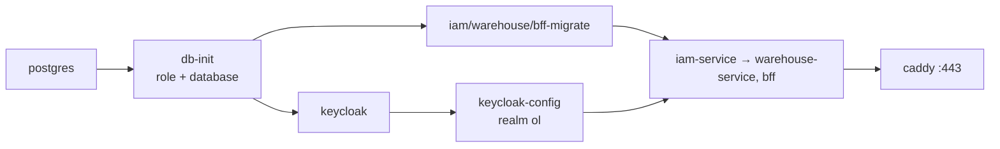

# Bước 2 — Source code và môi trường local

> Phiên bản: 0.1 · Ngày: 03/11/2026 · Trạng thái: **Code đã viết, CHƯA build/test được trong môi trường soạn thảo** (không có quyền truy cập npm registry ở đó). Mọi lệnh kiểm tra dưới đây là để BẠN chạy và gửi lại kết quả.

## 2.0 Tổng quan

| Mục | Nội dung |
|---|---|
| **Mục tiêu** | 7 repo có source hoàn chỉnh; `@<ORG>/node-kit` phát hành bản đầu; toàn bộ stack (PostgreSQL, Keycloak, IAM, Warehouse, BFF, frontend, Caddy HTTPS, Mailpit, Grafana) chạy ở `https://app.ol.test` bằng một lệnh |
| **Đầu vào** | Bước 1 nghiệm thu xong; Docker Engine chạy trong WSL Ubuntu (`wsl -e docker version` có phần Server) |
| **Nơi thao tác** | PowerShell 7 tại `D:\Coding\DevOps\ol-platform`; trình duyệt |
| **Kết quả** | `./ol.ps1 check` toàn `[OK]`; đăng nhập bằng tài khoản demo; test của mọi repo xanh |

Cây thư mục làm việc sau bước này:

```text
D:\Coding\DevOps\ol-platform\
├── ol-handbook\            ol-node-kit\            ol-iam-service\
├── ol-warehouse-service\   ol-bff\                 ol-web-admin\
├── ol-build-tooling\       ol-infra\               .github\    ol-repo-template\
```

Các repo PHẢI nằm cạnh nhau: `ol-infra/local/compose*.yaml` dùng đường dẫn tương đối `../../ol-iam-service`.

---

## 2.1 Khái niệm mới (5 câu)

#### Clean Architecture trong service
- **Nghĩa là gì?** Chia code theo vòng: `domain` (quy tắc thuần) ← `application` (use case + interface "port") ← `infrastructure` (DB, Keycloak) và `interfaces/http` (Express). Phụ thuộc chỉ hướng vào trong.
- **Dùng thế nào?** Use case `UserService.invite()` chỉ biết `UnitOfWork` và `IdentityProvider` (khai báo ở `application/ports.ts`); `DrizzleUnitOfWork` và `KeycloakAdminClient` hiện thực chúng; `container.ts` nối lại.
- **Thay thế bằng gì?** Kiến trúc lớp truyền thống (controller → service → repository dính ORM), hexagonal (gần như tương đương), NestJS module.
- **Lợi thế khi chọn?** Test use case bằng bản giả (`test/helpers/fakes.ts`) không cần Keycloak; đổi Keycloak sang IdP khác chỉ viết lại một file.
- **Không dùng thì sao?** Logic phân quyền và nghiệp vụ nằm rải trong route Express, test phải dựng cả HTTP + DB + Keycloak cho mọi trường hợp.

#### Unit of Work
- **Nghĩa là gì?** Một đơn vị công việc gom nhiều thao tác ghi vào một transaction; lỗi ở bất kỳ đâu → hủy toàn bộ.
- **Dùng thế nào?** `uow.run(async (r) => { await r.memberships.add(...); await r.bindings.create(...); await audit(r, ...) })`.
- **Thay thế bằng gì?** Gọi `db.transaction()` trực tiếp trong use case.
- **Lợi thế khi chọn?** Thao tác và bản ghi audit luôn cùng thành công hoặc cùng thất bại; use case không phụ thuộc Drizzle.
- **Không dùng thì sao?** Có thể tạo membership mà thiếu audit, hoặc tạo binding mồ côi khi bước sau lỗi.

#### Docker Compose
- **Nghĩa là gì?** Khai báo nhiều container và quan hệ giữa chúng trong file YAML, chạy bằng một lệnh.
- **Dùng thế nào?** `docker compose -f compose.yaml -f compose.apps.yaml up -d --build`; `depends_on: { condition: service_completed_successfully }` để migration chạy xong mới khởi động service.
- **Thay thế bằng gì?** Chạy từng `docker run`; Kubernetes local (kind, minikube); Tilt.
- **Lợi thế khi chọn?** Một file mô tả cả hệ thống, dùng đúng Dockerfile như production.
- **Không dùng thì sao?** Mỗi lần chạy phải nhớ thứ tự 10 container và hàng chục biến môi trường.

#### mkcert + Caddy (HTTPS ở local)
- **Nghĩa là gì?** mkcert tạo CA riêng trên máy và cấp chứng chỉ được Windows tin cậy; Caddy là reverse proxy dùng chứng chỉ đó.
- **Dùng thế nào?** `./ol.ps1 certs` → `local/certs/ol.test.pem`; Caddy định tuyến `app.ol.test` và `id.ol.test` giống ALB.
- **Thay thế bằng gì?** Chạy HTTP thuần `localhost:3000`; Traefik; nginx.
- **Lợi thế khi chọn?** Cookie `__Host-` + `Secure`, redirect URI của OIDC và chính sách cùng origin hoạt động y như production.
- **Không dùng thì sao?** Lỗi cookie/redirect chỉ lộ ra khi đã lên AWS — đúng loại lỗi bạn gặp ở lab IAM chương 03.

#### GitHub Packages (npm)
- **Nghĩa là gì?** Registry npm riêng của GitHub, gắn với org; package có scope `@<org>`.
- **Dùng thế nào?** `.npmrc` trỏ `@<ORG>:registry=https://npm.pkg.github.com`, token lấy từ biến `NODE_AUTH_TOKEN`; service cài bằng alias `"@ol/node-kit": "npm:@<ORG>/node-kit@^0.1.0"`.
- **Thay thế bằng gì?** Monorepo + workspace; npmjs.com (public); git dependency.
- **Lợi thế khi chọn?** Thư viện có version rõ ràng, service nâng cấp có kiểm soát qua Dependabot; giữ đúng yêu cầu multi-repo.
- **Không dùng thì sao?** Chép code middleware bảo mật vào từng repo → mỗi nơi một lỗi khác nhau.

#### Testcontainers
- **Nghĩa là gì?** Thư viện khởi động container thật (PostgreSQL) trong lúc test và dọn sau khi xong.
- **Dùng thế nào?** `new PostgreSqlContainer('postgres:17-alpine').start()` trong `test/helpers/db.ts`.
- **Thay thế bằng gì?** DB dùng chung cho test; SQLite; mock repository.
- **Lợi thế khi chọn?** Test RLS, trigger, khóa ngoại kép trên đúng PostgreSQL production dùng.
- **Không dùng thì sao?** Không chứng minh được "SELECT không điều kiện vẫn không lộ dữ liệu tenant khác".

---

## 2.2 Cài thêm công cụ

**Nơi thao tác:** PowerShell 7 (mở bằng Administrator cho lệnh `hosts`).

```powershell
winget install --id FiloSottile.mkcert -e --source winget   # Công cụ tạo chứng chỉ HTTPS local
mkcert -version                                              # Kỳ vọng: in số phiên bản
gh auth refresh -h github.com -s read:packages,write:packages # Thêm quyền đọc/ghi GitHub Packages vào phiên gh
gh auth status                                               # Kỳ vọng: scopes có read:packages, write:packages
```

Không cài Node, pnpm hay mkcert vào Ubuntu — WSL chỉ chạy Docker.

---

## 2.3 Đưa source vào các repo

### 2.3.1 Giải nén và thay giá trị giữ chỗ

Gói `ol-platform-source.zip` (kèm hướng dẫn này) chứa thư mục của từng repo. Giải nén vào một thư mục **tạm** (ví dụ `D:\Temp\ol-src`), rồi:

```powershell
pwsh -File D:\Temp\ol-src\ol-handbook\bootstrap\replace-placeholders.ps1 `
  -Workspace D:\Temp\ol-src -Org <ORG-chữ-thường> -Domain <domain-của-bạn> -AlertEmail <email-nhận-cảnh-báo>
```

| Tham số | Ý nghĩa |
|---|---|
| `-Workspace` | Thư mục chứa các thư mục `ol-*` vừa giải nén |
| `-Org` | Tên GitHub Organization (chữ thường, vì scope npm bắt buộc chữ thường) |
| `-Domain` | Domain gốc, ví dụ `ol.example.com`. Chưa mua thì tạm đặt và chạy lại script khi có |
| `-AlertEmail` | Email nhận cảnh báo/ngân sách |

Kết quả: danh sách file đã đổi; các chỗ giữ `__SHARED_ACCOUNT_ID__`, `__STATE_BUCKET__`... còn lại là bình thường (Bước 6).

### 2.3.2 Chép vào bản clone và mở PR — theo đúng thứ tự

Ruleset chặn push thẳng vào `main`, nên mỗi repo nhận source qua một Pull Request. Thứ tự quan trọng vì repo sau phụ thuộc repo trước:

1. `ol-build-tooling` (các repo khác gọi workflow của nó)
2. `ol-node-kit` (service cài thư viện này)
3. `ol-iam-service`, `ol-warehouse-service`, `ol-bff`, `ol-web-admin`
4. `ol-infra`
5. `ol-handbook` (cập nhật tài liệu)

Với mỗi repo (ví dụ `ol-node-kit`):

```powershell
Set-Location D:\Coding\DevOps\ol-platform\ol-node-kit
git switch main; git pull                                    # Cập nhật main
git switch -c feat/initial-source                            # Nhánh mới
robocopy D:\Temp\ol-src\ol-node-kit . /E /XD .git node_modules /NFL /NDL /NJH /NJS   # Chép mọi file, kể cả file ẩn, trừ .git
git add -A
git commit -m "feat: khởi tạo source"                       # Hook kiểm tra commit message + quét bí mật
git push -u origin feat/initial-source
gh pr create --fill
```

| Lệnh | Ý nghĩa |
|---|---|
| `robocopy ... /E` | Chép cả thư mục con (kể cả rỗng) |
| `/XD .git node_modules` | Không chép thư mục `.git` của gói tạm và `node_modules` |
| `/NFL /NDL /NJH /NJS` | Bớt in ra màn hình |

**Chưa merge vội**: CI của repo cần `ol-build-tooling` có tag `v1.0.0` và Actions được pin SHA. Làm 2.3.3 trước.

### 2.3.3 Phát hành `ol-build-tooling` v1.0.0 và pin Actions

Chính sách org bắt buộc `uses:` phải pin theo SHA (Bước 1). Script `pin-actions.sh` chạy bằng Git Bash (đi kèm Git for Windows):

```powershell
Set-Location D:\Coding\DevOps\ol-platform
foreach ($r in 'ol-build-tooling','ol-node-kit','ol-iam-service','ol-warehouse-service','ol-bff','ol-web-admin','ol-infra') {
  & "C:\Program Files\Git\bin\bash.exe" ./ol-build-tooling/scripts/pin-actions.sh "$r/.github/workflows"   # Đổi @vX → @<sha> # vX
}
```

Với `ol-build-tooling`: commit thay đổi pin vào nhánh `feat/initial-source`, merge PR (check `lint`, `security` phải xanh). Khi merge, job `release` mở **release PR** "chore(main): release 1.0.0". Merge release PR → tag `v1.0.0` được tạo.

```powershell
gh release list -R <ORG>/ol-build-tooling        # Kỳ vọng: v1.0.0
```

Nếu release-please đề xuất phiên bản khác `1.0.0`, sửa `@v1.0.0` trong workflow các repo khác cho khớp rồi chạy lại `pin-actions.sh` (script pin cả `__ORG__/ol-build-tooling/...@v1.0.0`).

### 2.3.4 Phát hành `ol-node-kit` bản đầu (thủ công, một lần)

Service không cài được thư viện chưa tồn tại, nên bản đầu publish tay; các bản sau do workflow phát hành.

```powershell
Set-Location D:\Coding\DevOps\ol-platform\ol-node-kit
$env:NODE_AUTH_TOKEN = gh auth token     # Token chỉ nằm trong biến môi trường của cửa sổ này
pnpm install                             # Tạo pnpm-lock.yaml lần đầu
pnpm run lint; pnpm run typecheck; pnpm test; pnpm run build
pnpm publish --no-git-checks             # Phát hành @<ORG>/node-kit@0.1.0 lên GitHub Packages
Remove-Item Env:NODE_AUTH_TOKEN          # Xóa token khỏi phiên sau khi xong
```

Sau đó trên web: trang package `node-kit` của org → **Package settings → Manage Actions access → Add repository**: thêm `ol-iam-service`, `ol-warehouse-service`, `ol-bff`, `ol-web-admin`, `ol-infra` với quyền **Read** (để `GITHUB_TOKEN` của các repo này cài được package).

Commit `pnpm-lock.yaml` vào PR của `ol-node-kit`, merge.

### 2.3.5 Các repo service

Với từng repo `ol-iam-service`, `ol-warehouse-service`, `ol-bff`, `ol-web-admin`:

```powershell
$env:NODE_AUTH_TOKEN = gh auth token
pnpm install                 # Tạo pnpm-lock.yaml; cài @ol/node-kit từ GitHub Packages
pnpm run format:fix          # Định dạng lại theo Prettier (lần đầu)
pnpm run lint
pnpm run typecheck
pnpm run test:unit           # (web-admin: pnpm test) — unit test chạy được ngay trên Windows
git add -A; git commit -m "build: thêm pnpm-lock.yaml"; git push
```

Test integration (Testcontainers) cần Docker. Docker nằm trong WSL nên chạy test trong container:

```powershell
Set-Location D:\Coding\DevOps\ol-platform\ol-infra\local
./ol.ps1 test ol-iam-service          # Tương tự cho ol-warehouse-service, ol-bff
```

`ol.ps1 test` khởi động container `node-dev`, cấp socket Docker và đặt `TESTCONTAINERS_HOST_OVERRIDE=host.docker.internal` để thư viện kết nối tới container PostgreSQL nó vừa tạo.

**Kết quả mong đợi:** mọi test xanh. Gửi nguyên văn lỗi nếu có — đây là lần đầu code được biên dịch.

Mở PR, chờ CI (`ci / quality`, `security / *`, `image-check`) — `image-check` sẽ đỏ cho tới khi xong Bước 6 (chưa có role AWS); tạm thời các check này chưa bắt buộc nên vẫn merge được.

---

## 2.4 Chạy toàn bộ stack ở local

**Nơi thao tác:** `D:\Coding\DevOps\ol-platform\ol-infra\local` — file: `compose.yaml`, `compose.apps.yaml`, `compose.dev.yaml`, `Caddyfile`, `ol.ps1`, `.env.example`.

```powershell
Set-Location D:\Coding\DevOps\ol-platform\ol-infra\local
./ol.ps1 certs        # 1. Tạo chứng chỉ *.ol.test, cài CA của mkcert vào Windows (một lần)
./ol.ps1 env          # 2. Sinh .env với mật khẩu ngẫu nhiên (một lần; .env không bao giờ commit)
# 3. Mở PowerShell Administrator tại thư mục này:
./ol.ps1 hosts        #    Thêm "127.0.0.1 app.ol.test id.ol.test mail.ol.test grafana.ol.test" vào hosts
./ol.ps1 up           # 4. Build image bằng Dockerfile tập trung và chạy toàn bộ (lần đầu 5–15 phút)
./ol.ps1 ps           # 5. Xem trạng thái
./ol.ps1 seed         # 6. Tạo tenant ACME, Globex và 3 người dùng demo (mật khẩu = SEED_PASSWORD trong .env)
./ol.ps1 check        # 7. Kiểm tra HTTPS, định tuyến, health
```

Trình tự khởi động mà compose bảo đảm:



| Địa chỉ | Dùng để |
|---|---|
| https://app.ol.test | Ứng dụng quản trị |
| https://id.ol.test/admin | Console Keycloak (user `admin`, mật khẩu `KEYCLOAK_ADMIN_PASSWORD` trong `.env`) — chỉ mở ở local |
| https://mail.ol.test | Mailpit: xem email mời/đặt lại mật khẩu |
| https://grafana.ol.test | Grafana: log (Loki), trace (Tempo), metric (Prometheus) |

**Kết quả mong đợi của `check`:**

```text
[OK] 200 https://app.ol.test/health/ready
[OK] 200 https://app.ol.test/
[OK] 200 https://id.ol.test/realms/ol/.well-known/openid-configuration
[OK] /api chưa đăng nhập bị từ chối: 401
```

Đăng nhập: mở https://app.ol.test → chuyển sang Keycloak → `operator@acme.test` + `SEED_PASSWORD` → về trang Kho. Thử `admin@acme.test`: Keycloak yêu cầu quét mã QR TOTP (ứng dụng Authenticator trên điện thoại) — đây là MFA bắt buộc cho quản trị viên.

### Chế độ phát triển (hot reload)

```powershell
./ol.ps1 up -Dev      # Service chạy từ source qua nodemon/Vite; sửa file → tự khởi động lại
./ol.ps1 logs iam-service -Dev
```

Lần đầu chậm vì `pnpm install` trong container; các lần sau dùng volume `pnpm_store`. Phát hiện thay đổi file bằng polling nên trễ 1–2 giây.

---

## 2.5 Lỗi thường gặp

| Triệu chứng | Nguyên nhân | Xử lý |
|---|---|---|
| `ERR_PNPM_FETCH_401 ... npm.pkg.github.com` | Thiếu `NODE_AUTH_TOKEN` hoặc token thiếu `read:packages` | `$env:NODE_AUTH_TOKEN = gh auth token`; `gh auth refresh -s read:packages` |
| `404 Not Found @<org>/node-kit` | Chưa publish, hoặc scope sai chữ hoa | Làm 2.3.4; tên org trong `.npmrc` phải chữ thường |
| `Failed to replace env in config: ${NODE_AUTH_TOKEN}` | pnpm đọc `.npmrc` khi biến chưa đặt | Đặt biến trước mọi lệnh pnpm |
| Trình duyệt báo chứng chỉ không tin cậy | Chưa `mkcert -install` hoặc trình duyệt dùng kho chứng chỉ riêng (Firefox) | Chạy lại `./ol.ps1 certs`; Firefox: bật `security.enterprise_roots.enabled` |
| `app.ol.test` không phân giải | Chưa sửa hosts | `./ol.ps1 hosts` bằng Administrator |
| Cổng 443 bị chiếm | IIS/Skype/Docker Desktop khác | `netstat -ano | findstr :443`, tắt tiến trình chiếm |
| Keycloak mãi `starting` | DB chưa sẵn sàng hoặc thiếu RAM cho WSL | `./ol.ps1 logs keycloak`; tăng RAM WSL trong `%UserProfile%\.wslconfig` (`memory=6GB`) |
| `keycloak-config` thất bại | Tag image keycloak-config-cli không khớp Keycloak | Chọn tag tương thích (Bước 4, mục 4.2) |
| BFF lỗi `unable to verify the first certificate` khi gọi `id.ol.test` | Container chưa tin CA mkcert | Kiểm tra `local/certs/rootCA.pem` tồn tại; biến `NODE_EXTRA_CA_CERTS` |
| `invalid_redirect_uri` ở Keycloak | APP_URL khác `https://app.ol.test` | Kiểm biến trong `compose.apps.yaml` và realm |
| Test Testcontainers treo | Không tới được Docker | Dùng `./ol.ps1 test <repo>` thay vì `pnpm test` trên Windows |

## 2.6 Hoàn tác

```powershell
./ol.ps1 down          # Dừng container, giữ dữ liệu
./ol.ps1 reset         # Dừng và XÓA dữ liệu local (DB, phiên) — hỏi xác nhận
mkcert -uninstall      # Gỡ CA của mkcert khỏi Windows
# Gỡ dòng "# ol-platform" trong C:\Windows\System32\drivers\etc\hosts (Administrator)
```

Phiên bản package đã publish trên GitHub Packages không ghi đè được; muốn bỏ thì xóa phiên bản trong trang package (Package settings → Delete this version).
