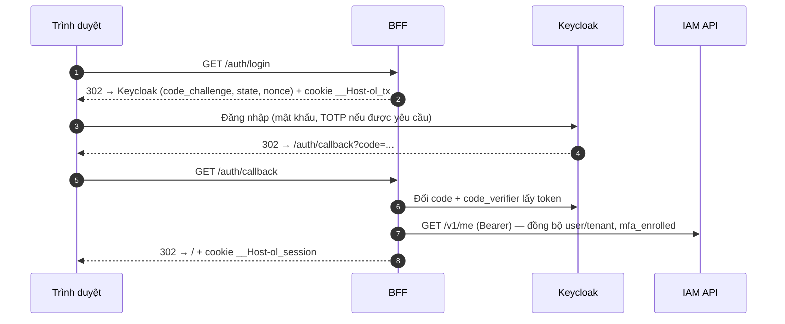

# Bước 3 — IAM và tích hợp

> Phiên bản: 0.1 · Ngày: 03/11/2026 · Trạng thái: **Code đã viết, CHƯA chạy được trong môi trường soạn thảo.** Các kịch bản kiểm chứng dưới đây là để bạn chạy trên stack local (Bước 2) và gửi lại kết quả.

## 3.0 Tổng quan

| Mục | Nội dung |
|---|---|
| **Mục tiêu** | Đăng nhập, phiên, đăng xuất, thu hồi, mời, khóa, MFA cho quản trị viên, gán quyền theo phạm vi, cách ly tenant, service-to-service và audit đều hoạt động và được kiểm chứng bằng test tự động + thao tác tay |
| **Đầu vào** | Stack local chạy (`./ol.ps1 check` toàn `[OK]`), đã `seed` |
| **Nơi thao tác** | Trình duyệt (`https://app.ol.test`, `https://mail.ol.test`, `https://id.ol.test/admin`), PowerShell tại `ol-infra/local` |
| **File liên quan** | `ol-iam-service/src/**`, `ol-bff/src/auth/**`, `ol-node-kit/src/{auth,authz,http}/**`, `ol-infra/keycloak/realm-ol.yaml`, `ol-warehouse-service/src/interfaces/http/routes.ts` |
| **Kết quả** | Bảng kiểm 3.6 toàn ✅; `./ol.ps1 test ol-iam-service`, `ol-warehouse-service`, `ol-bff` xanh |

### Ai làm gì (nhắc lại từ Bước 0)

| Thành phần | Vai trò | Không làm |
|---|---|---|
| **Keycloak** (IdP — dùng lại) | Xác thực: mật khẩu, TOTP, chính sách khóa đăng nhập, phát token OIDC, phiên SSO, email đặt lại mật khẩu | Không biết tenant, role nghiệp vụ |
| **ol-bff** | OIDC client của trình duyệt; giữ token phía server; cookie phiên; chống CSRF; proxy `/api/<service>/*` kèm Bearer token | Không quyết định phân quyền |
| **ol-iam-service** (tự xây) | Mô hình tenant/user/group/role/binding; API quản trị; API quyết định `POST /internal/v1/authorize`; audit | Không lưu mật khẩu, không phát token |
| **Service nghiệp vụ** | Tự xác minh JWT, tự hỏi quyền (qua cache), tự cách ly tenant bằng RLS | Không tin header do client gửi |
| **ALB/Caddy** | TLS, định tuyến | Không xác thực người dùng |

---

## 3.1 Khái niệm (5 câu)

#### OIDC Authorization Code + PKCE
- **Nghĩa là gì?** Quy trình đăng nhập chuẩn: trình duyệt được chuyển sang IdP, IdP trả về một `code` dùng một lần; phía server đổi `code` lấy token. PKCE gắn `code` với một bí mật ngẫu nhiên chỉ người khởi tạo biết.
- **Dùng thế nào?** `ol-bff/src/auth/oidc.ts` gọi `client.buildAuthorizationUrl()` với `code_challenge`, lưu `code_verifier` + `state` + `nonce` vào cookie tạm `__Host-ol_tx` (đã niêm phong), rồi `authorizationCodeGrant()` ở `/auth/callback`.
- **Thay thế bằng gì?** Implicit flow (đã lỗi thời), lưu token trong trình duyệt (SPA thuần), SAML.
- **Lợi thế khi chọn?** Chuẩn, có thư viện được kiểm định (`openid-client`); `code` bị đánh cắp cũng không dùng được.
- **Không dùng thì sao?** Phải tự viết giao thức đăng nhập — đúng điều yêu cầu cấm.

#### Session phía server (BFF)
- **Nghĩa là gì?** Trình duyệt chỉ giữ một cookie chứa ID phiên ngẫu nhiên; token thật nằm trong PostgreSQL, đã mã hóa.
- **Dùng thế nào?** Cookie `__Host-ol_session` (`Secure; HttpOnly; SameSite=Lax; Path=/`); DB chỉ lưu `sha256(id)`; access/refresh token mã hóa AES-256-GCM bằng `SESSION_ENC_KEY` (`node:crypto`, không tự viết thuật toán).
- **Thay thế bằng gì?** Token trong `localStorage`; cookie chứa JWT.
- **Lợi thế khi chọn?** Lỗi XSS không lấy được token; đăng xuất = xóa dòng DB, có hiệu lực ngay.
- **Không dùng thì sao?** Một đoạn script độc hại đọc được token và gọi API thay người dùng đến khi token hết hạn.

#### JWT access token, issuer, audience
- **Nghĩa là gì?** Token có chữ ký số do Keycloak phát; `iss` cho biết ai phát, `aud` cho biết token dành cho ai, `exp` hạn dùng (5 phút).
- **Dùng thế nào?** `JoseTokenVerifier` trong node-kit tải khóa công khai từ JWKS của realm, kiểm tra chữ ký, `iss`, `aud = ol-api`, `exp`. Mọi service đều tự xác minh.
- **Thay thế bằng gì?** Token mờ (opaque) + gọi introspection mỗi request.
- **Lợi thế khi chọn?** Xác minh tại chỗ, không gọi IdP mỗi request; Keycloak tạm sập vẫn phục vụ token còn hạn.
- **Không dùng thì sao?** Mọi request phụ thuộc IdP → IdP thành điểm nghẽn và điểm lỗi duy nhất.

#### Role binding có phạm vi (lấy ý tưởng từ GCP IAM/Azure RBAC)
- **Nghĩa là gì?** "Ai" (user/group/service) + "role" (tập permission) + "trên tài nguyên nào" (`platform`, `tenants/<id>`, `tenants/<id>/warehouses/<id>`). Binding ở cấp cha có hiệu lực xuống cấp con.
- **Dùng thế nào?** `POST /v1/tenants/{t}/role-bindings` với `roleId: roles/warehouse.operator`, `resource: tenants/{t}/warehouses/{w}` → người đó chỉ thao tác được trong kho `w`.
- **Thay thế bằng gì?** Role gắn thẳng vào user (RBAC phẳng); policy document kiểu AWS IAM; OPA/Cedar.
- **Lợi thế khi chọn?** Đủ biểu đạt cho logistics (theo tenant, theo kho), dễ giải thích trên giao diện, truy vấn một câu SQL.
- **Không dùng thì sao?** Hoặc ai cũng có quyền cả tenant, hoặc phải tạo role riêng cho từng kho.

#### Default deny và fail closed
- **Nghĩa là gì?** Không có binding khớp → từ chối. Không hỏi được IAM → cũng từ chối (503), không "cho qua".
- **Dùng thế nào?** `decide()` trả `allowed:false, reason:'no-binding'` khi không khớp; `CachingAuthorizer` ném `DependencyUnavailableError` khi IAM lỗi và không có cache.
- **Thay thế bằng gì?** Fail open (cho qua khi IAM lỗi).
- **Lợi thế khi chọn?** Sự cố hạ tầng không biến thành sự cố lộ dữ liệu.
- **Không dùng thì sao?** Kẻ tấn công chỉ cần làm IAM quá tải để vượt mọi kiểm tra quyền.

#### Client credentials (service-to-service)
- **Nghĩa là gì?** Service tự đăng nhập Keycloak bằng `client_id` + `client_secret` của nó, nhận token có `azp = <client>`.
- **Dùng thế nào?** `ClientCredentialsTokenProvider` (node-kit) lấy token, cache đến gần hết hạn, gộp yêu cầu đồng thời; `warehouse-service` dùng token đó gọi `/internal/v1/authorize`. IAM chỉ cho client có role `roles/iam.authzChecker` (danh sách `AUTHZ_CHECKER_SERVICES`).
- **Thay thế bằng gì?** mTLS/service mesh; IAM role của ECS task (SigV4); API key tĩnh.
- **Lợi thế khi chọn?** Cùng một cơ chế token và cùng mô hình phân quyền cho người và máy; không cần mesh.
- **Không dùng thì sao?** Bất cứ thứ gì trong VPC gọi được API nội bộ.

#### Back-channel logout
- **Nghĩa là gì?** Khi phiên SSO kết thúc ở Keycloak (người dùng đăng xuất, admin khóa, đăng xuất mọi nơi), Keycloak gửi một `logout_token` đã ký tới BFF.
- **Dùng thế nào?** `POST /auth/backchannel-logout` xác minh token bằng `jose` (JWKS realm, `events` chứa `http://schemas.openid.net/event/backchannel-logout`), xóa mọi phiên có `sid` tương ứng.
- **Thay thế bằng gì?** Chờ refresh token hết hạn; front-channel logout (iframe).
- **Lợi thế khi chọn?** Khóa tài khoản có hiệu lực ở BFF trong vài giây.
- **Không dùng thì sao?** Người bị khóa vẫn dùng được phiên BFF cho tới lần refresh kế tiếp.

---

## 3.2 Các luồng

### Đăng nhập (một lần mỗi phiên — KHÔNG đi qua IAM API mỗi request)



### Gọi API

```mermaid
sequenceDiagram
  participant B as Trình duyệt
  participant F as BFF
  participant W as warehouse-service
  participant I as IAM authorize
  B->>F: POST /api/warehouse/v1/... (cookie + X-OL-CSRF)
  F->>F: Kiểm cookie, CSRF, Origin; refresh token nếu sắp hết hạn
  F->>W: Bearer access token (người dùng)
  W->>W: Xác minh JWT (JWKS đã cache)
  W->>I: authorize(principal, permission, resource) — chỉ khi cache trượt
  I-->>W: allowed / reason
  W->>W: withTenant(tenantId) → RLS
  W-->>B: 2xx / 403 problem+json
```

### Thu hồi và thời gian có hiệu lực

| Sự kiện | Cơ chế | Hiệu lực tối đa |
|---|---|---|
| Đăng xuất | BFF xóa phiên + gọi end-session Keycloak | Ngay lập tức |
| Khóa người dùng toàn platform | IAM khóa ở Keycloak + đăng xuất mọi phiên → back-channel logout tới BFF; `principal-disabled` trong IAM | Vài giây (BFF); token đã phát ≤ 5 phút nhưng `authorize` từ chối khi cache 30 s hết |
| Khóa thành viên trong tenant | `membership.status = disabled` → `authorize` trả `membership-disabled` | ≤ 30 s (TTL cache allow) |
| Thu hồi binding | Xóa binding; `policy_state` tăng version | ≤ 30 s |
| Cấp thêm quyền | Tạo binding | ≤ 5 s (TTL cache deny) |

Cần nhanh hơn 30 s thì giảm `AUTHZ_CACHE_TTL_SECONDS` trong `ol-infra/deploy/<env>/warehouse-service.yaml` — đổi lại số lần gọi IAM tăng.

### Khi phụ thuộc lỗi

| Phụ thuộc lỗi | Hành vi |
|---|---|
| Keycloak | Không đăng nhập mới được; phiên đang có tiếp tục tới khi cần refresh; service vẫn xác minh token bằng JWKS đã cache |
| IAM API | Quyết định đã cache còn dùng; trượt cache → 503 `Retry-After` (fail closed) |
| DB của IAM | `/health/ready` của IAM đỏ → ALB/ECS ngừng gửi traffic; như trên |
| BFF | Toàn bộ UI không dùng được; API service vẫn chạy cho client máy |

---

## 3.3 Mô hình quyền đã cài sẵn

Permission đặt tên `service.resource.verb`; định nghĩa duy nhất ở `ol-iam-service/src/domain/catalog.ts`, được đồng bộ vào DB mỗi lần chạy migrate.

| Role | Phạm vi gán | Quyền chính | MFA |
|---|---|---|---|
| `roles/platform.admin` | `platform` | Tạo/liệt kê tenant, khóa user, đăng xuất user, reset MFA, audit platform. **Không** đọc dữ liệu nghiệp vụ tenant | Bắt buộc |
| `roles/iam.tenantAdmin` | tenant | Mọi quyền `iam.*` trong tenant | Bắt buộc cho thao tác ghi |
| `roles/iam.viewer` | tenant | Xem cấu hình IAM | — |
| `roles/iam.auditor` | tenant | Xem cấu hình + audit | — |
| `roles/warehouse.viewer` | tenant/kho | Xem kho, mặt hàng | — |
| `roles/warehouse.operator` | tenant/kho | + tạo mặt hàng, điều chỉnh tồn | — |
| `roles/warehouse.manager` | tenant/kho | + tạo kho | — |
| `roles/iam.authzChecker` | `platform` (chỉ service) | Gọi `/internal/v1/authorize` | — |

"MFA bắt buộc" nghĩa là: permission có `requiresMfa: true` chỉ được cho phép khi người dùng đã đăng ký TOTP (`mfa_enrolled`). Realm cũng đặt required action `CONFIGURE_TOTP` cho mọi tài khoản quản trị được tạo qua bootstrap/seed.

Bảo vệ cài sẵn:
- Không gán được role phạm vi `platform` từ API của tenant (trả 400/403).
- Không xóa/khóa được Tenant Admin cuối cùng của tenant (409).
- Role tùy chỉnh chỉ chứa permission `assignable: tenant`.
- Bảng `audit_events`: role ứng dụng không có quyền `UPDATE`/`DELETE`.

---

## 3.4 API

Tất cả qua BFF: `https://app.ol.test/api/iam/...` (IAM) và `/api/warehouse/...` (kho). Lỗi theo `application/problem+json` (RFC 9457).

| Phương thức + đường dẫn | Permission | Phạm vi |
|---|---|---|
| `GET /v1/me`, `GET /v1/me/permissions?resource=` | đã đăng nhập | — |
| `GET /v1/permissions` | đã đăng nhập | — |
| `GET/POST /v1/tenants` | `platform.tenants.list/create` | platform |
| `GET /v1/platform/audit-events` | `platform.audit.list` | platform |
| `POST /v1/users/{u}/disable · enable · logout · reset-mfa` | `platform.users.*` | platform |
| `GET /v1/tenants/{t}` | `iam.tenants.get` | tenant |
| `GET /v1/tenants/{t}/users`, `/invitations`; `POST /invitations`; `DELETE /users/{u}` | `iam.users.list/invite` | tenant |
| `POST /v1/tenants/{t}/users/{u}/disable · enable · reset-password` | `iam.users.*` | tenant |
| `GET/POST/DELETE /v1/tenants/{t}/groups[/{g}]`, `PUT/DELETE .../members/{u}` | `iam.groups.*` | tenant |
| `GET/POST/DELETE /v1/tenants/{t}/roles[/{name}]` | `iam.roles.*` | tenant |
| `GET/POST/DELETE /v1/tenants/{t}/role-bindings[/{id}]` | `iam.roleBindings.*` | tenant |
| `GET /v1/tenants/{t}/audit-events?before=&limit=` | `iam.audit.list` | tenant |
| `POST /internal/v1/authorize` | `iam.authz.check` | platform — **không** có route trên BFF |
| `GET/POST /v1/tenants/{t}/warehouses` (warehouse) | `warehouse.warehouses.*` | tenant |
| `GET /v1/tenants/{t}/warehouses/{w}[/items]`, `POST .../items`, `POST .../items/{i}/adjustments` | `warehouse.*` | kho |

Hợp đồng `authorize` (`ol-node-kit/src/contracts/authorize.ts`):

```json
// Yêu cầu
{ "principal": "users/0b7c...", "permission": "warehouse.stock.adjust", "resource": "tenants/3f2a.../warehouses/91de..." }
// Phản hồi
{ "allowed": false, "reason": "no-binding", "policyVersion": 42 }
```

---

## 3.5 Tạo quản trị viên platform đầu tiên (bootstrap an toàn)

**Vì sao cần quy trình riêng:** không có tài khoản mặc định, không có mật khẩu viết trong code. Lệnh bootstrap chỉ chạy được khi **chưa có** platform admin nào, và chỉ chạy được bởi người có quyền chạy lệnh trong container/ECS (tức là đã qua quyền AWS hoặc quyền máy local).

```powershell
./ol.ps1 bootstrap-admin -Email platform@ol.test
```

1. IAM tạo user ở Keycloak với required actions `UPDATE_PASSWORD`, `VERIFY_EMAIL`, `CONFIGURE_TOTP` và gửi email đặt mật khẩu.
2. Mở https://mail.ol.test → email "Update your account" → đặt mật khẩu → quét QR TOTP.
3. Đăng nhập https://app.ol.test → thấy mục **Tenants**.
4. Chạy lại lệnh → báo lỗi "đã có platform admin" (đúng thiết kế). Thêm admin khác thì dùng giao diện/API, có audit.

Trên AWS: workflow `ops.yml` của `ol-infra` → **Run workflow** → `bootstrap-platform-admin`, nhập email; job chạy trong environment có người duyệt (Bước 6).

---

## 3.6 Kịch bản kiểm chứng (bạn chạy và đánh dấu)

Tài khoản demo do `seed` tạo; mật khẩu là `SEED_PASSWORD` trong `ol-infra/local/.env`.

| # | Kịch bản | Thao tác | Kết quả đúng |
|---|---|---|---|
| 1 | Đăng nhập hợp lệ | `operator@acme.test` | Vào trang Kho của ACME |
| 2 | Thiếu quyền | `operator` mở **Users** của ACME | Thông báo không có quyền; DevTools → Network: `403`, `reason` không lộ chi tiết nội bộ |
| 3 | Thao tác được phép | `operator` tạo mặt hàng, điều chỉnh tồn +10 | `201`; lịch sử có dòng mới |
| 4 | Viewer chỉ đọc | `viewer@globex.test` thử điều chỉnh tồn (nút bị ẩn; gọi API trực tiếp bằng console) | `403` |
| 5 | **Cross-tenant** | Đăng nhập `operator@acme.test`, đổi URL sang `tenantId` của Globex (lấy từ tài khoản viewer) | `403` từ API; không có dữ liệu Globex nào hiển thị |
| 6 | **Cross-tenant ở tầng DB** | Test `rls.integration.test.ts` | `SELECT` không điều kiện chỉ trả dòng của tenant đặt trong `app.tenant_id` |
| 7 | MFA cho admin | `admin@acme.test` đăng nhập lần đầu | Bắt buộc quét QR TOTP trước khi vào |
| 8 | Mời người dùng | Admin ACME → Users → Invite `new@acme.test`, role Warehouse Viewer | Email trong Mailpit; đặt mật khẩu xong đăng nhập được, chỉ xem |
| 9 | Khóa thành viên | Admin khóa `new@acme.test` | Trong ≤ 30 s mọi API của người này trả `403 membership-disabled` |
| 10 | Thu hồi binding | Admin xóa binding Operator của `operator@acme.test` | ≤ 30 s: điều chỉnh tồn bị `403` |
| 11 | Đăng xuất mọi nơi | Platform admin → logout user | Phiên BFF của người đó bị xóa (lần gọi kế tiếp `401`) |
| 12 | Không hạ admin cuối | Admin ACME thử xóa binding Tenant Admin của chính mình khi là admin duy nhất | `409` |
| 13 | Service không được phép | Test `api.integration.test.ts` "non-checker service" | `403` |
| 14 | IAM sập → fail closed | `docker compose stop iam-service` (qua `wsl -e`), chờ 35 s, gọi API kho | `503` có `Retry-After`, KHÔNG phải `200` |
| 15 | Audit | Admin → Audit | Có sự kiện cho #8–#12 với người thực hiện, thời gian, request id |
| 16 | CSRF | Console: `fetch('/api/warehouse/v1/tenants/<t>/warehouses',{method:'POST',body:'{}'})` không có header `X-OL-CSRF` | `403` |

Lệnh cho #14:

```powershell
wsl --cd (Resolve-Path .) -e docker compose -f compose.yaml -f compose.apps.yaml stop iam-service   # Dừng IAM
wsl --cd (Resolve-Path .) -e docker compose -f compose.yaml -f compose.apps.yaml start iam-service  # Bật lại
```

Test tự động tương ứng:

```powershell
./ol.ps1 test ol-iam-service        # decide.test.ts + api.integration.test.ts (valid, thiếu quyền, cross-tenant, invite+audit, admin cuối, disable, hợp đồng)
./ol.ps1 test ol-warehouse-service  # rls.integration.test.ts + api.integration.test.ts
./ol.ps1 test ol-bff                # CSRF, cookie, proxy
```

E2E (Playwright, chạy từ Windows vì cần trình duyệt):

```powershell
Set-Location D:\Coding\DevOps\ol-platform\ol-web-admin
pnpm exec playwright install chromium                     # Tải trình duyệt cho Playwright (một lần)
$env:BASE_URL = 'https://app.ol.test'                    # Mặc định đã là địa chỉ này
$env:E2E_OPERATOR_EMAIL = 'operator@acme.test'; $env:E2E_VIEWER_EMAIL = 'viewer@globex.test'
$env:E2E_PASSWORD = (Select-String -Path ..\ol-infra\local\.env -Pattern '^SEED_PASSWORD=(.*)$').Matches[0].Groups[1].Value   # Đọc từ .env, không gõ ra màn hình
pnpm exec playwright test -c e2e/playwright.config.ts
```

> **[CHƯA XÁC MINH]** Selector của form đăng nhập Keycloak trong `e2e/support/login.ts` (`#username`, `#password`, `#kc-login`, `#totp`) lấy theo theme mặc định; nếu Keycloak 26.8 đổi theme, sửa selector theo HTML thực tế.

---

## 3.7 Lỗi thường gặp

| Triệu chứng | Nguyên nhân | Xử lý |
|---|---|---|
| `401 invalid issuer` ở service | Token phát với `iss=https://id.ol.test/realms/ol` nhưng service cấu hình khác | `OIDC_ISSUER` phải là URL công khai; `OIDC_INTERNAL_ISSUER` là URL nội bộ nếu Keycloak phát khác |
| `401 audience` | Client thiếu audience mapper `ol-api` | Kiểm `realm-ol.yaml` đã được `keycloak-config` áp |
| Mọi API trả `503` | warehouse không lấy được token client credentials | Log `warehouse-service`; kiểm secret `ol-warehouse-service` khớp Keycloak |
| Admin bị `403 mfa-required` | Chưa đăng ký TOTP hoặc `mfa_enrolled` chưa đồng bộ | Đăng xuất/đăng nhập lại (BFF gọi `/v1/me` để đồng bộ) |
| Không nhận email mời | SMTP Keycloak chưa trỏ Mailpit | Realm → Email; `./ol.ps1 logs keycloak` |
| Back-channel logout không tác dụng | URL logout của client không tới được BFF từ Keycloak | Kiểm `backchannelLogoutUrl` = `http://bff:3000/auth/backchannel-logout` (local) |

## 3.8 Hoàn tác

- Gán quyền sai: xóa binding (có audit) — không sửa DB trực tiếp.
- Mời nhầm: `DELETE /v1/tenants/{t}/users/{u}` hoặc thu hồi lời mời.
- Làm hỏng dữ liệu local: `./ol.ps1 reset` → `up` → `seed`.
- Không có thao tác "xóa audit": đó là thiết kế (append-only).
