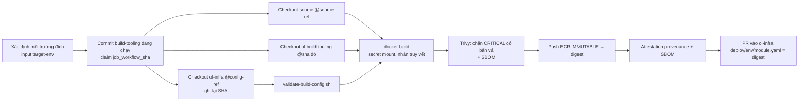

# Bước 4 — Docker và build config

> Phiên bản: 0.1 · Ngày: 03/11/2026 · Trạng thái: **Dockerfile và workflow đã viết, CHƯA build thử.** Script `validate-build-config.sh` đã chạy thử với file mẫu (đạt). Tag image công cụ ghi **[CHƯA XÁC MINH]** phải được bạn kiểm tra trước khi dùng.

## 4.0 Tổng quan

| Mục | Nội dung |
|---|---|
| **Mục tiêu** | Mọi image được build bằng Dockerfile tập trung trong `ol-build-tooling`, với build config của môi trường đích lấy từ `ol-infra`, không chứa bí mật, có nhãn truy vết + attestation, và được triển khai bằng digest |
| **Đầu vào** | Bước 2 xong (repo có source, `ol-build-tooling` có tag `v1.0.0`) |
| **Nơi thao tác** | `ol-build-tooling/dockerfiles/**`, `ol-infra/build-config/**`; PowerShell để build thử local |
| **Kết quả** | Build thử local thành công; hiểu rõ 3 loại cấu hình; biết chuỗi kích hoạt build khi source/Dockerfile/config đổi |

---

## 4.1 Khái niệm (5 câu)

#### Multi-stage build
- **Nghĩa là gì?** Một Dockerfile có nhiều `FROM`; stage sau chỉ lấy đúng file cần từ stage trước.
- **Dùng thế nào?** `node-service/Dockerfile`: `base → deps → build → (test) → prod-deps → runtime`; image cuối chỉ có `node_modules` production, `dist/`, `migrations/`.
- **Thay thế bằng gì?** Build trên máy rồi `COPY dist`; một stage duy nhất.
- **Lợi thế khi chọn?** Image nhỏ, không chứa compiler/devDependencies/source TypeScript; build lặp lại được.
- **Không dùng thì sao?** Image to gấp nhiều lần, nhiều lỗ hổng hơn, "chạy được trên máy tôi".

#### BuildKit secret mount
- **Nghĩa là gì?** Gắn bí mật vào **một** lệnh `RUN` dưới dạng file/biến môi trường tạm; không ghi vào layer, không có trong `docker history`.
- **Dùng thế nào?** `RUN --mount=type=secret,id=npm_token,env=NODE_AUTH_TOKEN pnpm install`; lúc build: `--secret id=npm_token,env=NODE_AUTH_TOKEN` (local) hoặc `secrets: npm_token=${{ github.token }}` (CI).
- **Thay thế bằng gì?** `ARG NPM_TOKEN` (lộ trong metadata image), copy `.npmrc` có token (lộ trong layer).
- **Lợi thế khi chọn?** Đáp ứng đúng yêu cầu "không đóng bí mật vào image".
- **Không dùng thì sao?** Ai kéo được image là có token đọc package của org.

#### Digest
- **Nghĩa là gì?** `sha256:...` — dấu vân tay của nội dung image. Tag có thể trỏ sang image khác; digest thì không.
- **Dùng thế nào?** `deploy/<env>/<module>.yaml` lưu `image.digest`; Terraform dựng `…/ol/iam-service@sha256:…`.
- **Thay thế bằng gì?** Deploy bằng tag `latest` hoặc `v1.2.3`.
- **Lợi thế khi chọn?** Thứ đã test ở dev chính xác là thứ chạy ở prod; rollback = trỏ lại digest cũ.
- **Không dùng thì sao?** Hai lần deploy "cùng phiên bản" có thể chạy hai image khác nhau.

#### Artifact attestation (SLSA provenance) và SBOM
- **Nghĩa là gì?** Chứng thư có chữ ký (Sigstore, do GitHub quản lý) nói "image digest X được build bởi workflow Y từ commit Z". SBOM là danh sách thành phần trong image.
- **Dùng thế nào?** `actions/attest-build-provenance` + `actions/attest-sbom` sau khi push; trước deploy: `gh attestation verify oci://… --signer-workflow <org>/ol-build-tooling/.github/workflows/build-image.yml`.
- **Thay thế bằng gì?** Cosign tự quản khóa; chỉ dựa vào nhãn OCI.
- **Lợi thế khi chọn?** Không quản khóa; nhãn có thể bị làm giả, chữ ký thì không; chứng minh image chỉ đến từ pipeline chính thức.
- **Không dùng thì sao?** Ai có quyền push ECR là đưa được image tùy ý lên prod.

---

## 4.2 Danh mục Dockerfile

| Dockerfile | Dùng cho | Build context | Ghi chú |
|---|---|---|---|
| `node-service` | iam-service, warehouse-service, bff | source của service | `USER node`, `HEALTHCHECK`, CA của RDS, OTel qua `--import` |
| `web-static` | web-admin | source của frontend | Build Vite → nginx không root (cổng 8080); `/config.json` sinh lúc khởi động từ biến môi trường |
| `keycloak` | Keycloak | `dockerfiles/keycloak` | `kc.sh build` trước (khởi động nhanh), CA của RDS |
| `keycloak-config` | Áp realm dạng code | `ol-infra/keycloak` | keycloak-config-cli |
| `node-dev` | Local dev/test | — | Không đẩy lên ECR |

Giải thích từng lệnh của `node-service` có trong chú thích ở chính file. Điểm cần nhớ:

| Dòng | Vì sao |
|---|---|
| `ARG BASE_IMAGE=node:26-slim` | Base image là build config (đổi được từ `ol-infra` mà không sửa Dockerfile) |
| `RUN npm install -g pnpm@10` | Node 25+ không kèm Corepack |
| `COPY package.json pnpm-lock.yaml .npmrc ./` trước `COPY . .` | Sửa code không làm mất cache bước cài dependency |
| `--mount=type=cache,id=pnpm-store` | Dùng lại store giữa các lần build |
| `pnpm install --frozen-lockfile` | Lockfile lệch `package.json` → build thất bại (không âm thầm nâng version) |
| `ADD --chmod=644 https://truststore.pki.rds.amazonaws.com/...` | TLS tới RDS với xác minh chứng chỉ đầy đủ |
| `LABEL io.ol-platform.*` | Truy vết commit source, Dockerfile, config, môi trường |
| `STOPSIGNAL SIGTERM` + `startServer` | ECS gửi SIGTERM → server ngừng nhận request mới, chờ request đang xử lý, đóng DB |

> **[CHƯA XÁC MINH]** Tag `adorsys/keycloak-config-cli:6.4.0-26.1.0` trong `build-config/*/keycloak-config.env` và `quay.io/keycloak/keycloak:26.8.1`. keycloak-config-cli phát hành tag theo cặp `<phiên-bản-cli>-<phiên-bản-keycloak>`; hãy mở trang tag của image trên Docker Hub, chọn tag có phần sau khớp (hoặc gần nhất, cùng major) với Keycloak đang dùng, rồi sửa cả 3 môi trường. Tương tự với các image trong `ol-build-tooling/tool-versions.env` (Trivy, gitleaks, hadolint, actionlint).

---

## 4.3 Ba loại cấu hình

| Loại | Ví dụ | Ở đâu | Khi nào đọc | Đổi giá trị thì |
|---|---|---|---|---|
| **Build-time config** | `BUILD_ARG_BASE_IMAGE`, `DOCKERFILE`, `CONTEXT` | `ol-infra/build-config/<env>/<module>.env` | Lúc `docker build` | Build image mới (workflow `rebuild.yml` tự chạy) |
| **Runtime config** | `LOG_LEVEL`, `AUTHZ_CACHE_TTL_SECONDS`, URL Keycloak, tên DB | `ol-infra/deploy/<env>/<module>.yaml` (`runtime.env`) + giá trị Terraform sinh (endpoint RDS…) | Lúc container khởi động | Triển khai lại task, **cùng** image |
| **Secret** | Mật khẩu DB, client secret, khóa phiên BFF, SMTP | AWS Secrets Manager `ol/<env>/...` (local: `.env` không commit) | ECS tiêm lúc khởi động | Đổi giá trị trong Secrets Manager + khởi động lại task (Bước 8) |
| **Build secret** | Token đọc GitHub Packages | `GITHUB_TOKEN` của job → BuildKit secret | Một lệnh `RUN` | Không lưu ở đâu cả |

Quy tắc đã cài cứng:
- `validate-build-config.sh` chỉ chấp nhận khóa `DOCKERFILE`, `CONTEXT`, `INFRA_CONTEXT_PATH`, `BUILD_TARGET`, `BUILD_ARG_*`; từ chối khóa có chữ `SECRET|PASSWORD|TOKEN|PRIVATE|CREDENTIAL|API_KEY`; từ chối giá trị có `$`, dấu nháy, khoảng trắng.
- Backend **không** có build-time config theo môi trường → file build-config của 3 môi trường giống hệt → image dev được thăng cấp nguyên digest lên staging/prod.
- Frontend: biến `VITE_*` bị nhúng vào bundle nên **chỉ** chứa giá trị công khai. Giá trị theo môi trường (tên môi trường, URL) đặt qua `/config.json` lúc chạy → cũng dùng chung image. Không có bí mật nào trong frontend: mọi token nằm ở BFF.

Kiểm tra build config:

```powershell
& "C:\Program Files\Git\bin\bash.exe" ol-build-tooling/scripts/validate-build-config.sh ol-infra/build-config/prod/iam-service.env
```

Kết quả đúng: in lại các dòng `KEY=VALUE`, mã thoát 0. Thử thêm dòng `BUILD_ARG_NPM_TOKEN=x` → báo "Khóa trông giống bí mật", mã thoát 1.

---

## 4.4 Build thử ở local

**Nơi thao tác:** PowerShell tại `D:\Coding\DevOps\ol-platform`. Docker trong WSL → chạy lệnh qua `wsl`.

```powershell
$env:NODE_AUTH_TOKEN = gh auth token; $env:WSLENV = 'NODE_AUTH_TOKEN/u'   # Chuyển token sang WSL qua biến môi trường, không qua file
wsl -e docker buildx build `
  -f ol-build-tooling/dockerfiles/node-service/Dockerfile `
  --secret id=npm_token,env=NODE_AUTH_TOKEN `
  --build-arg SOURCE_REVISION=$(git -C ol-iam-service rev-parse HEAD) `
  --build-arg TARGET_ENV=local `
  -t ol-local/iam-service:try --load ol-iam-service
```

| Phần | Ý nghĩa |
|---|---|
| `-f .../Dockerfile` | Dockerfile tập trung (không nằm trong repo service) |
| `--secret id=npm_token,env=NODE_AUTH_TOKEN` | Lấy giá trị biến `NODE_AUTH_TOKEN` làm secret `npm_token` |
| `--build-arg ...` | Nhãn truy vết |
| `--load` | Nạp image vào Docker local |
| `ol-iam-service` (cuối) | Build context = thư mục source |

Kiểm chứng:

```powershell
wsl -e docker history --no-trunc ol-local/iam-service:try | Select-String -Pattern 'gh[pous]_' -SimpleMatch:$false   # Kỳ vọng: KHÔNG có dòng nào (không lộ token)
wsl -e docker inspect ol-local/iam-service:try --format '{{json .Config.Labels}}'                                       # Kỳ vọng: có io.ol-platform.target-env=local
wsl -e docker run --rm ol-local/iam-service:try id                                                                      # Kỳ vọng: uid=1000(node)
wsl -e docker buildx build -f ol-build-tooling/dockerfiles/node-service/Dockerfile --secret id=npm_token,env=NODE_AUTH_TOKEN --target test ol-iam-service   # Chạy unit test trong image
```

---

## 4.5 Pipeline build (đã hiện thực trong `build-image.yml`)



Bốn thứ được ghim và truy vết được trên mỗi image:

| Thứ | Ghim bằng | Ghi ở |
|---|---|---|
| Source | `source-ref` = commit SHA | Nhãn `org.opencontainers.image.revision`, `deploy/*.yaml: source.revision` |
| Dockerfile | Commit của chính workflow build-tooling (`job_workflow_sha`) — repo gọi pin `@<sha> # v1.0.0` | Nhãn `io.ol-platform.dockerfile.ref`, `source.toolingRevision` |
| Build config | SHA của ol-infra lúc checkout | Nhãn `io.ol-platform.config.ref`, `source.configRevision` |
| Môi trường đích | `target-env` | Nhãn `io.ol-platform.target-env`, tag `<env>-<src12>-<cfg7>-<run>` |

Truy ngược từ một container đang chạy trên AWS:

```bash
aws ecs describe-tasks --cluster ol-prod --tasks <task-arn> --query 'tasks[0].containers[0].imageDigest'
gh attestation verify oci://<shared>.dkr.ecr.ap-southeast-1.amazonaws.com/ol/iam-service@sha256:... --owner <ORG> --format json \
  | jq '.[0].verificationResult.signature.certificate | {sourceRepositoryURI, sourceRepositoryDigest, buildSignerURI}'
```

### Truy cập chéo repo

| Ai | Cần gì | Bằng gì |
|---|---|---|
| Workflow service gọi workflow `ol-build-tooling` | Đọc workflow | Repo public (hoặc Settings → Actions → Access cho repo private) |
| `build-image` đọc `ol-infra`, `ol-build-tooling`, source | Đọc nội dung | Token GitHub App `ol-automation`, `permission-contents: read`, giới hạn đúng repo |
| `build-image` mở PR vào `ol-infra` | Ghi nhánh + PR | Token App riêng: `contents: write`, `pull-requests: write`, chỉ `ol-infra` |
| `pnpm install` trong build | Đọc GitHub Packages | `GITHUB_TOKEN` (`packages: read`) — repo đã được cấp quyền ở package (Bước 2.3.4) |
| Push ECR | Ghi ECR | OIDC → role `ol-gha-ecr-push` ở tài khoản shared, trust chỉ repo của org |

### Khi nào build lại

| Thay đổi | Cơ chế | Kết quả |
|---|---|---|
| Source service (merge vào `main`) | `ci.yml` của service → `build-image` với `target-env: dev` | PR digest vào `deploy/dev`, tự merge → deploy dev → PR thăng cấp staging |
| `ol-infra/build-config/<env>/<module>.env` | `rebuild.yml` (on push `build-config/**`) build lại module đó, dùng `source.revision` hiện có | PR digest vào `deploy/<env>` |
| `ol-infra/keycloak/**` (realm) | `rebuild.yml` build `keycloak-config` cho dev | Như trên |
| Dockerfile trong `ol-build-tooling` | Release mới (`v1.1.0`) → Dependabot mở PR nâng `uses: ...@<sha> # v1.1.0` ở từng repo → merge = build lại bằng Dockerfile mới | Có review, không ai bị "đổi Dockerfile ngầm" |
| Base image có bản vá | Dependabot (docker) ở `ol-build-tooling` cho Dockerfile; build-config đổi tag base → `rebuild.yml` | |
| `deploy/<env>/*.yaml` (digest/runtime) | `deploy.yml` — **không** build | Triển khai |

---

## 4.6 Lỗi thường gặp

| Triệu chứng | Nguyên nhân | Xử lý |
|---|---|---|
| `ERR_PNPM_FETCH_401` trong build | Repo chưa được cấp quyền đọc package `node-kit` | Package settings → Manage Actions access |
| `secret npm_token not found` | Quên `--secret` | Thêm như 4.4 |
| `ERR_PNPM_OUTDATED_LOCKFILE` | Sửa `package.json` mà không cập nhật lockfile | `pnpm install` rồi commit `pnpm-lock.yaml` |
| `tag invalid: The image tag already exists` | ECR IMMUTABLE | Đúng thiết kế; tag có `run_id` nên chỉ xảy ra khi chạy lại thủ công cùng run — dùng "Re-run" tạo run mới |
| Trivy chặn build | Lỗ hổng CRITICAL đã có bản vá | Nâng base image/dependency; nếu bất khả kháng, thêm `.trivyignore` có lý do + hạn, qua review security |
| `attest-build-provenance` lỗi quyền | Thiếu `id-token: write`, `attestations: write` ở job gọi | Kiểm `permissions:` của job gọi reusable workflow |
| Image web-admin hiển thị cấu hình sai môi trường | `/config.json` bị cache | nginx đặt `Cache-Control: no-store` cho `/config.json` — kiểm `nginx.conf` |

## 4.7 Hoàn tác

- Image lỗi đã lên môi trường: revert PR digest trong `ol-infra` (trỏ lại digest cũ) → `deploy.yml` triển khai lại. Không xóa image khỏi ECR: lifecycle policy chỉ giữ 100 image mới nhất mỗi repo, đủ để quay lại nhiều phiên bản. Nếu một module build rất thường xuyên, kiểm tra digest đang chạy ở prod vẫn nằm trong 100 image đó (hoặc đổi quy tắc giữ image theo tag `prod-*`).
- Dockerfile mới lỗi: không merge PR Dependabot nâng `ol-build-tooling`; hoặc phát hành bản vá `v1.1.1`.
- Build config sai: revert commit trong `ol-infra/build-config` → `rebuild.yml` build lại.
