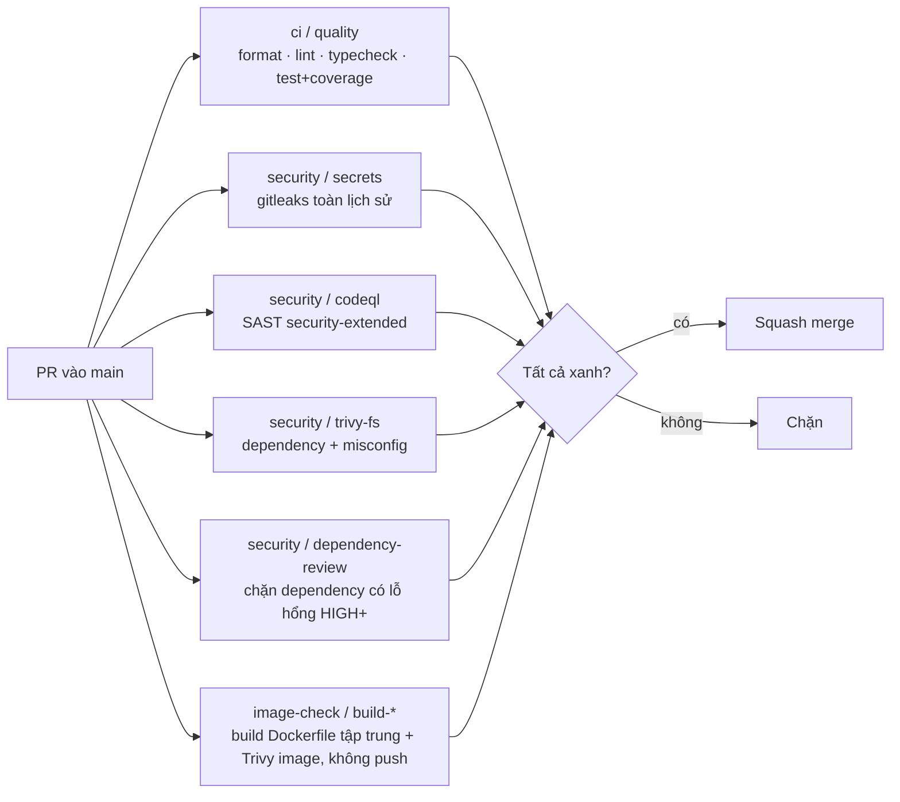

# Bước 5 — CI và kiểm thử

> Phiên bản: 0.1 · Ngày: 03/11/2026 · Trạng thái: **Workflow và test đã viết, CHƯA chạy trên GitHub.** Tên check trong `config/required-checks.json` suy ra từ cấu trúc workflow — đối chiếu với tab Checks của PR thật trước khi bật bắt buộc.

## 5.0 Tổng quan

| Mục | Nội dung |
|---|---|
| **Mục tiêu** | Mọi PR vào `main` phải qua: định dạng, lint, kiểm tra kiểu, unit + integration test có coverage, quét bí mật, SAST, quét dependency/cấu hình, build thử image + quét lỗ hổng image; không merge được khi đỏ |
| **Đầu vào** | Bước 2 (repo có source), Bước 4 (`ol-build-tooling` v1.0.0). Check `image-check` và `plan-*` cần Bước 6 (role AWS) mới xanh |
| **Nơi thao tác** | GitHub (tab Actions/Checks), PowerShell |
| **File** | `ol-build-tooling/.github/workflows/{node-ci,security-scan,build-image,release}.yml`, `<repo>/.github/workflows/ci.yml`, `ol-infra/.github/workflows/validate.yml`, `ol-handbook/bootstrap/github/{set-required-checks.ps1,config/required-checks.json}` |
| **Kết quả** | Ruleset của 7 repo có required status checks; PR cố tình làm hỏng bị chặn |

---

## 5.1 Khái niệm (5 câu)

#### Reusable workflow
- **Nghĩa là gì?** Workflow có `on: workflow_call`, được repo khác gọi như một job: `uses: <org>/ol-build-tooling/.github/workflows/node-ci.yml@<sha>`.
- **Dùng thế nào?** Mỗi repo service chỉ có một `ci.yml` ~70 dòng gọi 4 workflow dùng chung.
- **Thay thế bằng gì?** Chép nguyên workflow vào từng repo; composite action; template repo.
- **Lợi thế khi chọn?** Sửa một chỗ, mọi repo nhận qua PR Dependabot có review; pin SHA → không ai đổi pipeline ngầm.
- **Không dùng thì sao?** 7 bản pipeline lệch nhau, lỗ hổng sửa ở chỗ này còn ở chỗ khác.

#### Required status checks (trong ruleset)
- **Nghĩa là gì?** Danh sách check phải thành công thì nút Merge mới mở.
- **Dùng thế nào?** `set-required-checks.ps1` thêm luật `required_status_checks` vào ruleset `default-branch-protection`, ràng buộc check phải do app GitHub Actions tạo.
- **Thay thế bằng gì?** Branch protection cổ điển; dựa vào kỷ luật.
- **Lợi thế khi chọn?** Không ai (kể cả admin — ruleset không có bypass) merge được code đỏ.
- **Không dùng thì sao?** CI chỉ là "gợi ý".

#### Kim tự tháp kiểm thử của dự án

| Tầng | Công cụ | Ở đâu | Chạy khi |
|---|---|---|---|
| Unit | Vitest | `test/*.test.ts` (logic `decide()`, authorizer, verifier JWT, http client) | Mọi PR, `pnpm test:unit` local |
| Integration | Vitest + Supertest + Testcontainers (PostgreSQL thật) | `test/*.integration.test.ts` | Mọi PR (runner GitHub có Docker) |
| Contract | Zod schema dùng chung `AuthorizeRequestSchema/ResponseSchema` | node-kit + test "contract" ở IAM | Mọi PR |
| E2E | Playwright | `ol-web-admin/e2e` | Sau deploy dev/staging (`E2E_ENABLED=true`), local tùy ý |
| Smoke | curl | `ol-infra/scripts/smoke.sh` | Sau mọi deploy |
| Load | k6 | `ol-infra/loadtest/warehouse.js` | Thủ công trước phát hành lớn (Bước 9) |

- **Nghĩa là gì?** Nhiều test nhanh/rẻ ở dưới, ít test chậm/đắt ở trên.
- **Dùng thế nào?** Như bảng.
- **Thay thế bằng gì?** Chỉ E2E; chỉ unit với mock.
- **Lợi thế khi chọn?** Lỗi phân quyền/RLS bị bắt ở integration (vài giây) thay vì ở staging.
- **Không dùng thì sao?** Hoặc test chậm và chập chờn, hoặc test xanh mà hệ thống vẫn lộ dữ liệu.

---

## 5.2 Những gì chạy trên mỗi PR



Trên `main` (sau merge): `release` (release-please mở/cập nhật release PR) → `build` (push image cho dev + attestation + PR digest vào `ol-infra`). Chi tiết ở Bước 7.

`ol-infra` (`validate.yml`): `config` (kiểm tra build-config + YAML deploy), `terraform` (`fmt -check`, `validate` cho mọi thư mục root), `security / *`, `plan-<env>` (terraform plan bằng role chỉ đọc, kết quả ghi vào Summary của job).

---

## 5.3 Bật check bắt buộc

**Điều kiện:** mỗi repo đã có ít nhất một PR chạy hết các check (kể cả đỏ) để tên check hiện ra.

1. Mở một PR bất kỳ của `ol-iam-service` → tab **Checks** → ghi lại tên chính xác (ví dụ `ci / quality`).
2. So với `ol-handbook/bootstrap/github/config/required-checks.json`; sửa nếu khác.
3. Chạy:

```powershell
Set-Location D:\Coding\DevOps\ol-platform\ol-handbook
gh api repos/<ORG>/ol-iam-service/commits/main/check-runs --jq '.check_runs[0].app.id'    # Kỳ vọng: 15368 (app GitHub Actions)
pwsh -File .\bootstrap\github\set-required-checks.ps1 -Org <ORG> -DryRun                  # Xem trước
pwsh -File .\bootstrap\github\set-required-checks.ps1 -Org <ORG>                          # Áp dụng
```

> Nếu lệnh đầu trả số khác 15368, chạy script với `-ActionsAppId <số đó>`.

**Thời điểm bật `image-check` và `plan-*`:** hai check này cần role AWS (Bước 6). Trước Bước 6, tạm xóa chúng khỏi `required-checks.json` rồi chạy script; sau Bước 6 thêm lại và chạy lại script.

---

## 5.4 Secret cho Dependabot

PR do Dependabot mở **không** đọc được Actions secrets — chỉ đọc được *Dependabot secrets*. Hai chỗ cần:

| Secret (Dependabot, cấp org) | Dùng cho | Giá trị |
|---|---|---|
| `DEPENDABOT_PACKAGES_TOKEN` | `dependabot.yml` → registry `npm.pkg.github.com` (đọc `@<ORG>/node-kit`) | Classic PAT **chỉ** scope `read:packages`, hết hạn 90 ngày. Ngoại lệ có chủ đích: Dependabot chưa hỗ trợ token GitHub App cho registry riêng [CHƯA XÁC MINH — kiểm tra lại tài liệu Dependabot hiện hành] |
| `OL_APP_PRIVATE_KEY` | Workflow `image-check` chạy trên PR Dependabot cần token GitHub App | Cùng khóa với Actions secret ở Bước 1 |

Tạo (bạn tự nhập giá trị vào hộp thoại của `gh`, không dán vào hội thoại này):

```powershell
gh secret set DEPENDABOT_PACKAGES_TOKEN --org <ORG> --app dependabot --visibility all          # gh hỏi giá trị, ẩn khi gõ
Get-Content -Raw $HOME\Downloads\<tên-app>.private-key.pem | gh secret set OL_APP_PRIVATE_KEY --org <ORG> --app dependabot --visibility all
```

> **[CHƯA XÁC MINH]** Biến cấu hình (`vars.OL_APP_ID`, `vars.SHARED_ACCOUNT_ID`…) có đọc được trong workflow do Dependabot kích hoạt hay không. Nếu PR Dependabot báo `app-id` rỗng, chuyển `OL_APP_ID` sang dùng `vars` ở cấp org (đã làm ở Bước 1) và kiểm tra lại; nếu vẫn rỗng, tạo thêm Dependabot secret cùng tên rồi đổi workflow sang `secrets.OL_APP_ID`.

---

## 5.5 Coverage

`pnpm run test:coverage` (V8) xuất `coverage/` thành artifact `coverage` của job `ci / quality` (giữ 14 ngày). Ngưỡng đề xuất, đặt trong `vitest.config.ts` của từng repo **sau** khi có số liệu thực tế đầu tiên:

```ts
// vitest.config.ts — thêm vào test.coverage
thresholds: { lines: 70, branches: 60, functions: 70, statements: 70 },
```

Coverage chỉ là chỉ báo; điều bắt buộc là các kịch bản ở Bước 3.6 có test tương ứng.

---

## 5.6 Kiểm chứng (bạn chạy)

| # | Thử | Kết quả đúng |
|---|---|---|
| 1 | PR thêm dòng `const x = 1` không dùng | `ci / quality` đỏ (lint), Merge bị khóa |
| 2 | PR thêm chuỗi trông như token: `ghp_` + 36 ký tự ngẫu nhiên vào file test | Hook pre-commit chặn ở máy; nếu bỏ qua hook (`--no-verify`), push protection hoặc `security / secrets` chặn |
| 3 | PR đổi `decide()` thành luôn `allowed: true` | Integration test cross-tenant đỏ |
| 4 | PR thêm `RUN echo $NPM_TOKEN` vào Dockerfile | Review CODEOWNERS (platform) + hadolint/Trivy cảnh báo; không có token để in vì là secret mount |
| 5 | PR thêm `BUILD_ARG_API_KEY=x` vào build-config | `config` của `ol-infra` đỏ |
| 6 | PR hợp lệ | Tất cả xanh, Merge mở |

Đóng các PR thử sau khi xong.

---

## 5.7 Lỗi thường gặp

| Triệu chứng | Nguyên nhân | Xử lý |
|---|---|---|
| `The actions ... are not allowed` | Chính sách org chỉ cho phép action được chọn / bắt buộc pin SHA | Chạy `pin-actions.sh`; thêm action vào danh sách cho phép ở cài đặt Actions của org |
| `workflow was not found` khi gọi reusable workflow | Sai SHA/tag hoặc repo private chưa mở quyền | Kiểm tra `uses:`; repo public thì không cần cấu hình thêm |
| Check bắt buộc treo "Expected — Waiting for status" | Tên check trong ruleset khác tên thật | Sửa `required-checks.json`, chạy lại script |
| `image-check` đỏ "Could not assume role" | Chưa làm Bước 6 | Tạm bỏ khỏi danh sách bắt buộc |
| Integration test timeout trên runner | Kéo image PostgreSQL chậm | `vitest.config.ts` đã đặt 60 s; chạy lại job |
| CodeQL báo nhiều cảnh báo cũ | Lần quét đầu | Xử lý theo mức độ trong tab Security; không tắt CodeQL |

## 5.8 Hoàn tác

```powershell
# Gỡ luật check bắt buộc của một repo (khi tên check sai làm kẹt mọi PR)
$id = gh api repos/<ORG>/<repo>/rulesets --jq '.[] | select(.name=="default-branch-protection") | .id'
gh api repos/<ORG>/<repo>/rulesets/$id | ConvertFrom-Json -AsHashtable | ForEach-Object {
  $_.rules = @($_.rules | Where-Object type -ne 'required_status_checks'); $_ } |
  Select-Object name,target,enforcement,bypass_actors,conditions,rules | ConvertTo-Json -Depth 20 | gh api -X PUT repos/<ORG>/<repo>/rulesets/$id --input -
```

Hoặc chạy lại `bootstrap-github.ps1` (ghi đè ruleset về bản không có check bắt buộc).
