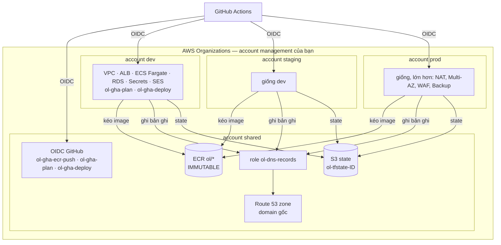

# Bước 6 — Hạ tầng AWS bằng Terraform

> Phiên bản: 0.1 · Ngày: 03/11/2026 · Trạng thái: **Terraform đã viết, CHƯA chạy `terraform validate/plan`** (môi trường soạn thảo không có Terraform và không có tài khoản AWS). Lần `plan` đầu tiên của bạn là lần kiểm tra đầu tiên — gửi lại nguyên văn lỗi nếu có. Mọi con số chi phí là **ước tính [CHƯA XÁC MINH]**, kiểm tra bằng AWS Pricing Calculator.

## 6.0 Tổng quan

| Mục | Nội dung |
|---|---|
| **Mục tiêu** | 4 account AWS (shared, dev, staging, prod) dưới AWS Organizations; GitHub Actions vào AWS bằng OIDC (không access key); state Terraform dùng chung, có khóa; môi trường dev chạy được toàn bộ hệ thống ở `https://app.dev.<domain>` |
| **Đầu vào** | Bước 1–5; một domain bạn quản lý được bản ghi NS; thẻ thanh toán cho AWS |
| **Nơi thao tác** | AWS Console (tạo account, IAM Identity Center); PowerShell (AWS CLI, Terraform); GitHub (biến, Environments) |
| **File** | `ol-infra/infrastructure/{bootstrap,envs,modules}/**`, `ol-infra/deploy/**`, `ol-infra/scripts/**`, `ol-infra/.github/workflows/**` |
| **Kết quả** | `deploy.yml` chạy xanh cho dev; `smoke.sh` toàn `[OK]`; đăng nhập được bằng platform admin vừa bootstrap |

### Bức tranh



| Thư mục Terraform | Chạy bởi | Khi nào |
|---|---|---|
| `bootstrap/shared` | Bạn, bằng tay, profile `ol-shared-admin` | Một lần (và khi đổi role/OIDC) |
| `bootstrap/account` | Bạn, bằng tay, một lần mỗi account | Một lần |
| `envs/shared` | Bạn, bằng tay | Khi thêm ECR repo / đổi DNS gốc |
| `envs/{dev,staging,prod}` | `deploy.yml` (GitHub Actions) | Mỗi khi `deploy/<env>` hoặc `envs/<env>` đổi |

---

## 6.1 Khái niệm (5 câu)

#### AWS Organizations + nhiều account
- **Nghĩa là gì?** Một account "management" quản lý nhiều account con; mỗi account là ranh giới cô lập hoàn toàn về quyền, tài nguyên, giới hạn và hóa đơn.
- **Dùng thế nào?** Tạo 4 account con `ol-shared`, `ol-dev`, `ol-staging`, `ol-prod`; mọi thứ của prod nằm trong account prod.
- **Thay thế bằng gì?** Một account, tách môi trường bằng tag/tên/VPC.
- **Lợi thế khi chọn?** Lỗi cấu hình hoặc thông tin đăng nhập bị lộ ở dev không chạm được prod; hóa đơn tách theo môi trường; miễn phí.
- **Không dùng thì sao?** Một policy IAM viết sai là dev xóa được database prod.

#### IAM Identity Center (SSO) cho người
- **Nghĩa là gì?** Đăng nhập một lần, nhận thông tin đăng nhập tạm thời vào từng account theo "permission set".
- **Dùng thế nào?** `aws configure sso` tạo profile `ol-dev-admin`…; `aws sso login --profile ol-dev-admin`.
- **Thay thế bằng gì?** IAM user + access key dài hạn.
- **Lợi thế khi chọn?** Không có access key nằm trên đĩa; bật MFA một chỗ; thu hồi một chỗ.
- **Không dùng thì sao?** Access key lộ trong file `~/.aws/credentials` hoặc lịch sử shell là lộ lâu dài.

#### OIDC giữa GitHub Actions và AWS
- **Nghĩa là gì?** Mỗi job nhận một token có chữ ký từ GitHub (ghi rõ repo, nhánh, environment); AWS đổi token đó lấy quyền tạm thời của một role nếu điều kiện trust khớp.
- **Dùng thế nào?** `aws-actions/configure-aws-credentials` với `role-to-assume: arn:aws:iam::<acct>:role/ol-gha-deploy`; trust policy chỉ chấp nhận `repo:<ORG>/ol-infra:environment:<env>`.
- **Thay thế bằng gì?** Lưu `AWS_ACCESS_KEY_ID`/`SECRET` trong GitHub secrets.
- **Lợi thế khi chọn?** Không có bí mật AWS nào trong GitHub; quyền hết hạn sau job; workflow ở nhánh khác hoặc repo khác không giả được.
- **Không dùng thì sao?** Key dài hạn có quyền deploy prod nằm trong GitHub — một PR độc hại có thể đánh cắp.

#### Terraform state + khóa bằng lockfile S3
- **Nghĩa là gì?** State là bản ghi Terraform "đã tạo những gì"; khóa ngăn hai lần `apply` cùng lúc.
- **Dùng thế nào?** `backend.hcl`: bucket ở account shared, `use_lockfile = true` (Terraform ≥ 1.10 tạo file `.tflock` cạnh state, không cần DynamoDB).
- **Thay thế bằng gì?** State local; Terraform Cloud/HCP; DynamoDB lock (cách cũ).
- **Lợi thế khi chọn?** Một nguồn sự thật, có versioning để khôi phục, không thêm dịch vụ.
- **Không dùng thì sao?** Mất file state = Terraform không còn biết hạ tầng; hai người apply cùng lúc làm hỏng state.

> State **chứa bí mật** (mật khẩu DB sinh bởi `random_password`). Vì vậy bucket: chặn public, mã hóa SSE-S3, versioning, bucket policy chỉ cho role `ol-gha-*` và admin của shared.

#### ECS Fargate + Service Connect
- **Nghĩa là gì?** Chạy container mà không quản lý máy chủ; Service Connect cho service gọi nhau bằng tên (`http://iam-service:3000`) kèm số liệu.
- **Dùng thế nào?** Module `ecs-service` tạo task definition + service + autoscaling; `deploymentCircuitBreaker` bật rollback tự động.
- **Thay thế bằng gì?** EKS (Kubernetes), App Runner, EC2 tự quản.
- **Lợi thế khi chọn?** Đủ cho 6 container, không phí control plane, không vá OS; bài toán hiện tại chưa cần Kubernetes.
- **Không dùng thì sao?** Với EKS: thêm ~73 USD/tháng/cluster [CHƯA XÁC MINH] và một hệ thống lớn cần vận hành.

---

## 6.2 Cài công cụ

```powershell
winget install --id Hashicorp.Terraform -e --source winget   # Terraform CLI
winget install --id Amazon.AWSCLI -e --source winget         # AWS CLI v2
terraform version    # Kỳ vọng: >= 1.10 (workflow dùng ~1.13)
aws --version        # Kỳ vọng: aws-cli/2.x
```

> **[CHƯA XÁC MINH]** ID winget `Hashicorp.Terraform`, `Amazon.AWSCLI`. Nếu không tìm thấy: `winget search terraform`.

---

## 6.3 Tạo account và đăng nhập SSO (Console)

1. Đăng nhập AWS bằng account hiện có (sẽ là **management**). Bật MFA cho root, không dùng root cho việc hằng ngày.
2. **AWS Organizations → Create organization** (chế độ All features). Ghi lại **Organization ID** (`o-xxxxxxxxxx`).
3. **Add an AWS account → Create** 4 lần: `ol-shared`, `ol-dev`, `ol-staging`, `ol-prod`. Mỗi account cần một email riêng — dùng địa chỉ có dấu cộng nếu hộp thư hỗ trợ (`ban+ol-dev@...`). Ghi lại 4 **Account ID**.
4. **IAM Identity Center → Enable** (region `ap-southeast-1`). Tạo user cho bạn, bật MFA. **Permission sets → Create → AdministratorAccess**. **AWS accounts** → chọn 4 account → gán user + permission set.
5. Cấu hình profile trên máy:

```powershell
aws configure sso --profile ol-shared-admin
# SSO session name: ol | SSO start URL: (trang "AWS access portal URL" của Identity Center) | SSO region: ap-southeast-1
# Chọn account ol-shared, role AdministratorAccess, CLI default region: ap-southeast-1, output: json
aws configure sso --profile ol-dev-admin       # Tương tự, chọn account ol-dev (dùng lại session "ol")
aws configure sso --profile ol-staging-admin
aws configure sso --profile ol-prod-admin
aws sso login --sso-session ol                 # Mở trình duyệt để xác nhận; thông tin tạm thời có hạn vài giờ
aws sts get-caller-identity --profile ol-dev-admin   # Kỳ vọng: Account = ID của ol-dev
```

6. Điền giá trị AWS vào code (chạy ở thư mục chứa các repo):

```powershell
pwsh -File .\ol-handbook\bootstrap\replace-placeholders.ps1 -Workspace . -Org <ORG> -Domain <domain> -AlertEmail <email> `
  -SharedAccountId <12 số> -DevAccountId <12 số> -StagingAccountId <12 số> -ProdAccountId <12 số> `
  -OrgId o-xxxxxxxxxx -StateBucket ol-tfstate-<SharedAccountId>
```

Commit các thay đổi vào `ol-infra` qua PR (chưa merge vội nếu `validate.yml` chưa có role — xem 6.7).

---

## 6.4 Bootstrap account shared (state local → S3)

**Nơi thao tác:** `ol-infra/infrastructure/bootstrap/shared`.

Vòng lặp "con gà – quả trứng": bucket chứa state chưa tồn tại, nên lần đầu dùng state local, sau đó chuyển lên bucket.

```powershell
Set-Location D:\Coding\DevOps\ol-platform\ol-infra\infrastructure\bootstrap\shared
Copy-Item terraform.tfvars.example terraform.tfvars                         # Giá trị đã được replace-placeholders điền
Set-Content backend_override.tf 'terraform { backend "local" {} }'          # Tạm dùng state local (file *_override.tf đã nằm trong .gitignore)
terraform init                                                              # Tải provider, backend local
terraform plan -out tfplan                                                  # Xem trước: bucket, OIDC, 4 role
terraform apply tfplan                                                      # Tạo thật
Remove-Item backend_override.tf                                             # Bỏ override → quay về backend "s3"
terraform init -migrate-state -backend-config=backend.hcl                   # Hỏi "copy state lên S3?" → yes
Remove-Item terraform.tfstate, terraform.tfstate.backup                     # State đã nằm trên S3 (có versioning)
terraform plan                                                              # Kỳ vọng: No changes
```

| Lệnh | Ý nghĩa |
|---|---|
| `backend_override.tf` | File override của Terraform thay khối `backend "s3" {}` bằng `local` mà không sửa `main.tf` |
| `-out tfplan` | Lưu kế hoạch; `apply tfplan` áp đúng thứ đã xem, không tính lại |
| `-migrate-state` | Chép state hiện tại sang backend mới |

Kết quả: bucket `ol-tfstate-<shared-id>`; OIDC provider `token.actions.githubusercontent.com`; role `ol-gha-ecr-push`, `ol-gha-plan`, `ol-gha-deploy`, `ol-dns-records`.

## 6.5 Bootstrap từng account môi trường

**Nơi thao tác:** `ol-infra/infrastructure/bootstrap/account`. Một thư mục, ba file tfvars + ba file backend.

```powershell
Set-Location ..\account
foreach ($e in 'dev','staging','prod') {
  terraform init -reconfigure -backend-config="$e.backend.hcl"   # State ở bucket shared, key bootstrap/<env>
  terraform apply -var-file="$e.tfvars"                          # Xem kế hoạch, gõ yes: OIDC + ol-gha-plan + ol-gha-deploy
}
```

`ol-gha-deploy` của account prod chỉ tin token có `environment:production` — job chưa qua người duyệt của Environment `production` thì không lấy được quyền.

> Quyền của `ol-gha-deploy` hiện là rộng (quản trị hạ tầng trong account đó) vì Terraform tạo VPC, IAM role, RDS… Ranh giới thật là **account** + **điều kiện trust**. Thu hẹp dần bằng permission boundary là việc của Bước 8 (đã ghi trong danh sách nâng cấp).

## 6.6 Account shared: ECR, DNS gốc

```powershell
Set-Location ..\..\envs\shared
$env:AWS_PROFILE = 'ol-shared-admin'
terraform init -backend-config=backend.hcl -backend-config="profile=ol-shared-admin"
terraform apply                                    # ECR ol/* (IMMUTABLE, quét khi push, cho account con kéo), hosted zone, budget
terraform output name_servers                      # 4 name server của zone
```

**Ủy quyền DNS:** tại nơi bạn mua domain, đổi name server của domain sang 4 giá trị trên (nếu domain đang dùng cho việc khác, thay vào đó dùng một subdomain, ví dụ `ol.example.com`, và tạo bản ghi `NS` cho subdomain đó trỏ về 4 giá trị — khi đó `-Domain` ở 6.3 phải là subdomain).

```powershell
Resolve-DnsName -Type NS <domain>                  # Kỳ vọng: trả 4 name server awsdns-*. Có thể mất tới 48 giờ
```

## 6.7 Biến GitHub

Không có giá trị nào trong số này là bí mật (account ID không cấp quyền gì) → dùng **variables**.

```powershell
$ORG = '<ORG>'
gh variable set SHARED_ACCOUNT_ID --org $ORG --visibility all --body '<shared-id>'      # build-image: ECR, role push
gh variable set DEV_ACCOUNT_ID     -R "$ORG/ol-infra" --body '<dev-id>'                  # validate.yml: plan
gh variable set STAGING_ACCOUNT_ID -R "$ORG/ol-infra" --body '<staging-id>'
gh variable set PROD_ACCOUNT_ID    -R "$ORG/ol-infra" --body '<prod-id>'
gh variable set AWS_ACCOUNT_ID -R "$ORG/ol-infra" --env dev        --body '<dev-id>'      # deploy/ops theo environment
gh variable set AWS_ACCOUNT_ID -R "$ORG/ol-infra" --env staging    --body '<staging-id>'
gh variable set AWS_ACCOUNT_ID -R "$ORG/ol-infra" --env production --body '<prod-id>'
gh variable list --org $ORG; gh variable list -R "$ORG/ol-infra"; gh variable list -R "$ORG/ol-infra" --env production
```

`AWS_REGION` đã đặt ở cấp org ở Bước 1.

Sau khi có biến: chạy lại các check đỏ (`image-check`, `plan-*`) trên PR đang mở, rồi thêm chúng vào check bắt buộc (Bước 5.3).

## 6.8 Triển khai dev lần đầu

1. Merge PR mã nguồn của các service (Bước 2) → mỗi service build image cho dev → bot mở PR `deploy(dev): <module> ...` ở `ol-infra` → tự merge khi check xanh.
2. Keycloak và keycloak-config: chạy tay **Actions → rebuild → Run workflow**, `env: dev`, lần lượt `module: keycloak` và `keycloak-config` (nếu PR của `ol-build-tooling` chưa tạo image Keycloak).
3. Khi cả 6 file `deploy/dev/*.yaml` có `image.digest`, `deploy.yml` chạy `scripts/deploy.sh dev`:

| Bước trong `deploy.sh` | Làm gì | Vì sao theo thứ tự này |
|---|---|---|
| 1. `apply -target=...task` | Tạo mạng, RDS, secrets, task definition của task chạy một lần | DB phải có trước migration |
| 2. `db-init` | Chạy `db/bootstrap.sql`: role `*_app`/`*_migrator`, database, quyền tối thiểu | Idempotent |
| 3. `*-migrate` | Migration của từng service bằng role migrator | Phải xong trước khi service mới chạy |
| 4. `apply` đầy đủ | Rolling update các service, chờ ổn định | Circuit breaker rollback nếu task mới không khỏe |
| 5. `keycloak-config` | Áp realm `ol` từ code | Cần Keycloak đang chạy |

4. Job tiếp tục: `verify-artifacts.sh` (đã chạy trước bước deploy) → `smoke.sh` → (E2E nếu bật) → mở PR thăng cấp staging.

Kiểm chứng:

```powershell
gh run list -R <ORG>/ol-infra -w deploy -L 3        # Kỳ vọng: completed success
gh run view -R <ORG>/ol-infra <run-id> --log | Select-String '\[OK\]|\[LỖI\]'
```

Mở `https://app.dev.<domain>` → chuyển sang `https://id.dev.<domain>` để đăng nhập.

## 6.9 Email (SES) và quản trị viên đầu tiên

- Account SES mới ở **sandbox**: chỉ gửi được tới địa chỉ đã xác minh. Terraform đã tạo identity cho `ses_verified_recipients` (email cảnh báo của bạn) → AWS gửi thư xác minh, bấm link trong thư. Bản ghi DKIM cho `dev.<domain>` được tạo tự động.
- Platform admin đầu tiên: **Actions → ops → Run workflow**: `env: dev`, `command: bootstrap-platform-admin`, `email:` một địa chỉ đã xác minh ở SES. Nhận email → đặt mật khẩu → cấu hình TOTP.
- Prod dùng thật (gửi cho khách): SES Console → **Request production access** cho account prod (AWS duyệt thủ công, thường trong 24 giờ [CHƯA XÁC MINH]).
- Bấm **Confirm subscription** trong email SNS để nhận cảnh báo.

## 6.10 E2E sau deploy (tùy chọn)

`seed-demo` bị chặn ngoài `local`/`dev` và không chạy được qua `ops.yml`. Tạo tài khoản kiểm thử thật bằng giao diện (platform admin tạo tenant `e2e`, mời 2 người dùng có địa chỉ đã xác minh SES, gán Warehouse Operator và Warehouse Viewer), rồi:

```powershell
gh variable set E2E_ENABLED        -R "$ORG/ol-infra" --env dev --body 'true'
gh variable set E2E_OPERATOR_EMAIL -R "$ORG/ol-infra" --env dev --body '<email operator>'
gh variable set E2E_VIEWER_EMAIL   -R "$ORG/ol-infra" --env dev --body '<email viewer>'
gh secret   set E2E_PASSWORD       -R "$ORG/ol-infra" --env dev        # gh hỏi giá trị, ẩn khi gõ
```

## 6.11 Chi phí ước tính [CHƯA XÁC MINH]

Giá region Singapore thay đổi; dùng [AWS Pricing Calculator](https://calculator.aws/) với cấu hình trong `terraform.tfvars`.

| Môi trường | Thành phần chi phối | Ngân sách đặt trong Terraform |
|---|---|---|
| shared | Route 53 zone, ECR lưu trữ | 20 USD |
| dev | ALB (cả tháng), RDS `db.t4g.micro` + Fargate Spot **chỉ giờ hành chính** T2–T6 (service 07:30–20:00, RDS 07:00–20:15, giờ Việt Nam), IPv4 công khai cho task (không NAT) | 60 USD |
| staging | Như dev + WAF | 80 USD |
| prod | ALB, NAT Gateway, RDS Multi-AZ `db.t4g.small`, 2–6 task mỗi service, WAF, AWS Backup | 250 USD |
| **Tổng mục tiêu** | | **≈ 410 USD/tháng** |

AWS Budgets gửi email khi chi phí dự báo vượt ngân sách. Thứ dễ phát sinh ngoài dự kiến: NAT data processing, CloudWatch Logs ingest (đặt `LOG_LEVEL=info`), Performance Insights ngoài gói miễn phí.

---

## 6.12 Lỗi thường gặp

| Triệu chứng | Nguyên nhân | Xử lý |
|---|---|---|
| `Not authorized to perform sts:AssumeRoleWithWebIdentity` | `sub` của token không khớp trust (sai repo, nhánh, environment) | Kiểm biến `AWS_ACCOUNT_ID` của environment; job phải có `environment:`; xem claim trong log `configure-aws-credentials` |
| `AccessDenied` khi `terraform init` ở `envs/<env>` từ máy bạn | Bucket policy chỉ cho role `ol-gha-*` + admin shared | `init` với `-backend-config="profile=ol-shared-admin"`; nhưng provider `aws.dns` vẫn cần role `ol-gha-*` → plan cho env nên chạy qua CI (`validate.yml`) |
| ACM treo "Pending validation" | NS chưa ủy quyền xong | `Resolve-DnsName`; chờ; Terraform timeout thì chạy lại |
| `CannotPullContainerError` | Account con không kéo được ECR | Kiểm repository policy ECR có `aws:PrincipalOrgID` đúng `o-...` |
| Task dừng `ResourceInitializationError ... secretsmanager` | Task không ra được Internet/VPC endpoint để đọc secret | dev/staging: task phải có public IP; prod: NAT hoạt động |
| Service lỗi `password authentication failed` | Secret đổi nhưng role DB chưa | Chạy lại deploy (`db-init` chạy `ALTER ROLE ... PASSWORD` theo secret hiện tại) |
| ngoài giờ trang trả 503 | Lịch tắt dev/staging | Đúng thiết kế; bật tay: `aws ecs update-service --desired-count 1` + `aws rds start-db-instance` |
| `Error acquiring the state lock` | Một lần chạy trước bị hủy | Đảm bảo không có job nào đang chạy rồi `terraform force-unlock <ID>` |

## 6.13 Hoàn tác

- Một thay đổi hạ tầng lỗi: revert PR trong `ol-infra` → `deploy.yml` áp lại trạng thái trước.
- Gỡ toàn bộ một môi trường không phải prod: `terraform destroy` trong `envs/<env>` bằng role deploy (chạy tay qua workflow tạm hoặc từ máy với quyền tương đương). Prod có `deletion_protection = true` cho RDS và ALB: phải đổi biến qua PR có duyệt trước — đó là chủ đích.
- Bootstrap: `terraform destroy` theo thứ tự ngược (envs → bootstrap/account → envs/shared → bootstrap/shared). Bucket state có versioning: xóa hết phiên bản mới xóa được bucket.
- Đóng account: AWS Organizations → account → Close (account vào trạng thái treo 90 ngày rồi mới xóa hẳn).
