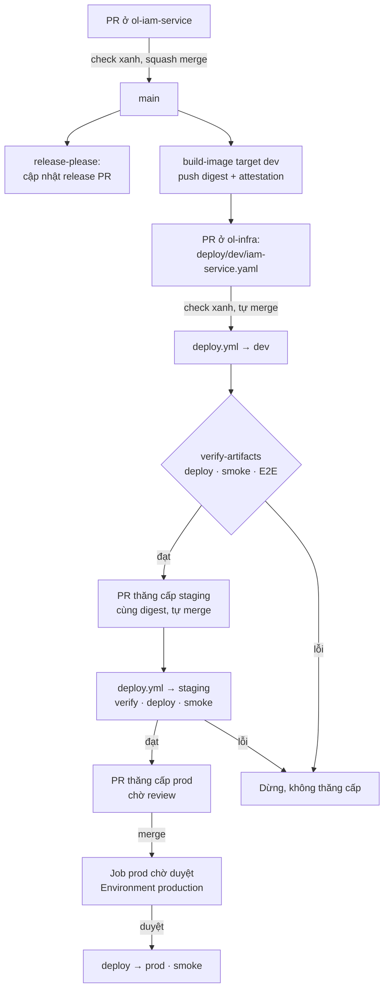

# Bước 7 — CD và phát hành

> Phiên bản: 0.1 · Ngày: 03/11/2026 · Trạng thái: **Workflow đã viết, CHƯA chạy end-to-end.** Kịch bản 7.7 là bài kiểm tra nghiệm thu của bước này.

## 7.0 Tổng quan

| Mục | Nội dung |
|---|---|
| **Mục tiêu** | Từ một commit được merge tới prod theo đường duy nhất, có cổng kiểm soát, truy vết được, quay lui được trong vài phút |
| **Đầu vào** | Bước 4–6 xong; dev đã triển khai được |
| **Nơi thao tác** | GitHub (PR, Actions, Environments), PowerShell |
| **File** | `<service>/.github/workflows/ci.yml`, `ol-build-tooling/.github/workflows/{build-image,release}.yml`, `ol-build-tooling/scripts/open-deploy-pr.sh`, `ol-infra/.github/workflows/{deploy,_deploy-env,rebuild}.yml`, `ol-infra/scripts/{deploy,promote,verify-artifacts,smoke}.sh` |
| **Kết quả** | Một thay đổi nhỏ đi được dev → staging → prod; rollback bằng revert PR được diễn tập |

## 7.1 Đường đi của một thay đổi



**Nguyên tắc:**
- **Một artifact cho mọi môi trường:** cùng một digest đi từ dev lên prod (backend và frontend không có build-time config theo môi trường). Chỉ build lại khi build-config của môi trường đích khác (`promote.sh` tự phát hiện và gọi `rebuild.yml`).
- **GitOps:** trạng thái mong muốn nằm trong `ol-infra/deploy/<env>/*.yaml`. Không ai chạy `terraform apply` vào prod từ máy cá nhân. Lịch sử triển khai = lịch sử Git của `ol-infra`.
- **Thăng cấp chỉ sau khi môi trường trước đạt** verify + smoke (+ E2E nếu bật).

## 7.2 Khái niệm (5 câu)

#### Semantic Versioning + Conventional Commits + release-please
- **Nghĩa là gì?** `MAJOR.MINOR.PATCH`; commit `feat:` tăng MINOR, `fix:` tăng PATCH, `feat!:`/`BREAKING CHANGE:` tăng MAJOR. release-please đọc commit và mở "release PR" cập nhật `CHANGELOG.md` + phiên bản.
- **Dùng thế nào?** Viết commit đúng quy ước (lefthook đã kiểm). Khi muốn phát hành: merge release PR → tag `v1.3.0` + GitHub Release; build tiếp theo ghi `1.3.0` vào nhãn image và `deploy/*.yaml: source.version`.
- **Thay thế bằng gì?** semantic-release (phát hành ngay mỗi commit); đánh tag tay; CalVer.
- **Lợi thế khi chọn?** Có điểm dừng để gom thay đổi, CHANGELOG tự động, không cần token npm cho service.
- **Không dùng thì sao?** Không ai biết prod đang chạy "phiên bản" gì và nó khác hôm qua ở đâu.

> Với service, **phiên bản ≠ triển khai**: mọi commit trên `main` đều được build và đi lên dev; phiên bản chỉ là nhãn cho người đọc. Với thư viện (`ol-node-kit`) và `ol-build-tooling`, phiên bản là thứ người dùng tham chiếu → chỉ phát hành qua release PR.

#### Rolling deployment + circuit breaker
- **Nghĩa là gì?** ECS khởi động task mới (tối đa 200%), chờ health check đạt rồi mới dừng task cũ (luôn giữ 100%). Nếu task mới liên tục không khỏe, circuit breaker dừng triển khai và **tự quay về** task definition trước.
- **Dùng thế nào?** Đã cấu hình trong module `ecs-service` (`deployment_minimum_healthy_percent = 100`, `maximum_percent = 200`, `deployment_circuit_breaker { rollback = true }`); `terraform apply` chờ service ổn định.
- **Thay thế bằng gì?** Blue/green (hai bộ task, chuyển traffic một lần), canary (chuyển dần 10% → 100%) — ECS có hỗ trợ blue/green tích hợp từ 2025 [CHƯA XÁC MINH: kiểm tra tài liệu ECS hiện hành], hoặc qua CodeDeploy.
- **Lợi thế khi chọn?** Không thêm dịch vụ, không gấp đôi chi phí, đủ cho lưu lượng hiện tại; lỗi khởi động bị chặn tự động.
- **Không dùng thì sao?** (Nếu dừng hết task cũ trước) mỗi lần triển khai là một lần gián đoạn.

**Khi nào nâng lên canary/blue-green:** khi lưu lượng prod đủ lớn để 5% request mang ý nghĩa thống kê, hoặc khi có khách hàng với SLA chặt. Khi đó cần thêm cảnh báo theo phiên bản (đã có nhãn `version`) để tự động dừng.

#### Expand/contract migration
- **Nghĩa là gì?** Thay đổi schema theo hai pha để phiên bản cũ và mới của service cùng chạy được trong lúc rolling.
- **Dùng thế nào?** Ví dụ đổi tên cột `items.sku` → `items.code`:

| Lần phát hành | Migration | Code |
|---|---|---|
| 1 — expand | `ALTER TABLE items ADD COLUMN code text;` + trigger/UPDATE đồng bộ | Ghi cả hai cột, đọc `sku` |
| 2 | `UPDATE items SET code = sku WHERE code IS NULL;` + `NOT NULL` | Đọc `code` |
| 3 — contract | `ALTER TABLE items DROP COLUMN sku;` | Không còn nhắc `sku` |

- **Thay thế bằng gì?** Migration "đổi tên" một bước + dừng hệ thống.
- **Lợi thế khi chọn?** Không downtime; rollback code về phiên bản trước vẫn chạy được với schema mới.
- **Không dùng thì sao?** Trong vài phút rolling, task cũ gọi cột không còn tồn tại → lỗi 500 hàng loạt; rollback code không cứu được.

Quy tắc PR migration (reviewer kiểm):
1. Không sửa file migration đã merge — luôn thêm file mới (`pnpm db:new <tên>`).
2. Không `DROP`/`RENAME`/đổi kiểu cột trong cùng phát hành với code ngừng dùng nó.
3. `CREATE INDEX CONCURRENTLY` cho bảng lớn (đặt trong migration riêng — không chạy được trong transaction).
4. Migration chạy **trước** service mới (deploy.sh bước 3) → phải tương thích với code **đang** chạy.

## 7.3 Cổng kiểm soát

| Cổng | Ở đâu | Chặn gì |
|---|---|---|
| Check bắt buộc | Ruleset mọi repo | Code đỏ, lỗ hổng, bí mật |
| Review CODEOWNERS | Ruleset (`require_code_owner_review` khi team ≥ 2) | Thay đổi không ai xem |
| Artifact | `verify-artifacts.sh` | Image không có provenance của `build-image.yml` của org |
| Smoke | `smoke.sh` | Hệ thống không trả lời, cấu hình bảo vệ bị gỡ (admin Keycloak lộ, `/internal` lộ, HTTP không chuyển HTTPS) |
| E2E | Playwright (biến `E2E_ENABLED`) | Luồng đăng nhập/phân quyền hỏng |
| Thăng cấp prod | PR do bot mở, không tự merge | Đưa lên prod khi chưa ai quyết định |
| Environment `production` | Required reviewers = team `platform`, chỉ nhánh `main` | Chạy job prod; role AWS prod chỉ cấp cho token có `environment:production` |
| `concurrency: deploy-<env>` | `_deploy-env.yml` | Hai lần triển khai đè nhau |

> Khi làm một mình: GitHub cho phép bạn tự duyệt deployment của chính mình (trừ khi bật "Prevent self-review"). Cổng vẫn có giá trị như một bước xác nhận có chủ đích và để lại dấu vết ai duyệt, lúc nào. Khi có người thứ hai, bật "Prevent self-review" trong Environment `production`.

## 7.4 Quay lui

| Tình huống | Cách | Thời gian |
|---|---|---|
| Task mới không khởi động/không khỏe | Circuit breaker tự rollback; `deploy.yml` đỏ | Tự động, vài phút |
| Lỗi nghiệp vụ phát hiện sau triển khai | **Revert PR digest** trong `ol-infra` (nút Revert trên PR `deploy(prod): ...`) → merge (có duyệt) → `deploy.yml` triển khai digest cũ | 10–15 phút |
| Lỗi do migration | **Roll forward**: migration mới sửa lại. Không chạy migration "down" tự động | Tùy lỗi |
| Lỗi cấu hình runtime | Revert PR đổi `runtime.env` | 10–15 phút |
| Dữ liệu bị hỏng | Khôi phục PITR (Bước 8) | 30–60 phút |

Vì sao revert PR thay vì nút "rollback" trong AWS: trạng thái mong muốn nằm trong Git; sửa tay trong console sẽ bị lần `apply` kế tiếp ghi đè, và không để lại dấu vết.

Lệnh tương đương bằng CLI:

```powershell
gh pr list -R <ORG>/ol-infra --state merged --search 'deploy(prod) in:title' -L 5    # Tìm PR triển khai gần nhất
gh pr view <số-PR> -R <ORG>/ol-infra --web                                             # Mở trên web → nút "Revert"
```

## 7.5 Hotfix

1. Nhánh `fix/...` từ `main` của service → PR → check xanh → merge.
2. Build dev → deploy dev tự động. Kiểm tra trên dev.
3. Thăng cấp staging tự động sau smoke; PR prod mở ngay khi staging đạt → duyệt.

Không có nhánh release riêng: `main` luôn triển khai được. Nếu `main` đang chứa thay đổi chưa muốn đưa lên prod, ẩn chúng sau feature flag (thêm sau — hiện chưa cần) hoặc revert khỏi `main` trước khi hotfix.

## 7.6 Phát hành thư viện và công cụ

| Repo | Khi merge release PR | Bên dùng nhận thế nào |
|---|---|---|
| `ol-node-kit` | Tag `vX.Y.Z` + job `publish` đẩy `@<ORG>/node-kit@X.Y.Z` lên GitHub Packages | Dependabot mở PR nâng version ở từng service (thứ Hai hằng tuần) |
| `ol-build-tooling` | Tag `vX.Y.Z` (release-type simple, `version.txt`) | Dependabot (github-actions) mở PR đổi `uses: ...@<sha> # vX.Y.Z` |

Thay đổi phá vỡ (`feat!:`) ở hai repo này: ghi hướng dẫn nâng cấp trong mô tả PR; release PR sẽ tăng MAJOR.

## 7.7 Kiểm chứng (bạn chạy)

| # | Thử | Kết quả đúng |
|---|---|---|
| 1 | Sửa câu chữ một trang trong `ol-web-admin`, commit `feat(ui): ...`, merge | Trong ~15 phút thay đổi có ở dev; PR staging tự merge; PR prod chờ |
| 2 | Duyệt PR prod + duyệt deployment | Thay đổi có ở prod; `deploy/prod/web-admin.yaml` có cùng digest với dev |
| 3 | So sánh digest đang chạy với Git | `aws ecs describe-services` → task definition → image digest = `deploy/prod/*.yaml` |
| 4 | Verify nguồn gốc | `gh attestation verify oci://<ecr>/ol/web-admin@<digest> --owner <ORG>` → thành công |
| 5 | Diễn tập rollback ở staging: revert PR `deploy(staging): ...` | Staging chạy lại digest cũ, smoke đạt |
| 6 | Diễn tập circuit breaker ở dev: PR đặt `runtime.env.PORT: "9999"` cho `warehouse-service` | `deploy.yml` đỏ, ECS tự rollback, dev vẫn phục vụ; revert PR |
| 7 | Merge release PR của `ol-iam-service` | Tag + Release; lần build kế tiếp ghi `source.version` mới |

## 7.8 Lỗi thường gặp

| Triệu chứng | Nguyên nhân | Xử lý |
|---|---|---|
| PR digest không tự merge | Check của `ol-infra` đỏ hoặc chưa bật "Allow auto-merge" | Xem check; cài đặt repo (bootstrap đã bật) |
| `deploy.yml` không chạy sau merge | File thay đổi không nằm trong `paths` | Chạy tay `workflow_dispatch` với `env` |
| Job prod bị "Skipped" | Staging thất bại trong cùng lần chạy | Xem job staging |
| PR thăng cấp không được mở | Token App thiếu quyền ghi `ol-infra` | Kiểm cài đặt GitHub App (Bước 1) |
| `verify-artifacts` thất bại | Image build tay/ngoài `build-image.yml`, hoặc thiếu `attestations: read` | Build lại qua pipeline |
| Deploy treo ở "waiting for service stable" | Health check không đạt nhưng chưa đủ ngưỡng circuit breaker | Xem log task trong CloudWatch; timeout job 90 phút |

## 7.9 Hoàn tác

Mọi thứ của bước này đều đảo ngược bằng revert commit trong `ol-infra`. Không xóa tag/release (ruleset `release-tags` chặn) — phát hành bản sửa mới.
